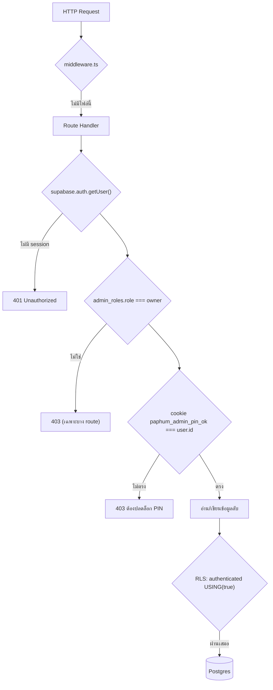

# PAPhum — ภาพรวมระบบและสถาปัตยกรรม

> **เอกสารชุด Technical Documentation & Audit Report (ภาษาไทย)**
> จัดทำเมื่อ: 18 พฤศจิกายน 2026
> ขอบเขตการอ้างอิง: อ่านจาก source code จริงใน repository นี้ทั้งหมด (`src/`, `supabase/`, `scripts/`, `tests/`, `package.json`, `next.config.ts`)
> **ข้อจำกัดสำคัญ:** เอกสารนี้อ้างอิงจาก "ไฟล์ในโปรเจกต์" เท่านั้น ยังไม่มีการเชื่อมต่อฐานข้อมูล Supabase จริงเพื่อตรวจ schema สด ดังนั้นทุกครั้งที่โค้ดกับ `supabase/migrations/001_initial_schema.sql` ไม่ตรงกัน เอกสารจะระบุว่าเป็น **Schema Drift** และไม่ถือว่าฝั่งใดถูก

---

## 1. ภาพรวมธุรกิจ

PAPhum เป็นระบบเดียวที่ให้บริการ 2 ธุรกิจพร้อมกัน

| ธุรกิจ | หน้าหลัก | สินค้า/บริการ | โมเดลรายได้ |
|---|---|---|---|
| ขายไอดีเกม ROV | `/store`, `/id/[code]` | ไอดีเกมพร้อมสกิน แยกตามสถานะ 4 แบบ | ขายขาด หรือผ่อนรายสัปดาห์/รายเดือน |
| รับตัดป้าย + ส่งงานกราฟิก | `/banners`, `/banners/[slug]`, `/deliver/[token]` | ผลงานตัดป้ายพร้อมลายน้ำ (WebP) และไฟล์ต้นฉบับ | คิดค่าจ้างต่องาน, ส่งมอบผ่านลิงก์มีอายุ |

### 1.1 สถานะไอดี 4 แบบ

ประกาศไว้ที่ `src/types/database.ts:1`

```ts
export type AccountStatus = 'Unavailable' | 'Available' | 'Installment' | 'SoldOut';
```

| สถานะ | ความหมายทางธุรกิจ | ปรากฏที่หน้าเว็บสาธารณะ |
|---|---|---|
| `Available` | พร้อมขาย | แสดง + ป้าย "พร้อมขาย" (`src/components/AccountCatalogClient.tsx:26`) |
| `Installment` | ติดผ่อน (ลูกค้ากำลังผ่อน) | แสดง + ป้าย "ติดผ่อน" (`:30`) |
| `SoldOut` | ขายแล้ว | แสดง + ป้าย "ขายแล้ว" (`:34`) |
| `Unavailable` | ปิดการขาย/ไม่พร้อม | **ไม่แสดง** — ถูกกรองที่ `src/app/store/page.tsx:14`, `src/app/id/[code]/page.tsx:29`, `src/components/AccountCatalogClient.tsx:58` |

> **✅ ยืนยันกับ production แล้ว (18 พ.ย. 2026)**
> ค่าที่ใช้จริงคือ **PascalCase** และ `accounts.status` เป็น `text` default `'Unavailable'` (ดู `supabase/migrations/DB.md:18`) — view `accounts_public` ก็กรองด้วย `'Available','Installment','SoldOut'` (`DB.md:116`)
> ส่วน `CHECK` ตัวพิมพ์เล็กที่ `supabase/migrations/001_initial_schema.sql:8` และ RLS `:117-120` เป็นของ **ไฟล์ migration ที่ล้าสมัย** ไม่ใช่ของ production → **ห้ามยึดไฟล์ 001 เป็นความจริง และห้ามเปลี่ยนสถานะเป็นตัวพิมพ์เล็ก** รายละเอียดอยู่ใน `docs/05-database-normalize-and-optimize.md` §1.1 และ §5.1

### 1.2 โมเดลการผ่อน 2 โหมด

| โหมด | เงื่อนไขที่ใช้ใน lib | ดอกเบี้ยคงที่ | งวดฟรีดอก | เงินดาวน์ขั้นต่ำ |
|---|---|---|---|---|
| รายสัปดาห์ (weekly) | ราคา `< 6,000` (`src/lib/installment.ts:5,66`) | 140 บาท/สัปดาห์ (`:3`) | `interest_free_weeks` (default 2, `001_initial_schema.sql:12`) | `min_down_weekly` (default 1,000, `:10`) |
| รายเดือน (monthly) | ราคา `>= 6,000` | 600 บาท/เดือน (`:4`) | `interest_free_months` (default 1, `:13`) | `min_down_monthly` (default 2,000, `:11`) |

> เกณฑ์ 5,000 ที่ปรากฏใน UI (`src/components/AccountDetailClient.tsx:35`, `src/components/AccountCatalogClient.tsx:208`) **ไม่ตรงกับ** 6,000 ใน lib — ดู `docs/01-feature-store-and-installment.md` หัวข้อ 4.1

---

## 2. Tech Stack และ Dependencies

ที่มา: `package.json:5-34`

### 2.1 Runtime dependencies

| แพ็กเกจ | เวอร์ชัน | ใช้ทำอะไร | จุดเรียกใช้หลัก |
|---|---|---|---|
| `next` | `16.4.6` | App Router, RSC, Route Handlers, Turbopack | ทั้งโปรเจกต์ |
| `react` / `react-dom` | `19.3.0` | UI, `useMemo`, Suspense boundary | ทุก Client Component |
| `@supabase/supabase-js` | `^2.119.0` | PostgREST client | `src/lib/supabase/server.ts:1` |
| `@supabase/ssr` | `^0.12.7` | cookie-based session ฝั่ง server | `src/lib/supabase/server.ts:5-24` |
| `@aws-sdk/client-s3` | `^3.1170.0` | อัปโหลด/ลบ object บน Cloudflare R2 | `src/lib/r2.ts:1-6` |
| `@aws-sdk/s3-request-presigner` | `^3.1170.0` | สร้าง presigned URL | `src/lib/r2.ts:8,83,122` |
| `lucide-react` | `^1.73.0` | ไอคอนทั้งหมด (โปรเจกต์ห้ามใช้อีโมจิ) | `src/components/**` |

### 2.2 Dev dependencies

| แพ็กเกจ | เวอร์ชัน | หมายเหตุ |
|---|---|---|
| `tailwindcss` + `@tailwindcss/turbopack` | `4.3.3` | ต่อ loader ผ่าน `next.config.ts:7-14` |
| `vitest` | `^5.1.0` | **ไม่มี** `test` script และ **ไม่มี** `vitest.config.*` → ต้องรัน `npx vitest run` |
| `sharp` | `^0.35.5` | ติดตั้งไว้แต่ **ไม่มีไฟล์ใด import** (ตรวจทั้ง `src/` และ `scripts/`) |
| `tsx` | `^4.23.15` | รันสคริปต์ `scripts/migrate-banners.ts` |
| `dotenv` | `^18.0.10` | **ไม่มีไฟล์ใด import** — สคริปต์ parse `.env` เองที่ `scripts/migrate-banners.ts:7-36` |
| `eslint` / `eslint-config-next` | `^9` / `16.4.6` | `npm run lint` = `eslint` |
| `typescript` | `^5` | `tsconfig.json` |

### 2.3 Config ที่มีผลต่อสถาปัตยกรรม

`next.config.ts:3-15`

```ts
const nextConfig: NextConfig = {
  cacheComponents: true,      // เปิด Cache Components (Next 16)
  partialPrefetching: true,   // ต้องคู่กับ cacheComponents
  turbopack: { rules: { "*.css": { loaders: ["@tailwindcss/turbopack"], as: "*.css" } } },
};
```

| ค่า | ผลลัพธ์ |
|---|---|
| `cacheComponents: true` | data fetching เป็น dynamic โดย default, ต้องมี `<Suspense>` ครอบ, ห้าม export `runtime` |
| `partialPrefetching: true` | `<Link>` prefetch เฉพาะ app shell ต่อ route |
| ไม่มีบล็อก `images` | ทำให้ **ใช้ `next/image` ไม่ได้** กับ URL จาก R2 (ไม่มี `remotePatterns`) → ทั้งโปรเจกต์ใช้ `` ดิบ |

---

## 3. แผนผังสถาปัตยกรรม

### 3.1 ภาพรวมระบบ (Component & Data Flow)

```mermaid
flowchart LR
  subgraph Client["เบราว์เซอร์ผู้ใช้"]
    C1["ลูกค้า: หน้า /store และ /id/code"]
    C2["ลูกค้า: หน้า /deliver/token"]
    C3["แอดมิน: หน้า /admin"]
  end

  subgraph Next["Next.js 16.4.6 App Router"]
    RSC["Server Components<br/>store / id / banners / deliver / admin"]
    CC["Client Components<br/>AccountCatalogClient, AccountDetailClient<br/>BannerBulkUploader, AdminDashboardClient"]
    API["Route Handlers /api/**"]
  end

  subgraph SB["Supabase"]
    AUTH["Auth (email + password)"]
    PG["Postgres + RLS<br/>accounts, accounts_public, banners, deliveries"]
    VIEW["ตาราง/วิวสาธารณะ accounts_public"]
  end

  subgraph R2["Cloudflare R2 (S3-compatible)"]
    PUB["portfolio/ + accounts/<br/>ไฟล์ WebP ติดลายน้ำ (public)"]
    TMP["temp-deliveries/<br/>ไฟล์ต้นฉบับ (private by key)"]
  end

  subgraph GS["Google Workspace"]
    GAS["Apps Script Web App<br/>doPost()"]
    SHEET["Google Sheets<br/>สำรองข้อมูลไอดี"]
  end

  C1 -->|HTTPS| RSC
  C2 -->|HTTPS| RSC
  C3 -->|HTTPS| RSC
  RSC -->|anonymized select| VIEW
  RSC -->|session cookie| AUTH
  CC -->|fetch JSON| API
  API -->|service session| PG
  API -->|SigV4 presign| R2
  API -->|decrypt AES-256-GCM| PG
  API -->|POST JSON| GAS
  GAS --> SHEET
  C2 -->|GET /api/deliver/token/download| API
  API -->|302 redirect presigned GET| TMP
  PUB -->|CDN URL| C1
  PUB -->|CDN URL| C2
````

### 3.2 ลำดับการทำงาน: อัปโหลดผลงาน → ส่งมอบให้ลูกค้า

```mermaid
sequenceDiagram
  autonumber
  participant A as "แอดมิน (เบราว์เซอร์)"
  participant U as "BannerBulkUploader"
  participant P as "POST /api/admin/upload/presign"
  participant R as "Cloudflare R2"
  participant B as "POST /api/admin/banners"
  participant D as "Supabase deliveries"
  participant C as "ลูกค้า"
  participant G as "GET /api/deliver/[token]/download"

  A->>U: เลือกไฟล์หลายรูป
  U->>U: processImageToWebP() + ลายน้ำ (canvas)
  U->>P: {folder, filename, contentType}
  P-->>U: {uploadUrl, publicUrl}
  U->>R: PUT uploadUrl (image/webp)
  U->>R: PUT ต้นฉบับไป temp-deliveries
  U->>B: {categoryIds, code, watermarkedUrl, originalR2Key}
  B->>D: insert token 32 hex + expires_at +7 วัน
  B-->>U: {banner, deliveryToken}
  U-->>A: ลิงก์ /deliver/{token}
  A-->>C: ส่งลิงก์ให้ลูกค้า
  C->>G: GET พร้อม token
  G->>D: select ... gt(expires_at, now())
  G-->>C: 302 → presigned URL (อายุ 3,600 วิ)
```

### 3.3 ชั้นการป้องกันที่ออกแบบไว้ vs ที่ใช้งานจริง



> ชั้น `middleware.ts` **ไม่มีอยู่ในโปรเจกต์** (ตรวจ glob `middleware.*` แล้วไม่พบ) และ RLS อ้าง `admin_roles` **เฉพาะตาราง `accounts`** (`supabase/migrations/DB.md:129`) — อีก 5 ตารางยังเป็น policy `true` ให้ `authenticated` (`DB.md:125-145`) → การป้องกันที่เหลือพึ่ง Route Handler เท่านั้น ดู `docs/04-security-audit.md`

---

## 4. แผนผังเส้นทาง (Route Inventory)

### 4.1 หน้าเว็บ

| Path | ไฟล์ | ชนิด | Data source | Auth | หมายเหตุ |
|---|---|---|---|---|---|
| `/` | `src/app/page.tsx:3-5` | Server | — | ไม่มี | `redirect('/store')` |
| `/store` | `src/app/store/page.tsx:11-19` | Server + Client | `accounts_public` (`:12`) | ไม่มี | `select('*')`, ไม่มี limit |
| `/id/[code]` | `src/app/id/[code]/page.tsx:22-41` | Server + Client | `accounts` (`:24`) + `installment_settings` (`:31`) | ไม่มี | `notFound()` ที่ `:34-36` |
| `/banners` | `src/app/banners/page.tsx:15-118` | Server + Client | `banner_categories`, `banners` (4 query) | ไม่มี | `connection()` ที่ `:12` |
| `/banners/[slug]` | `src/app/banners/[slug]/page.tsx:26-67` | Server + Client | `banner_categories`, `banners` | ไม่มี | `PAGE_SIZE = 24` (`:8`) |
| `/deliver/[token]` | `src/app/deliver/[token]/page.tsx:16-23` | Server | `deliveries` + join `banners` | token ใน path | ไม่มี `noindex` |
| `/admin` | `src/app/admin/page.tsx:14-94` | Server + Client | `admin_roles`, `accounts`, `banner_categories`, `installment_settings`, `admin_security` | session + role | fallback เป็น staff ที่ `:31` |

### 4.2 API Route Handlers (ทั้งหมด 7 ไฟล์)

| Method | Path | ไฟล์ | session | role owner | PIN cookie |
|---|---|---|---|---|---|
| GET, POST | `/api/admin/accounts` | `src/app/api/admin/accounts/route.ts` | ✅ `:20` | ✅ `:101,138` | ✅ `:146` |
| GET, PATCH, DELETE | `/api/admin/accounts/[id]` | `src/app/api/admin/accounts/[id]/route.ts` | ✅ `:16` | ✅ `:155,206,362` | ✅ `:163,247,370` (ยกเว้น `quickStatusOnly` `:217`) |
| GET, POST | `/api/admin/pin` | `src/app/api/admin/pin/route.ts` | ✅ `:9,34` | ❌ | — |
| GET, POST, PATCH, DELETE | `/api/admin/banners` | `src/app/api/admin/banners/route.ts` | ✅ `:14,63,172,340` | ❌ | ❌ |
| GET, POST, PATCH, DELETE | `/api/admin/banner-categories` | `src/app/api/admin/banner-categories/route.ts` | ✅ `:14,59,105,160` | ❌ | ❌ |
| POST | `/api/admin/upload/presign` | `src/app/api/admin/upload/presign/route.ts` | ✅ `:97-104` | ❌ | ❌ |
| GET | `/api/deliver/[token]/download` | `src/app/api/deliver/[token]/download/route.ts` | ไม่มี (ใช้ token) | — | — |

**Route ที่ UI เรียกแต่ไม่มีอยู่จริง** (บั๊กสำคัญ):
- `/api/admin/logout` — เรียกจาก `src/components/admin/AdminDashboardClient.tsx:198`
- `/api/admin/settings` — เรียกจาก `src/components/admin/AdminDashboardClient.tsx:287`
- `DELETE /api/admin/pin` — เรียกจาก `src/components/admin/AdminDashboardClient.tsx:203` แต่ route มีเฉพาะ GET/POST

---

## 5. แผนผังโฟลเดอร์

```text
paphumshop/
├── next.config.ts                     # cacheComponents + partialPrefetching (17 บรรทัด)
├── package.json                       # ไม่มี test script (35 บรรทัด)
├── .env.local                         # 11 key (ไม่ commit: .gitignore:34)
├── docs/
│   ├── 00-overview-architecture.md    # เอกสารนี้
│   ├── 01-feature-store-and-installment.md
│   ├── 02-feature-banners-and-delivery.md
│   ├── 03-feature-admin-and-sync.md
│   ├── 04-security-audit.md
│   ├── 05-database-normalize-and-optimize.md
│   ├── 06-roadmap-and-new-features.md
│   └── techdocs.md                    # เอกสารรุ่นก่อน (ถูกแทนที่แล้ว)
├── supabase/migrations/
│   ├── DB.md                          # ⭐ production dump: 8 ตาราง + 1 view + policy จริง (145 บรรทัด)
│   └── 001_initial_schema.sql         # เอกสารประวัติ (7 ตาราง) — ห้ามใช้สร้าง DB ใหม่
├── scripts/
│   ├── google-apps-script.js          # doPost() รับ webhook (142 บรรทัด)
│   ├── migrate-banners.ts             # CSV → R2 + Supabase (344 บรรทัด)
│   └── migrate-legacy-banners.ts      # 0 bytes
├── tests/lib/                         # vitest 3 ไฟล์ (ไม่มี config)
└── src/
    ├── app/                           # 7 หน้า + 7 API route
    ├── components/                    # 9 component สาธารณะ + 8 component admin
    ├── lib/                           # crypto, installment, r2, sheets-sync, totp, image-processor, supabase/server
    └── types/database.ts              # type กลาง 83 บรรทัด
```

### 5.1 ไฟล์ขนาดใหญ่ที่ต้องระวังเมื่อแก้ไข

| ไฟล์ | บรรทัด | ความรับผิดชอบ |
|---|---|---|
| `src/components/admin/AccountFormModal.tsx` | 1,140 | ฟอร์มสร้าง/แก้ไอดี + ถอดรหัส secret เพื่อ prefill (`:318-339`) |
| `src/components/admin/BannerCategoryManager.tsx` | 1,007 | CRUD หมวด, pin, bulk move, logo upload |
| `src/components/admin/AdminDashboardClient.tsx` | 795 | state กลางของหลังบ้าน 3 แท็บ |
| `src/app/api/admin/banners/route.ts` | 296 | 6 action ในไฟล์เดียว |
| `src/lib/installment.ts` | 323 | สูตรผ่อน + ข้อความ + วันที่ |

---

## 6. Environment Variables

รายชื่อ key ทั้งหมดจาก `.env.local` (ตรวจเฉพาะ **ชื่อ** ไม่เปิดเผยค่า) และจุดใช้งานจริงจาก grep `process.env.`

| # | ตัวแปร | ฝั่ง | ใช้ที่ | หน้าที่ | ความเสี่ยงหากตั้งผิด |
|---|---|---|---|---|---|
| 1 | `NEXT_PUBLIC_SUPABASE_URL` | server + **client (inline)** | `src/lib/supabase/server.ts:8`, `src/components/admin/AdminLoginForm.tsx:14`, `scripts/migrate-banners.ts:107,123` | ปลายทาง Supabase project | ชี้ผิด environment → เขียนข้อมูลข้ามโปรเจกต์; ผิดรูปแบบ → ทุก query พัง |
| 2 | `NEXT_PUBLIC_SUPABASE_ANON_KEY` | server + **client (inline)** | `server.ts:9`, `AdminLoginForm.tsx:15` | anon key ให้ RLS ทำงาน | ถ้าเผลอใส่ service_role ที่นี่ → ข้าม RLS ทั้งหมดและรั่วใน bundle |
| 3 | `SUPABASE_SERVICE_ROLE_KEY` | server (CLI เท่านั้น) | `scripts/migrate-banners.ts:108,124` | bypass RLS ในสคริปต์ migration | หลุดเข้า client = อ่าน/ลบทุกตาราง; **ปัจจุบัน `src/` ไม่ได้ใช้** (ดี) |
| 4 | `ENCRYPTION_SECRET_KEY` | server | `src/lib/crypto.ts:8` | master key AES-256-GCM (hex 64 ตัว) | ผิดรูปแบบ → throw ที่ `crypto.ts:9-11` ทุกครั้งที่เข้ารหัส; เปลี่ยน key = ถอด ciphertext เก่าไม่ได้ทั้งหมด (ไม่มี key version) |
| 5 | `R2_ACCOUNT_ID` | server | `src/lib/r2.ts:28`, `src/app/api/admin/upload/presign/route.ts:106`, `scripts/migrate-banners.ts:109,125,137` | Cloudflare account ID | presign 403 / endpoint ผิด |
| 6 | `R2_ACCESS_KEY_ID` | server | `r2.ts:29`, `presign/route.ts:107`, `migrate-banners.ts:110,126` | R2 access key | อัปโหลดไม่ผ่าน |
| 7 | `R2_SECRET_ACCESS_KEY` | server | `r2.ts:30`, `presign/route.ts:108`, `migrate-banners.ts:111,127` | R2 secret | รั่ว = ควบคุม bucket ได้ทั้งใบ |
| 8 | `R2_BUCKET_NAME` | server | `r2.ts:31`, `presign/route.ts:109`, `migrate-banners.ts:112,128` | ชื่อ bucket | ไฟล์ไปผิด bucket / 404 ทั้งเว็บ |
| 9 | `R2_PUBLIC_URL` | server → ส่งกลับ client | `r2.ts:32`, `presign/route.ts:111` | CDN base URL ของ bucket | ผิด → `publicUrl` เสียทุกรูป (`presign/route.ts:146-148` fallback เป็น storage endpoint ที่ anon เข้าไม่ได้) |
| 10 | `NEXT_PUBLIC_R2_PUBLIC_URL` | server (fallback) | `presign/route.ts:112` | fallback CDN URL | **ไม่ได้ตั้งใน `.env.local`** จึงใช้ข้อ 9 |
| 11 | `GOOGLE_SHEETS_WEBHOOK_URL` | server | `src/lib/sheets-sync.ts:26,54` | Apps Script Web App URL | ว่าง → sync คืน `{ok:false}` ไม่ crash แต่ข้อมูลไม่ถูกสำรอง |
| 12 | `GOOGLE_SHEETS_WEBHOOK_SECRET` | server | `sheets-sync.ts:27,55` | shared secret (ส่งใน JSON body `:37`) | ไม่ตรงกับ `scripts/google-apps-script.js:2` → ถูกปฏิเสธทุก request `:65`; secret ปรากฏใน execution log ของ Apps Script |
| 13 | `NODE_ENV` | server (implicit) | `src/app/api/admin/pin/route.ts:86,117` | ตั้ง flag `secure` ของคุกกี้ | ตั้งผิด → cookie ไม่ถูกส่งบน HTTPS หรือถูกส่งแบบไม่ secure ใน production |

### 6.1 ข้อควรทราบเรื่อง env

1. `.gitignore:34` คือ `.env*` ซึ่งครอบ `.env.local` แล้ว แต่ **ไม่มีการยกเว้น `!.env.example`** → จึงไม่มีไฟล์ตัวอย่าง env ในโปรเจกต์
2. ไม่มี `LEGACY_SUPABASE_*` / `NEW_SUPABASE_SERVICE_ROLE_KEY` / `CRON_SECRET` แม้เอกสารรุ่นก่อนจะอ้างถึง
3. `ENCRYPTION_SECRET_KEY` ที่มีอยู่ผ่านเงื่อนไข 64 hex ตาม `crypto.ts:9` (ตรวจเฉพาะรูปแบบ ไม่ได้พิมพ์ค่า)

---

## 7. กลไกกลางที่ใช้ทั้งระบบ

| กลไก | ไฟล์อ้างอิง | สรุป |
|---|---|---|
| Dynamic rendering | `await connection()` 6 จุด: `store/page.tsx:8`, `banners/page.tsx:12`, `banners/[slug]/page.tsx:17`, `id/[code]/page.tsx:17`, `deliver/[token]/page.tsx:12`, `admin/page.tsx:15` | จำเป็นเพราะ `cacheComponents: true`; ทุกหน้ามี `<Suspense>` ครอบ loader |
| Session ฝั่ง server | `src/lib/supabase/server.ts:5-24` | `cookies()` + `createServerClient`, **ใช้ anon key** ไม่ใช้ service role |
| Modal | `src/components/ModalPortal.tsx` | `createPortal(..., document.body)` กัน modal ถูก clip โดย `transform` ของ parent (ใช้ที่ `BannerPortfolioClient.tsx:198-208`) |
| รูปภาพ | `` ทุกจุด (ไม่ใช้ `next/image`) | เพราะ `next.config.ts` ไม่มี `images.remotePatterns` |
| ข้อความไทย/เงิน | `toLocaleString('en-US')` + suffix `.-` | ไม่มี `Intl.NumberFormat` แบบ currency, ไม่มีสกุลเงินในระดับ type |
| วันที่ | UTC ล้วนใน `installment.ts:126-198` | ไม่มี `Asia/Bangkok`, ไม่มี พ.ศ. |
| ความลับบัญชี | `src/lib/crypto.ts` | AES-256-GCM + IV 12 bytes + authTag, format `iv:tag:cipher` (hex) |
| PIN | `src/app/api/admin/pin/route.ts` + `crypto.ts:70-96` | scrypt hash + cookie `paphum_admin_pin_ok` อายุ 30 วัน |

---

## 8. ข้อจำกัดของสถาปัตยกรรมปัจจุบัน (สรุปผู้บริหาร)

1. **ข้อมูลลับและข้อมูลสาธารณะแยกกันที่ "วิว" ไม่ใช่ที่ตาราง** — production ใช้ตาราง `accounts` เดียวที่เก็บทั้งข้อมูลสาธารณะและ ciphertext (`supabase/migrations/DB.md:16-41`) แล้วสร้าง **view `accounts_public`** กรองเฉพาะ 3 สถานะเพื่อให้หน้าเว็บอ่าน (`DB.md:114-116`) → ความปลอดภัยจึงขึ้นกับว่าใครมีสิทธิ์บนตารางฐาน ไม่ใช่บนวิว และตาราง `accounts_secret` ที่ออกแบบไว้ก็ไม่มีโค้ดใช้
2. **สิทธิ์ owner/staff ถูกบังคับไม่สม่ำเสมอ** — `accounts` บังคับ owner ที่ชั้น DB แล้ว (`DB.md:129`) แต่ `accounts_secret`, `deliveries`, `banners`, `banner_categories`, `installment_settings` ยังมี policy `true` ให้ `authenticated` (`DB.md:125-145`) และ `admin_roles` ไม่ถูกอ้างใน policy ของตารางเหล่านี้
3. **ไม่มี middleware** — ทุก route ต้องป้องกันตัวเอง ซึ่งทำไม่สม่ำเสมอ (banner 3 route ไม่เช็ก role/PIN)
4. **ไม่มีชั้น cache** — เปิด Cache Components แต่ไม่มีการใช้ `use cache`/`cacheTag` เลย; หน้า `/banners` ดึง banner ทั้งตารางมา serialize ลง client ทุกครั้ง (`src/app/banners/page.tsx:26-65`)
5. **ไม่มี observability** — ไม่มี `console.*` ใน `src/` เลย, ไม่มี audit log, ไม่มี error boundary (`error.tsx`) หรือ `not-found.tsx`
6. **Test coverage แคบ** — มีแค่ 3 ไฟล์ใน `tests/lib/` ครอบ crypto/r2/installment และ R2 helper ที่ทดสอบ (`createPresignedUploadUrl`) กลับไม่ถูกใช้ใน production route

---

## 9. ภาคผนวก: เอกสารรุ่นก่อน (`docs/techdocs.md`) ที่ถูกแทนที่

`docs/techdocs.md` เป็นสเปกภาษาอังกฤษที่เขียนไว้ก่อนหน้าและ **ไม่ตรงกับไฟล์ migration ใน repository 9 จุดสำคัญ** (บางจุดตรงกับ production จริง) จึงถูกแทนที่ด้วยเอกสารชุดนี้ จุดที่ขัดกันมากที่สุด:

| # | เอกสารเดิมระบุ | ความจริงในโค้ด |
|---|---|---|
| 1 | `accounts_public` เป็น VIEW | **จริงใน production** (`DB.md:114-116`) แต่เป็น TABLE ในไฟล์ `001_initial_schema.sql:5` → เอกสารเดิมถูกเรื่องนี้ แต่ไฟล์ migration ใน repo ผิด |
| 2 | มีตาราง `accounts` เดียวเก็บ public + secret | **จริงใน production** (`DB.md:16-41`) — ไฟล์ migration 001 แยกเป็น `accounts_public` + `accounts_secret` และไม่มีตาราง `accounts` จึงล้าสมัย |
| 3 | ไม่กล่าวถึงระบบ role | **มีจริงใน production**: ตาราง `admin_roles` (`DB.md:68-71`) และ policy owner-only บน `accounts` (`DB.md:129`) — แต่ไม่มีในไฟล์ migration 001 |
| 4 | PIN hash = PBKDF2 | ใช้ **scrypt** (`src/lib/crypto.ts:75,89`) |
| 5 | PIN cookie อายุ 15 นาที, `sameSite: lax` | 30 วัน, `strict` (`src/app/api/admin/pin/route.ts:7,85`) |
| 6 | `deliveries` อ่านได้เฉพาะ token ที่ตรง | RLS ให้ anon อ่าน **ทุกแถวที่ยังไม่หมดอายุ** — ยืนยันใน production ที่ `DB.md:131,133` → enumerate ได้ (ดู `docs/04` C-2) |
| 7 | มี `scripts/migrate-legacy-banners.ts` (±1,230 รูป, sharp, watermark) | ไฟล์ **0 bytes**; ตัวจริงคือ `migrate-banners.ts` ที่อ่าน CSV และไม่ใช้ sharp |
| 8 | endpoint `/api/upload/presign` | จริงคือ `/api/admin/upload/presign` (และ UI ยังเรียก path เก่าที่ `BannerCategoryManager.tsx:39`) |
| 9 | มี `/api/admin/logout`, `/api/admin/settings`, `DELETE /api/admin/pin` | ทั้ง 3 ไม่มีอยู่จริง |

---

## 10. ดัชนีเอกสารชุดนี้

| ไฟล์ | เนื้อหา |
|---|---|
| `docs/00-overview-architecture.md` | ภาพรวม, stack, env, route, ไดอะแกรม (เอกสารนี้) |
| `docs/01-feature-store-and-installment.md` | หน้าร้าน, รายละเอียดไอดี, แสงกเลอรี่, สูตรผ่อน + edge case 38 กรณี |
| `docs/02-feature-banners-and-delivery.md` | พอร์ตโฟลิโอ, pipeline อัปโหลด WebP → R2, delivery token |
| `docs/03-feature-admin-and-sync.md` | หลังบ้าน, owner/staff, PIN, AES-256, Google Sheets |
| `docs/04-security-audit.md` | ช่องโหว่ 27 รายการ Critical → Low พร้อมวิธีแก้ |
| `docs/05-database-normalize-and-optimize.md` | Normalization 1NF/2NF/3NF, index ที่ขาด, SQL พร้อมรัน |
| `docs/06-roadmap-and-new-features.md` | แผน 4 เฟส + ฟีเจอร์ใหม่ 6 ข้อ |
