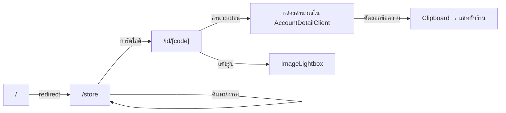

# ฟีเจอร์ที่ 1 — หน้าร้าน, รายละเอียดไอดี และระบบผ่อนชำระ

> ไฟล์ที่เกี่ยวข้อง: `src/app/store/page.tsx`, `src/app/id/[code]/page.tsx`, `src/components/AccountCatalogClient.tsx`, `src/components/AccountDetailClient.tsx`, `src/components/ImageLightbox.tsx`, `src/components/InstallmentCalculator.tsx`, `src/lib/installment.ts`, `tests/lib/installment.test.ts`
> เอกสารที่เกี่ยวข้อง: `docs/00-overview-architecture.md` (ภาพรวม), `docs/04-security-audit.md` (ช่องโหว่), `docs/05-database-normalize-and-optimize.md` (index/query)

---

## 1. ภาพรวมเส้นทางซื้อไอดี



| ขั้น | ไฟล์ | ชนิด component | หน้าที่ |
|---|---|---|---|
| 1 | `src/app/page.tsx:3-5` | Server | `redirect('/store')` ทันที ไม่มีเนื้อหา |
| 2 | `src/app/store/page.tsx:7-20` | Server | query `accounts_public` แล้วส่ง props |
| 3 | `src/components/AccountCatalogClient.tsx` | Client | ค้นหา/กรอง/แสดงการ์ด |
| 4 | `src/app/id/[code]/page.tsx:12-44` | Server | query `accounts` + `installment_settings` |
| 5 | `src/components/AccountDetailClient.tsx` | Client | แกลเลอรี + คำนวณผ่อน + คัดลอกข้อความ |

---

## 2. หน้าร้าน `/store`

### 2.1 ชั้น Server Component

`src/app/store/page.tsx:7-20`

```ts
7:  async function StoreAccountsList() {
8:    await connection();                                     // บังคับ dynamic render
9:    const supabase = await createSupabaseServerClient();    // อ่าน cookies()
12:   const { data } = await supabase
12:     .from('accounts_public')
13:     .select('*')
14:     .in('status', ['Available', 'Installment', 'SoldOut'])
15:     .order('created_at', { ascending: false });
17:   const accounts = (data ?? []) as AccountPublic[];
```

| ประเด็น | รายละเอียด | หลักฐาน |
|---|---|---|
| ตารางที่อ่าน | `accounts_public` (ไม่ใช่ `accounts`) | `:12` |
| คอลัมน์ | `select('*')` — ดึงทั้งแถว | `:13` |
| ตัวกรอง | เฉพาะ 3 สถานะ (ตัด `Unavailable`) | `:14` |
| การเรียง | ใหม่สุดก่อน (`created_at DESC`) | `:15` |
| **Pagination** | **ไม่มี** `.limit()` หรือ `.range()` → ดึงทุกแถวในครั้งเดียว | `:11-15` |
| Error handling | ไม่ตรวจ `error` เลย ใช้ `data ?? []` | `:17` |
| Suspense | ครอบด้วย `<Suspense>` fallback skeleton 3 การ์ด | `:24-37` |

**ผลกระทบ:** เมื่อจำนวนไอดีเพิ่มขึ้น หน้า `/store` จะส่ง HTML + RSC payload โตเป็นเส้นตรง และ client ต้อง render การ์ดทั้งหมดพร้อมกัน (ไม่มี virtualization) — ดู `docs/05-database-normalize-and-optimize.md` หัวข้อ 5.2

**Skeleton ไม่ตรงสัดส่วนจริง:** fallback ใช้ `aspect-[3/4]` (`store/page.tsx:30`) แต่การ์ดจริงใช้ `aspect-[4/5]` (`AccountCatalogClient.tsx:221`) → เกิด layout shift เมื่อ hydrate

### 2.2 State และตัวแปรกรอง

`src/components/AccountCatalogClient.tsx`

| ตัวแปร | บรรทัด | ค่าเริ่มต้น | หมายเหตุ |
|---|---|---|---|
| `statusFilter` | `:48` | `'ALL'` | union `PublicStatusFilter` ที่ `:19` |
| `searchQuery` | `:49` | `''` | เก็บข้อความดิบ |
| `maxPrice` | `:50` | `''` | **เก็บเป็น string** ไม่ใช่ number |
| `showFilters` | `:51` | `false` | เปิด/ปิดแผงกรอง |
| `sourceAccounts` | `:43-46` | `accounts ?? initialAccounts ?? []` | `initialAccounts` เป็น prop เสริม แต่ผู้เรียกส่งแค่ `accounts` (`store/page.tsx:19`) |

### 2.3 ลำดับการกรองจริง (ทีละบรรทัด)

`AccountCatalogClient.tsx:53-74`

```ts
54:  const q = searchQuery.trim().toLowerCase();
55:  const priceCap = Number(maxPrice);          // '' -> 0, 'abc' -> NaN
58:  .filter((acc) => acc.status !== 'Unavailable')
60:  if (statusFilter !== 'ALL' && acc.status !== statusFilter) return false;
63:  if (priceCap > 0 && acc.price > priceCap) return false;
66:  if (!q) return true;
67:  const inCode = acc.code.toLowerCase().includes(q);
68:  const inTags = (acc.tags ?? []).some((t) => t.toLowerCase().includes(q));
71:  const inDesc = (acc.description ?? '').toLowerCase().includes(q);
72:  return inCode || inTags || inDesc;
```

| กติกาที่เกิดขึ้นจริง | ผลลัพธ์ | ข้อสังเกต |
|---|---|---|
| งบประมาณ | "ราคา **ไม่เกิน** งบ" (inclusive) | `maxPrice = 0` หรือค่าว่าง = **ไม่กรอง** (`priceCap > 0` เป็น false) |
| ค่าที่ไม่ใช่ตัวเลข | `NaN > 0` เป็น false → ไม่กรอง | ไม่มี validation/แจ้งเตือนผู้ใช้ |
| ค้นหา | substring 3 ฟิลด์: `code`, `tags` ทุกตัว, `description` | ไม่มี fuzzy match, ไม่ normalize ภาษาไทย/ตัวพิมพ์ใหญ่-เล็กของอีโมจิ |
| สถานะ | เทียบแบบ exact case-sensitive | ต้องตรงกับค่าใน DB เป๊ะ |
| การเรียง | **ไม่มี sort ฝั่ง client** | ลำดับมาจาก DB เท่านั้น (`created_at DESC`) |

**ช่องโหว่เชิง UX:** ตัวเลขบนแท็บสถานะคำนวณจาก `sourceAccounts` ที่กรองแค่ `Unavailable` (`:76-86`) **ไม่สนใจ** คำค้นและงบประมาณ → ผู้ใช้เห็น "พร้อมขาย (12)" แต่ผลลัพธ์จริงเหลือ 2 รายการ

### 2.4 UI ที่ผู้ใช้เห็น

| องค์ประกอบ | บรรทัด | รายละเอียด |
|---|---|---|
| ปุ่มเปิดแผงกรอง "งบประมาณ" | `:114-125` | toggle `showFilters` |
| ช่องราคา | `:133-140` | `type="number"`, placeholder "เช่น 3000" |
| ปุ่ม preset | `:141-150` | hardcode `[1000, 3000, 5000, 10000]` |
| ปุ่มล้างราคา | `:151-159` | reset `maxPrice` |
| แท็บสถานะ | `:164-184` | 4 แท็บ: ทั้งหมด / พร้อมขาย / ติดผ่อน / ขายแล้ว (`:166-169`) |
| Empty state | `:189-200` | ไอคอน `Snowflake` + "ไม่พบไอดีที่ตรงกับเงื่อนไข" |
| การ์ด | `:208-300` | badge, ราคา, "ดาวน์เริ่ม", แท็ก 3 ตัวแรก + `+N` |

**ตรรกะ "ดาวน์เริ่ม":**

```ts
208: const isMonthly = acc.price > 5000;
209: const lowestDown = isMonthly ? acc.min_down_monthly : acc.min_down_weekly;
258: {acc.status === 'Available' && lowestDown > 0 && ( ... "ดาวน์เริ่ม" ... )}
```

- เกณฑ์ `> 5000` **ไม่ตรงกับ** `lib/installment.ts:5` ที่ใช้ `>= 6000`
- "ดาวน์เริ่ม" แสดงเฉพาะสถานะ `Available` แต่การ์ดของ `Installment`/`SoldOut` ยังแสดงราคาปกติ

### 2.5 ปัญหาที่พบในหน้านี้

| # | ปัญหา | หลักฐาน | ผลกระทบ |
|---|---|---|---|
| S-1 | ไม่มี pagination ทั้ง DB และ UI | `store/page.tsx:11-15` | โหลดช้าลงตามจำนวนไอดี |
| S-2 | `select('*')` | `store/page.tsx:13` | คอลัมน์ใหม่ในอนาคตไหลเข้า client อัตโนมัติ |
| S-3 | ตัวนับแท็บไม่ผูกกับตัวกรอง | `AccountCatalogClient.tsx:76-86` | ตัวเลขทำให้เข้าใจผิด |
| S-4 | skeleton คนละ aspect ratio | `store/page.tsx:30` vs `AccountCatalogClient.tsx:221` | CLS |
| S-5 | `` ไม่มี `width/height/srcSet` | `AccountCatalogClient.tsx:222-233` | เปลืองแบนด์วิดท์มือถือ + CLS |
| S-6 | ไม่มี `not-found`/`error` ของ route | glob `src/app/**` ไม่พบไฟล์ | error ของ Supabase กลายเป็นหน้าว่าง |

---

## 3. หน้ารายละเอียดไอดี `/id/[code]`

### 3.1 การโหลดข้อมูล

`src/app/id/[code]/page.tsx:12-44`

```ts
17:  await connection();
19:  const decodedCode = decodeURIComponent(code);        // ไม่มี try/catch
22:  const [accountRes, settingsRes] = await Promise.all([
24:    supabase.from('accounts')                          // ← ตารางที่ไม่มีใน migration
25:      .select('id, code, status, price, min_down_weekly, min_down_monthly, interest_free_weeks, interest_free_months, tags, description, main_image_url, gallery_urls, created_at, updated_at')
28:      .ilike('code', decodedCode)
29:      .neq('status', 'Unavailable')
30:      .maybeSingle(),
31:    supabase.from('installment_settings').select('*').eq('id', 1).maybeSingle(),
32:  ]);
34:  if (!accountRes.data) {
35:    notFound();
36:  }
```

| ประเด็น | รายละเอียด |
|---|---|
| ตาราง | `accounts` — **ไม่มีนิยามใน `supabase/migrations/001_initial_schema.sql`** (มีแต่ `accounts_public` `:5` และ `accounts_secret` `:23`) |
| คอลัมน์ | ระบุชัด 14 ฟิลด์ — **ไม่ดึง secret ใด ๆ** (ดี) |
| การค้น | `ilike` = ไม่สนตัวพิมพ์ แต่ **ตีความ `%` และ `_` เป็น wildcard** และไม่ escape |
| 404 | `notFound()` เมื่อไม่พบ **หรือ** status = `Unavailable` |
| Error | ไม่ตรวจ `error` → DB error กลายเป็น 404 เงียบ |
| `decodeURIComponent` | ถ้า path มี `%` เดี่ยวจะ throw `URIError` → 500 |

### 3.2 สิ่งที่แสดงบนหน้า

`src/components/AccountDetailClient.tsx`

| ส่วน | บรรทัด | หมายเหตุ |
|---|---|---|
| รวมรูป | `:25-32` | `main_image_url` ก่อน แล้วต่อ `gallery_urls` แบบ dedupe |
| รูปหลัก | `:125-139` | `<button>` เปิด lightbox index 0, `aspect-[4/5]` |
| รูปย่อย | `:141-164` | grid 4/5 คอลัมน์, `loading="lazy"` |
| รหัสไอดี (h1) | `:173-175` | เป็นรหัส ไม่ใช่ชื่อสินค้า |
| ราคา | `:179-182` | `toLocaleString('en-US')` + `.-` |
| description | `:199-203` | `whitespace-pre-line` แบบ text → **ปลอด XSS** |
| trust badge | `:205-208` | ข้อความ static ไม่ผูกกับข้อมูล |
| กล่องคำนวณผ่อน | `:213-317` | แสดงทุกสถานะ (ไม่มีเงื่อนไข `status`) |
| ปุ่มคัดลอก | `:300-316` | copy ข้อความสรุป |

**ปัญหาสำคัญ — ไม่มีการเช็กสถานะฝั่ง client:** ไฟล์ `AccountDetailClient.tsx` ไม่มีคำว่า `status` เลย → ไอดีที่ `SoldOut` หรือ `Installment` ยังแสดงกล่องผ่อนและปุ่มคัดลอกข้อความขายเต็มรูปแบบ ผู้ใช้ทั่วไปอาจเข้าใจผิดว่ายังซื้อได้ (server กรองแค่ `Unavailable` ที่ `page.tsx:29`)

**ไม่มี SEO รายสินค้า:** ไม่มี `generateMetadata` ในไฟล์นี้ (ทั้งโปรเจกต์มีเฉพาะ static metadata ที่ `src/app/layout.tsx:22-25`) → แชร์ลิงก์ไอดีจะได้ title ร้านเดียวกันทุกครั้ง และไม่มี OG image/canonical

### 3.3 สูตรผ่อนที่ถูกคำนวณซ้ำใน client

`AccountDetailClient.tsx:34-86` — **ไม่ import `src/lib/installment.ts`** แต่เขียนสูตรใหม่

```ts
34: const planType = account.price > 5000 ? 'monthly' : 'weekly';   // ← 5,000 ไม่ใช่ 6,000
37: const minDown = planType === 'monthly'
38:   ? (account.min_down_monthly || settings?.default_min_down_monthly || 2000)
39:   : (account.min_down_weekly || settings?.default_min_down_weekly || 1000);
42: const freePeriods = planType === 'weekly'
43:   ? account.interest_free_weeks : account.interest_free_months;
47: const interestRate = planType === 'weekly'
48:   ? (settings?.weekly_interest_rate ?? 140) : (settings?.monthly_interest_rate ?? 600);

59: const { safeDown, periods, totalInterest, amountPerPeriod } = useMemo(() => {
60:   const safeDown = Math.max(minDown, Math.min(account.price, downPayment || minDown));
64:   const periods = Math.max(1, installmentCount || 1);
65:   const principalAfterDown = Math.max(0, account.price - safeDown);
66:   const extraInterestPeriods = Math.max(0, periods - freePeriods);
67:   const totalInterest = extraInterestPeriods * interestRate;
68:   const totalToPay = principalAfterDown + totalInterest;
69:   const perPeriodAmount = Math.ceil(totalToPay / periods);
```

| ความเสี่ยง | รายละเอียด |
|---|---|
| เกณฑ์โหมดต่างจาก lib | 5,001–5,999 → UI = monthly แต่ engine default = weekly |
| ใช้ `||` กับตัวเลข | ค่า `0` ใน DB (เช่น `min_down_weekly = 0`) ถูกกลืนไปใช้ default |
| ไม่ clamp จำนวนงวด | input มี `max={24}` (`:264`) แต่ logic ไม่จำกัด → พิมพ์ 99 ก็คำนวณ 99 งวด |
| ไม่มี guard `Number.isInteger` | พิมพ์ 1.5 → `Math.ceil(total/1.5)` โดยไม่ throw (ต่างจาก lib `:85`) |
| ไม่แสดงยอดรวม | แสดงดาวน์/ยอดเหลือ/ดอก/งวดละ (`:271-298`) แต่ไม่มียอดรวมที่ต้องจ่ายจริง |

---

## 4. สูตรการผ่อนชำระ (แหล่งความจริง: `src/lib/installment.ts`)

### 4.1 เกณฑ์เลือกโหมด

```ts
5:  export const MONTHLY_DEFAULT_PRICE_THRESHOLD = 6000;
65: export function getDefaultInstallmentMode(price: number): InstallmentMode {
66:   return price >= MONTHLY_DEFAULT_PRICE_THRESHOLD ? 'monthly' : 'weekly';
67: }
```

| ราคา | โหมด |
|---|---|
| 5,999 | weekly |
| 6,000 | monthly (ยืนยันด้วยเทสต์ `tests/lib/installment.test.ts:13-14`) |

> **ข้อขัดแย้งที่ต้องแก้:** UI ใช้ `> 5000` (`AccountDetailClient.tsx:35`, `AccountCatalogClient.tsx:208`) และ API สร้างไอดีใช้ `> 5000` ในการคำนวณ free periods (`src/app/api/admin/accounts/route.ts:191-194`, `[id]/route.ts:265-267`) → มี 3 เกณฑ์ในระบบเดียว (5,000 / 5,000 / 6,000)

### 4.2 ตัวแปรเข้าของสูตร

ประกาศที่ `installment.ts:7-14`

| ฟิลด์ | ความหมาย | ที่มา |
|---|---|---|
| `price` | ราคาไอดี (บาท, จำนวนเต็ม) | `accounts.price` |
| `downPayment` | เงินดาวน์ที่ลูกค้าจ่าย | ผู้ใช้กรอก |
| `minDownPayment` | ดาวน์ขั้นต่ำตามโหมด | `min_down_weekly` / `min_down_monthly` |
| `mode` | `'weekly'` หรือ `'monthly'` | จากเกณฑ์ 6,000 |
| `periods` | จำนวนงวดทั้งหมด | ผู้ใช้เลือก 1–24 |
| `interestFreePeriods` | จำนวนงวดแรกที่ปลอดดอก | `interest_free_weeks` / `interest_free_months` |

### 4.3 สูตรทีละบรรทัด

`installment.ts:82-105`

```text
guard: price ต้อง finite และ > 0                      (:82-84)
guard: periods ต้องเป็นจำนวนเต็ม >= 1                  (:85-87)
guard: downPayment >= minDownPayment                   (:88-90)
guard: downPayment <= price                            (:91-93)

safeFreePeriods      = max(0, floor(interestFreePeriods))          (:95)
interestRatePerPeriod = weekly ? 140 : 600                          (:96-97)

principal            = price - downPayment                          (:99)
chargeablePeriods    = max(0, periods - safeFreePeriods)            (:100)
totalInterest        = chargeablePeriods × interestRatePerPeriod    (:101)
remainingTotal       = principal + totalInterest                    (:102)
totalAmountWithDown  = downPayment + remainingTotal                 (:103)
amountPerPeriod      = remainingTotal === 0 ? 0
                       : ceil(remainingTotal / periods)              (:104-105)
```

**จุดสำคัญทางธุรกิจ:**

1. ดอกเบี้ยเป็น **จำนวนเงินคงที่ต่องวด** ไม่ใช่เปอร์เซ็นต์ (คอมเมนต์ยืนยันที่ `:3-4`) และ DB เก็บเป็น `INTEGER` (`001_initial_schema.sql:46-47`) → ไม่มีเศษสตางค์
2. งวดฟรีดอกนับเป็น "จำนวนงวด" ตามโหมด: weekly = สัปดาห์, monthly = เดือน
3. ดอกไม่กระจายตามสัดส่วนเงินต้น — คิดเหมา `chargeablePeriods × rate`
4. `Math.ceil` ทำให้ **ยอดรวมของตารางสูงกว่ายอดจริง** สูงสุด `periods - 1` บาท เพราะทุกงวดใช้ `amountPerPeriod` เท่ากัน ไม่มีงวดปรับเศษ (`:105` + `:222`)

### 4.4 ตัวอย่างคำนวณจริง (ตรวจกับเทสต์แล้ว)

**ตัวอย่าง A — weekly 3,290 บาท, ดาวน์ 1,000, ฟรี 2 สัปดาห์, 4 งวด**

| รายการ | สูตร | ค่า |
|---|---|---|
| principal | 3,290 − 1,000 | 2,290 |
| chargeablePeriods | 4 − 2 | 2 |
| totalInterest | 2 × 140 | 280 |
| remainingTotal | 2,290 + 280 | 2,570 |
| amountPerPeriod | ⌈2,570 ÷ 4⌉ = ⌈642.5⌉ | **643** |
| totalAmountWithDown | 1,000 + 2,570 | 3,570 |
| **ยอดที่เก็บได้จริงจากตาราง** | 643 × 4 | **2,572 (เกิน 2 บาท)** |

หลักฐาน: `tests/lib/installment.test.ts:24` (ค่า 643) และ `:111-112` (ดอก 280, ยอดรวม 3,570)

**ตัวอย่าง B — monthly 10,000 บาท, ดาวน์ 3,000, ฟรี 1 เดือน, 4 งวด**

| รายการ | สูตร | ค่า |
|---|---|---|
| principal | 10,000 − 3,000 | 7,000 |
| chargeablePeriods | 4 − 1 | 3 |
| totalInterest | 3 × 600 | 1,800 |
| remainingTotal | 7,000 + 1,800 | 8,800 |
| amountPerPeriod | ⌈8,800 ÷ 4⌉ | **2,200** |
| totalAmountWithDown | 3,000 + 8,800 | 11,800 |

หลักฐาน: `tests/lib/installment.test.ts:190-203`

**ตัวอย่าง C — weekly 4,000 บาท, ดาวน์ 1,000, ฟรี 2, 1 งวด**

`chargeablePeriods = max(0, 1 − 2) = 0` → ดอก 0 → งวดละ 3,000 (เทสต์ `:71-82`)

### 4.5 ตารางวันนัดชำระ

`generatePaymentSchedule` (`:203-233`) และ `addInstallmentPeriodDate` (`:169-198`)

| โหมด | วิธีคำนวณ | ตัวอย่าง |
|---|---|---|
| weekly | `Date.UTC(y, m-1, d + i*7)` (`:177`) | 2026-11-16 → 23/11, 30/11, 07/12, 14/12 |
| monthly | บวกเดือนแล้ว clamp วันเป็นวันสุดท้ายของเดือน (`:188-192`) | 31/01 → 28/02 → 31/03 → 30/04 → 31/05 |

- คำนวณด้วย `getUTC*` ทั้งหมด → **ไม่เพี้ยนตาม timezone** และไม่มี `Asia/Bangkok`
- ปีอธิกสุรทิน: 2028-01-31 → 29/02 (เทสต์ `:140-151`)
- `dateLabel` เป็น `DD/MM` **ไม่มีปี** → สัญญาที่ข้ามปีจะเห็นวันที่ซ้ำกันได้
- `ScheduleEntry` มีเพียง 4 ฟิลด์ (`:31-36`): `periodNumber`, `dateISO`, `dateLabel`, `amount` → **แยกเงินต้น/ดอกต่องวดไม่ได้**

### 4.6 ข้อความสำเร็จรูป

| ฟังก์ชัน | บรรทัด | รูปแบบ |
|---|---|---|
| `formatCustomerQuoteText` | `:242-280` | "--- ตัวเลือกการผ่อน PAPHUM ---" + ราคา/ดาวน์ + ตัวเลือก 2–8 งวด |
| `formatAdminScheduleText` | `:285-323` | ตาราง "[งวดที่ N] DD/MM → amount฿" + บรรทัดดาวน์ |

**ข้อบกพร่องของข้อความ:**

- `maxPeriods` default = 8 (`:250`) แต่ UI ส่งค่าอื่นได้ → ข้อความกับหน้าจอไม่ตรงกัน
- ชื่อ `minPeriods` จริง ๆ คือ "งวดเริ่มต้น" (`:253-254`) ไม่ใช่ค่าขั้นต่ำ — weekly เริ่มที่จำนวนสัปดาห์ฟรีดอก, monthly เริ่มที่ 1
- ถ้า `minPeriods < 1` → engine throw (`:85-87`) และ**ไม่มี try/catch** ใน `formatCustomerQuoteText` → error หลุดถึงผู้เรียก
- `formatAdminScheduleText` แสดง "ฟรีดอก N วัน" โดยเอา `interestFreePeriods × 7` (`:301`) — สมมติ 1 งวด = 7 วันเป๊ะ ไม่สนวันเริ่มจริง
- ยอดรวมในข้อความ (`:311`) ใช้ `totalAmountWithDown` ที่**ไม่ตรงกับผลรวมแถวจริง**จากปัญหา `Math.ceil`

---

## 5. Edge Cases ของการคำนวณ (ตรวจครบ 30+ กรณี)

ตารางนี้คือผลจากอ่านโค้ดจริง ไม่ใช่ทฤษฎี — คอลัมน์ "บรรทัดที่ตัดสิน" ชี้จุดที่ทำให้เกิดพฤติกรรมนั้น

| # | อินพุต | ผลลัพธ์ | ป้องกันแล้ว? | บรรทัด |
|---|---|---|---|---|
| 1 | `price = 0` | throw "ราคาไอดีต้องมากกว่า 0 บาท" | ✅ | `:82-84` |
| 2 | `price < 0` | throw | ✅ | `:82` |
| 3 | `price = NaN` / `Infinity` | throw (`!Number.isFinite`) | ✅ | `:82` |
| 4 | `price = 3290.5` (ทศนิยม) | **ผ่าน** คำนวณต่อ | ❌ | ไม่มี `Number.isInteger(price)` |
| 5 | `down = price` | **ผ่าน** → principal 0 แต่ยังคิดดอกถ้ามี chargeable periods | ⚠️ ผ่านตามกฎธุรกิจไม่ชัด | `:91` (`>` ไม่ใช่ `>=`) |
| 6 | `down = price` + free ≥ periods | `amountPerPeriod = 0` แต่ **สร้างแถว 0 บาทครบทุกงวด** | ⚠️ | `:105`, `:218-223` |
| 7 | `down > price` | throw "เงินดาวน์ต้องไม่เกินราคาไอดี" | ✅ | `:91-93` |
| 8 | `down < minDown` | throw พร้อม format `1,000` | ✅ | `:88-90` |
| 9 | เศษ `Math.ceil` | ยอดรวมเกินจริง ≤ `periods-1` บาท | ❌ | `:105` + `:222` |
| 10 | `periods = 0` | throw (กัน division by zero) | ✅ | `:85-87` |
| 11 | `periods < 0` | throw | ✅ | `:85` |
| 12 | `periods = 1.5` / `NaN` | throw | ✅ | `:85` |
| 13 | `periods = 1` | ปกติ: ดอก 0 ถ้า free ≥ 1 | ✅ | `:100-105` |
| 14 | `interestFreePeriods < 0` | clamp เป็น 0 | ✅ | `:95` |
| 15 | `interestFreePeriods = 2.7` | `floor` → 2 | ✅ | `:95` |
| 16 | `interestFreePeriods = NaN` | **NaN ลามทั้งผลลัพธ์ ไม่ throw** | ❌ | `:95,100-105` |
| 17 | `minDownPayment = NaN` | guard ทั้งสองถูกข้าม (เทียบ NaN = false) | ❌ | `:88,91` |
| 18 | `downPayment = NaN` | `principal = NaN` → งวดละ NaN | ❌ | `:88-105` |
| 19 | `freePeriods >= periods` | ดอก 0, งวดละ `ceil(principal/periods)` | ✅ | `:100-105` |
| 20 | `freePeriods = 1e9` | chargeable = 0 ไม่ overflow | ✅ | `:100` |
| 21 | `price = MAX_SAFE_INTEGER` | สูญเสียความแม่นยำ เกิน 2^53 | ❌ (ไม่มีขอบเขตบน) | `:99-105` |
| 22 | `mode` ค่าอื่น | ไม่ throw → ตกไป monthly | ❌ | `:96-97` |
| 23 | `startDateISO = '2026-2-3'` | throw "รูปแบบวันที่ไม่ถูกต้อง" | ✅ | `:127-130` |
| 24 | `2026-02-30` | throw "วันที่ไม่อยู่ในปฏิทินจริง" | ✅ | `:135-142` |
| 25 | `startDateISO` มีช่องว่างหัวท้าย | parse ผ่าน `.trim()` แต่ผลลัพธ์คืนค่าดิบ | ⚠️ | `:127` vs `:229` |
| 26 | `periodIndex = -1` (monthly) | ได้เดือน `00` → `YYYY-00-DD` | ❌ | `:188-196` |
| 27 | `periodIndex = 1.7` | `Date.UTC` ตัดเศษทิ้ง | ❌ | `:177` |
| 28 | `formatCustomerQuoteText({minPeriods: 0})` | engine throw หลุดออกจากฟังก์ชัน | ❌ | `:253-255`, `:265-273` |
| 29 | `formatCustomerQuoteText({maxPeriods < startPeriod})` | คืน 1 บรรทัด (ไม่ throw) | ✅ | `:255` |
| 30 | `code = '   '` | กลายเป็น `'PM0000'` | ✅ | `:228` |
| 31 | UI: `installmentCount = 0` | `Math.max(1, 0 \|\| 1)` = 1 | ✅ | `AccountDetailClient.tsx:64` |
| 32 | UI: `downPayment = 0` | ใช้ `minDown` แทน | ✅ | `:60-63` |
| 33 | UI: พิมพ์งวด 99 | คำนวณ 99 งวด (ไม่ clamp) | ❌ | `:64` vs `:264` |
| 34 | UI: `min_down_weekly = 0` | ถูกแทนด้วย default (ใช้ `\|\|`) | ⚠️ | `:39-40` |
| 35 | UI: ดาวน์ > ราคา | บีบลงเป็นราคา (ไม่ error) | ✅ | `:60-63` |

### 5.1 สรุปจุดที่ยัง unprotected และควรแก้

1. **NaN propagation** ที่ `interestFreePeriods`, `minDownPayment`, `downPayment` (`:88-105`) → ควรเพิ่ม `Number.isFinite` ทุกตัวก่อนคำนวณ
2. **ไม่ reconcile เศษปัด** (`:105`, `:222`) → ควรกำหนดงวดสุดท้ายเป็น `remainingTotal - amountPerPeriod × (periods - 1)` เพื่อให้ผลรวมตรง
3. **`periodIndex` ติดลบ/ทศนิยม** (`:188-196`) → ควร throw ถ้า `!Number.isInteger(periodIndex) || periodIndex < 0`
4. **ไม่มีขอบเขตบนตัวเลข** (`:99-105`) → ควรกำหนดช่วงราคาที่ยอมรับ (เช่น ≤ 10,000,000) และ `periods ≤ 24`
5. **UI คำนวณซ้ำ** (`AccountDetailClient.tsx:59-86`) → ควรเรียก `calculateInstallmentPlan` จาก lib โดยตรง เพื่อให้มี guard ชุดเดียวกัน

---

## 6. ImageLightbox (`src/components/ImageLightbox.tsx`, 144 บรรทัด)

| หัวข้อ | สถานะจริง | หลักฐาน |
|---|---|---|
| Props | `images, initialIndex=0, isOpen, onClose, title` | `:6-20` |
| State | `currentIndex`, `zoomed` | `:21-22` |
| Keyboard | `Escape` ปิด, `ArrowLeft/Right` เลื่อน + wrap | `:29-44` |
| Touch/Swipe | **ไม่มี** — ไม่มี `onTouchStart` ในไฟล์ | ทั้งไฟล์ |
| Zoom | toggle CSS เป็น `w-[180vw]` (ไม่ใช่ pinch) | `:106-110` |
| Portal | **ไม่ใช้ `createPortal`** | ไม่มี import `react-dom` |
| Focus trap | **ไม่มี** — กด Tab ออกไปหลัง modal ได้ | ทั้งไฟล์ |
| `aria` | มี `role="dialog"` + `aria-modal` แต่ไม่มี `aria-label` | `:53-54` |
| Scroll lock | **ไม่มี** — body ยังเลื่อนได้ | ทั้งไฟล์ |
| รูป | `` เต็มขนาด ไม่มี lazy/preload รูปถัดไป | `:102-111` |
| Effect churn | dep `[onClose]` ที่ parent ส่ง arrow ใหม่ทุก render | `:44` + `AccountDetailClient.tsx:327` |

**ข้อเสนอ:** ใช้ `ModalPortal` (มีอยู่แล้วที่ `src/components/ModalPortal.tsx`) ครอบ, เพิ่ม focus trap + คืน focus, ใส่ `aria-labelledby`, preload รูปถัดไป 1 รูป, และใช้ `transform: scale()` แทนการเปลี่ยน `width`

---

## 7. เทสต์ที่มีอยู่และช่องว่าง

### 7.1 เทสต์ที่ครอบจริง (9 เคส)

| # | ชื่อเทสต์ | บรรทัด |
|---|---|---|
| 1 | selects weekly below 6,000 / monthly at or above | `:11-16` |
| 2 | weekly plan numbers (3,290 / 1,000 / 2 free) periods 2–8 | `:20-43` |
| 3 | monthly plan numbers (10,000 / 3,000 / 1 free) periods 1–8 | `:45-69` |
| 4 | zero interest when periods ≤ free limit | `:71-82` |
| 5 | rejects down payment below minimum | `:84-95` |
| 6 | weekly dates +7 วัน | `:99-119` |
| 7 | month-end clamp + leap year | `:121-152` |
| 8 | customer quote template | `:156-176` |
| 9 | admin schedule template | `:178-204` |

### 7.2 ช่องว่างของเทสต์ (19 ข้อ)

| # | ยังไม่ถูกทดสอบ | ความเสี่ยง |
|---|---|---|
| 1 | `price <= 0` / ไม่ finite | error message เปลี่ยนโดยไม่มีเทสต์จับ |
| 2 | `downPayment > price` | เงื่อนไขธุรกิจสำคัญ |
| 3 | `periods = 0` / ติดลบ / ไม่ใช่ integer | division by zero |
| 4 | `interestFreePeriods` ติดลบ/ทศนิยม | clamp ผิด |
| 5 | `interestFreePeriods = NaN` | **ผลลัพธ์ NaN เงียบ** |
| 6 | `down = price` (remaining 0) | แถว 0 บาท |
| 7 | ผลรวม schedule vs `remainingTotal` | เศษ `ceil` ไม่ถูกจับ |
| 8 | ราคาทศนิยม | precision |
| 9 | ตัวเลขระดับ MAX_SAFE_INTEGER | precision |
| 10 | `addInstallmentPeriodDate` index 0 / ติดลบ | ไม่มีเทสต์เลย |
| 11 | `parseISODateParts` error path | ไม่มีเทสต์ |
| 12 | quote โหมด monthly | ไม่มีเทสต์ |
| 13 | quote `minPeriods` ที่ผู้เรียกส่งเอง | ไม่มีเทสต์ |
| 14 | quote `maxPeriods < startPeriod` | ไม่มีเทสต์ |
| 15 | admin text โหมด weekly | ไม่มีเทสต์ |
| 16 | `code = ''` → `PM0000` | ไม่มีเทสต์ |
| 17 | `getDefaultInstallmentMode(0)` | ไม่มีเทสต์ |
| 18 | ตรรกะซ้ำใน `AccountDetailClient.tsx:59-86` | **ไม่มีเทสต์เลย** (รวมเกณฑ์ 5,000) |
| 19 | `InstallmentCalculator.tsx` | **dead code** ไม่ถูก import ที่ใด |

### 7.3 วิธีรัน

```bash
npx vitest run tests/lib/installment.test.ts
```

`package.json:5-10` **ไม่มี** script `test` และไม่มี `vitest.config.*` → `npm test` ใช้ไม่ได้ (รายละเอียด `docs/00-overview-architecture.md` หัวข้อ 2.2)

---

## 8. สรุปสิ่งที่ควรแก้ในโมดูลนี้

| ลำดับ | งาน | เหตุผล |
|---|---|---|
| 1 | รวมเกณฑ์โหมดเป็นค่าเดียว (แนะนำ 6,000 ตาม lib) และให้ UI import จาก lib | ขจัดการแสดงผลขัดกันในช่วง 5,001–5,999 |
| 2 | ให้ `AccountDetailClient` เรียก `calculateInstallmentPlan` แทนสูตรซ้ำ | ได้ guard/edge case ชุดเดียวกับที่เทสต์ครอบ |
| 3 | เพิ่ม guard `Number.isFinite` ให้ทุกตัวเลข + จำกัด `periods ≤ 24` | กัน NaN/Infinity หลุดถึงหน้าจอ |
| 4 | ปรับงวดสุดท้ายให้ reconcile เศษ `Math.ceil` | ยอดในสัญญาตรงกับยอดเก็บจริง |
| 5 | เพิ่ม `status` guard ใน `AccountDetailClient` | ไม่ให้ขายไอดีที่ sold แล้ว |
| 6 | เพิ่ม `generateMetadata` ใน `/id/[code]` | SEO และการแชร์ลิงก์ |
| 7 | เพิ่ม `.limit()`/pagination ที่ `/store` และ `select` เฉพาะคอลัมน์ | performance |
| 8 | เพิ่มเทสต์ 19 ข้อตาม §7.2 | กัน regression |
| 9 | ลบหรือเชื่อม `InstallmentCalculator.tsx` | ลด dead code |
| 10 | ใส่ `ModalPortal` + focus trap ใน `ImageLightbox` | accessibility |

---

## 9. สถานะการแก้ไข (อัปเดต 18 พ.ย. 2026)

| งาน | สิ่งที่ทำ | ไฟล์ |
|---|---|---|
| รวมเกณฑ์โหมดผ่อน | ทุกจุดใช้ `getDefaultInstallmentMode()` / `MONTHLY_DEFAULT_PRICE_THRESHOLD = 6000` จาก lib แล้ว (เดิมมี 5,000 ใน UI/API) | `AccountDetailClient.tsx`, `AccountCatalogClient.tsx`, `AccountFormModal.tsx`, `ScheduleGeneratorModal.tsx`, `api/admin/accounts/route.ts`, `api/admin/accounts/[id]/route.ts` |
| ลบสูตรซ้ำใน UI | `AccountDetailClient` เรียก `calculateInstallmentPlan()` ตรง ๆ, จำกัดงวด 1–24 และ clamp ดาวน์ให้อยู่ในช่วง `[minDown, price]`, แสดงดอก/ยอดจากผลลัพธ์ lib | `AccountDetailClient.tsx` |
| status guard | สถานะ `SoldOut` แสดงกล่อง "ไอดีนี้ขายแล้ว" แทนกล่องคำนวณผ่อนและปุ่มคัดลอก | `AccountDetailClient.tsx` |

> หมายเหตุ: `installment_settings.weekly_interest_rate/monthly_interest_rate` ยังไม่ถูกใช้ในการคำนวณ เพราะ `calculateInstallmentPlan` ใช้ค่าคงที่จาก lib (140/600) ตาม§4.3

---

## 10. สถานะการแก้ไขรอบที่ 2 (อัปเดต 18 พ.ย. 2026)

| งาน | สิ่งที่ทำ | ไฟล์ |
|---|---|---|
| เรทผ่อนจากฐานข้อมูล | `resolveInstallmentRates(settings)` อ่าน `weekly_interest_rate` และ `monthly_interest_rate` จากตาราง `installment_settings` ส่งเข้า `calculateInstallmentPlan()` (fallback 140/600 เมื่อไม่มีหรือค่าไม่ถูกต้อง) | `src/lib/installment-config.ts`, `src/lib/installment.ts`, `AccountDetailClient.tsx` |
| แคชหน้าสาธารณะ & R2 Image | ย้ายการโหลดข้อมูล `/store` และ `/id/[code]` ไปใช้ `unstable_cache` (`tags: ['accounts']`, `['settings']`) และล้างแคชผ่าน `revalidateTag` ทันทีที่หลังบ้านบันทึก; เปลี่ยนรูปหน้าร้านเป็น `next/image` (AVIF/WebP) สำหรับโดเมน R2 ของร้าน | `src/lib/public-data.ts`, `src/lib/image-url.ts`, `next.config.ts`, `store/page.tsx`, `id/[code]/page.tsx`, `AccountCatalogClient.tsx`, `AccountDetailClient.tsx` |