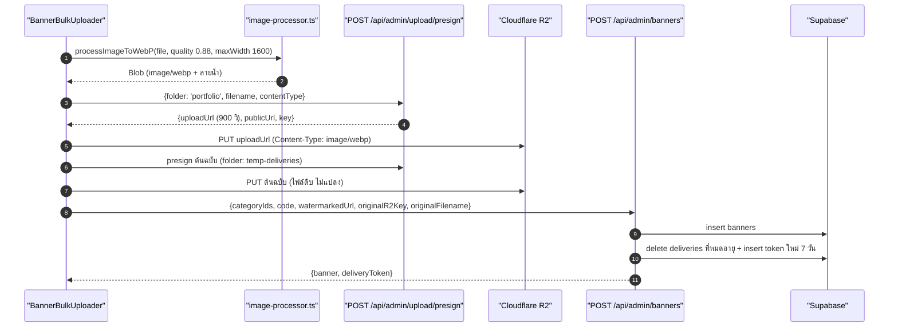

# ฟีเจอร์ที่ 2 — พอร์ตโฟลิโอตัดป้าย, อัปโหลด R2 และระบบส่งงาน

> ไฟล์ที่เกี่ยวข้อง: `src/app/banners/page.tsx`, `src/app/banners/[slug]/page.tsx`, `src/components/BannerPortfolioClient.tsx`, `src/components/BannerCoverflowCarousel.tsx`, `src/components/BannerCategoryDetailClient.tsx`, `src/components/admin/BannerBulkUploader.tsx`, `src/components/admin/BannerCategoryManager.tsx`, `src/lib/image-processor.ts`, `src/lib/r2.ts`, `src/app/api/admin/upload/presign/route.ts`, `src/app/api/admin/banners/route.ts`, `src/app/api/admin/banner-categories/route.ts`, `src/app/deliver/[token]/page.tsx`, `src/app/api/deliver/[token]/download/route.ts`, `src/components/DeliveryDownloadClient.tsx`
> เอกสารที่เกี่ยวข้อง: `docs/04-security-audit.md` (C-2, H-1, M-4), `docs/05-database-normalize-and-optimize.md` (GIN index, N+1)

---

## 1. หน้าพอร์ตโฟลิโอ `/banners`

### 1.1 การดึงข้อมูล (4 query ขนาน)

`src/app/banners/page.tsx:15-65`

```ts
12: await connection();
15: const [categoriesRes, countRes, firstBatch, secondBatch] = await Promise.all([
16:   supabase.from('banner_categories')
19:     .order('hide_preview', { ascending: true })
20:     .order('sort_order', { ascending: true })
21:     .order('created_at', { ascending: true }),
22:   supabase.from('banners').select('id', { count: 'exact', head: true })
25:     .eq('is_public', true),
26:   supabase.from('banners')
28:     .select('id, category_id, category_ids, code, watermarked_url, is_public, is_pinned, pin_order, created_at')
29:     .eq('is_public', true)
30:     .order('is_pinned', { ascending: false })
31:     .order('pin_order', { ascending: true })
32:     .order('created_at', { ascending: false })
33:     .range(0, 999),
34:   supabase.from('banners').select(/* ชุดเดียวกัน */).range(1000, 1999),
35: ]);
```

| Query | ตาราง | เงื่อนไข | ช่วงข้อมูล |
|---|---|---|---|
| 1 | `banner_categories` | — | ทั้งหมด เรียง `hide_preview`, `sort_order`, `created_at` |
| 2 | `banners` | `is_public = true` | นับอย่างเดียว (`head: true`) |
| 3 | `banners` | `is_public = true` | `range(0, 999)` |
| 4 | `banners` | `is_public = true` | `range(1000, 1999)` |
| 5 (ถ้า > 2,000) | `banners` | `is_public = true` | `range(2000, exactTotal - 1)` (`:52-65`) |

**ข้อสังเกตหนัก:** หน้าแรกดึง **banner สาธารณะทั้งหมด** (สูงสุด 3 query) มาไว้ใน memory ฝั่ง server แล้ว serialize ลง RSC payload แม้จะแสดงเพียง 10 รูปต่อหมวด (`:101-102`) — สวนทางกับ `partialPrefetching` ที่ตั้งใจให้ app shell เล็ก

### 1.2 การจัดกลุ่มตามหมวด (many-to-many)

`src/app/banners/page.tsx:72-87`

```ts
73: const ids = Array.isArray(banner.category_ids) && banner.category_ids.length > 0
74:   ? banner.category_ids
75:   : banner.category_id ? [banner.category_id] : [];
```

- ใช้ `category_ids` ก่อน แล้ว fallback ไป `category_id` เดี่ยว (รองรับข้อมูลเก่า)
- banner ที่ไม่มีทั้งสองค่า → **ไม่ปรากฏใน section ใดเลย** แต่ยังถูกนับใน `totalWorksCount` (`:22-25`) → ตัวเลขหัวเว็บไม่ตรงกับผลรวมรายการ
- `hide_preview = true` → section มีแค่ `total_count` ไม่มีรูป (`:93-99`)

### 1.3 Carousel (`BannerCoverflowCarousel.tsx`, 196 บรรทัด)

| หัวข้อ | รายละเอียด | บรรทัด |
|---|---|---|
| จำนวน slot | 7 ตำแหน่งคงที่ `[-3,-2,-1,0,1,2,3]` | `:97` |
| เลข index | `getCircularIndex` ด้วย modulo | `:13-15` |
| ปุ่มก่อนหน้า/ถัดไป | `setVirtualIndex(prev ± 1)` ไม่มีขอบเขต | `:56-57` |
| Swipe | threshold 36px และต้องมากกว่าแนวตั้ง 1.15 เท่า | `:88-94` |
| รูปเดียว | early return การ์ดเดียว + `loading="eager"` | `:30-53` |
| Lazy loading | eager 3 รูปกลาง (`|offset| ≤ 1`) นอกนั้น lazy | `:158` |
| ขนาดรูป | ไม่มี `width/height/srcSet` | `:155-164` |
| จุดนำทาง | 1 ปุ่มต่อ banner ทุกตัว | `:196-211` |

**ผลกระทบ:** 1 section = 7 `` (ถ้าหมวดมี < 7 รูป จะ render รูปซ้ำ) + N ปุ่ม dots และภาพกลางเป็น LCP element ที่ไม่มี `fetchpriority` — ต้องรอ 4 query เสร็จก่อนเริ่มโหลด

### 1.4 หน้าหมวด `/banners/[slug]`

`src/app/banners/[slug]/page.tsx`

| ประเด็น | รายละเอียด | บรรทัด |
|---|---|---|
| ขนาดหน้า | `PAGE_SIZE = 24` | `:8` |
| Slug validation | มีแค่ `decodeURIComponent(slug)` — ไม่มี regex/allowlist | `:21` |
| 404 | `.maybeSingle()` + `notFound()` | `:28-36` |
| Pagination | `Math.max(1, Number(pageParam) \|\| 1)` | `:22` |
| ช่วงข้อมูล | `.range(from, to)` | `:46` |
| ตัวกรอง | `.contains('category_ids', [category.id])` **ไม่มี fallback ไป `category_id`** | `:41` |
| คอลัมน์ | `select('*', { count: 'exact' })` | `:40` |

**บั๊กที่พบ:**

1. `page=1.5` → `from = 12` (page เศษหลุดเข้าสู่ range)
2. `page=999` → ตารางว่างแต่ตอบ 200 (ไม่มี clamp/redirect)
3. banner เก่าที่มีเฉพาะ `category_id` จะ **หายจากหน้ารายหมวด** ทั้งที่ยังโชว์ในหน้าแรก → ข้อมูลสองหน้าไม่ตรงกัน
4. ไม่มีการเช็ก `hide_preview` → หมวดที่ซ่อนยังเข้าถึงได้ด้วย URL ตรง (เจตนา เพราะ archive card ลิงก์มาที่นี่ `BannerPortfolioClient.tsx:173-179`)
5. `decodeURIComponent` กับ slug ที่มี `%` เดี่ยว → `URIError` → 500

### 1.5 Client หน้าแรก (`BannerPortfolioClient.tsx`)

| ส่วน | บรรทัด | หมายเหตุ |
|---|---|---|
| แยก section ปกติ / archive | `:63-64` | ตาม `hide_preview` |
| section ปกติ | `:92-142` | carousel + จำนวน + ลิงก์ `/banners/{slug}` |
| archive | `:144-184` | แถบจำนวน + ปุ่มดูทั้งหมด ไม่มีรูป |
| Lightbox | `:55-61, 198-208` | ใช้ `ModalPortal` (ถูกต้อง) |
| ปุ่มเลื่อนขึ้นด้านบน | `:33-39, 187-196` | listener แบบ passive |

---

## 2. Pipeline อัปโหลดผลงาน (14 ขั้นตอน)



### 2.1 ตารางอ้างอิงทุก hop

| # | ขั้น | ไฟล์:บรรทัด | รายละเอียด |
|---|---|---|---|
| 1 | เลือกไฟล์ | `BannerBulkUploader.tsx:297-304` | `accept="image/*" multiple` ไม่จำกัดขนาด |
| 2 | อ่านไฟล์ | `:96-98` | `Array.from(e.target.files ?? [])` |
| 3 | ตั้งสถานะ | `:100-101` | `uploading = true` |
| 4 | วนทีละไฟล์ | `:109-111` | `for` loop + ข้อความ "กำลังประมวลผลรูปที่ i จาก n" |
| 5 | คำนวณรหัสงาน | `:104-116` | ถ้าเป็นตัวเลขล้วน → `startingNumber + i` |
| 6 | แปลง WebP | `:118-122` | `processImageToWebP(file, { watermarkText, quality: 0.88, maxWidth: 1600 })` |
| 7 | ขอ presign (watermark) | `:26-39`, `:124-129` | body `{folder:'portfolio', filename, contentType}` |
| 8 | PUT ขึ้น R2 | `:41-49` | `PUT` + `Content-Type` + blob |
| 9 | อัปโหลดต้นฉบับ | `:131-140` | `uploadBlobToR2(file, 'temp-deliveries', file.name, file.type \|\| 'image/png')` — **ไม่แปลง/ไม่จำกัดขนาด** |
| 10 | สร้าง DB row | `:142-158` | POST `/api/admin/banners` |
| 11 | insert banner | `banners/route.ts:125-137` | `category_id = category_ids[0]`, `is_pinned:false`, `pin_order:0` |
| 12 | กวาด delivery หมดอายุ | `banners/route.ts:153` | `delete().lt('expires_at', now)` ทั้งตาราง |
| 13 | สร้าง token | `banners/route.ts:149-161` | `randomBytes(16).toString('hex')` = 32 hex (128 บิต) |
| 14 | ส่งลิงก์ให้ผู้ใช้ | `BannerBulkUploader.tsx:160-169` | `` `${origin}/deliver/${deliveryToken}` `` |

### 2.2 `image-processor.ts` (138 บรรทัด)

| หัวข้อ | รายละเอียด | บรรทัด |
|---|---|---|
| Signature | `processImageToWebP(file, options)` | `:11-14` |
| ค่าเริ่มต้น | `quality = 0.88`, `maxWidth = 1600` | `:15` |
| Decode | `URL.createObjectURL` + `new Image()` — **ไม่ใช้ `createImageBitmap`** | `:56-70` |
| Revoke URL | ทั้ง `onload` และ `onerror` | `:61, :65` |
| Resize | จำกัด **ความกว้างเท่านั้น** — ความสูงไม่จำกัด | `:72-85` |
| Canvas | `getContext('2d')` + throw ถ้า null, `imageSmoothingQuality='high'` | `:24-34` |
| ลายน้ำ | ตัวอักษรเฉียง −28°, เงาเข้ม + ตัวขาวโปร่ง, ระยะห่างตามขนาดภาพ | `:90-123` |
| Encode | `canvas.toBlob(..., 'image/webp', quality)` | `:41-53` |
| EXIF | canvas re-encode ตัด EXIF ให้ไฟล์ WebP อัตโนมัติ | โดยพฤติกรรม canvas |
| ขนาด mémoire | canvas = `กว้าง × สูง × 4` ไบต์; bitmap ต้นฉบับค้างจน GC | `:56-70` |

**ความเสี่ยงที่สำคัญ:**

1. **ไม่จำกัดความสูง** → รูปแนวตั้ง 3000×8000 จะกลายเป็น 1600×4267 (~27 MB ใน canvas) และรูปต้นฉบับ 8000×8000 ใช้ decoded memory ~256 MB → Safari/iOS อาจ crash เมื่อทำ 30 ไฟล์ต่อเนื่อง
2. ต้นฉบับที่ส่งเข้า `temp-deliveries` เป็นไฟล์ดิบ **รวม EXIF/GPS** (ต่างจากไฟล์ WebP ที่ใช้แสดง)
3. ไม่มี `srcSet` → มือถือโหลดภาพกว้าง 1600px เต็มทุกใบ

---

## 3. Presigned URL: พฤติกรรมจริงและช่องโหว่

`src/app/api/admin/upload/presign/route.ts` (155 บรรทัด) implement SigV4 เองทั้งหมด (`:20-94`) แทนการใช้ `createPresignedUploadUrl` ที่มีอยู่แล้วใน `src/lib/r2.ts:83-117`

### 3.1 สิ่งที่ตรวจ / ไม่ตรวจ

| การตรวจ | สถานะ | หลักฐาน |
|---|---|---|
| Session | ✅ `auth.getUser()` | `:97-104` |
| Role owner/staff | ❌ **ไม่มี** | ทั้งไฟล์ |
| PIN cookie | ❌ **ไม่มี** | ทั้งไฟล์ |
| MIME จาก client | ❌ อ่าน `contentType` แต่ไม่ตรวจ | body ถูกอ่านแค่ `folder`/`filename` `:129-135` |
| นามสกุลไฟล์ | ❌ **ไม่มี allowlist** — regex รับ `[a-zA-Z0-9]+` | `:134-135` |
| ขนาดไฟล์ | ❌ **ไม่มี** `content-length-range` ใน signature | `:52-58` |
| จำกัด folder | ❌ รับชื่ออะไรก็ได้ (sanitize แค่ตัวอักษร) | `:129-132` |
| Path traversal | ✅ ปลอดภัย — `/`, `.` ถูกตัดออกจาก folder และ ext | `:131, 134` |
| Expiry | 900 วินาที (15 นาที) | `:34, 138-144` |
| Payload ผูกกับ body | ❌ `UNSIGNED-PAYLOAD` + signed header แค่ `host` | `:57, :67` |

**ผลลัพธ์เชิงโจมตี:** ผู้ใช้ Supabase Auth คนใดก็ได้ (ไม่ต้องเป็น staff) สามารถขอ presigned PUT แล้วอัปโหลดไฟล์ชนิดใดก็ได้ ขนาดเท่าใดก็ได้ ไปยัง path ใดก็ได้ใน bucket (ยกเว้นต้องผ่าน sanitize) โดย Content-Type ที่ส่งจริงไม่ถูกผูกกับ signature เลย → วางไฟล์ `.html`/`.svg` ในโฟลเดอร์ `portfolio/` ได้ และถ้า CDN เสิร์ฟตาม Content-Type ที่อัปโหลด อาจเกิด stored XSS บนโดเมน CDN

> **หมายเหตุสำคัญ:** `src/lib/r2.ts:12-17` มี `ALLOWED_IMAGE_MIME_TYPES` และ `:58-60` มี `isAllowedImageMimeType()` แต่ **ไม่มีไฟล์ใดเรียกใช้ใน production** (grep แล้วพบเฉพาะ declaration และ `tests/lib/r2.test.ts`) → เทสต์ R2 ครอบโค้ดที่ไม่ได้ใช้งานจริง

### 3.2 ทางแก้ที่แนะนำ

```ts
// 1) ตรวจ role + PIN ก่อนสร้าง URL
const { data: roleRow } = await supabase
  .from('admin_roles').select('role').eq('user_id', user.id).maybeSingle();
if (!roleRow) return NextResponse.json({ error: 'Forbidden' }, { status: 403 });

// 2) allowlist MIME + นามสกุล + folder
const ALLOWED = new Set(['image/webp', 'image/png', 'image/jpeg']);
const FOLDERS = new Set(['portfolio', 'accounts', 'temp-deliveries']);
if (!ALLOWED.has(String(body.contentType))) return ...400;
if (!FOLDERS.has(folder)) return ...400;

// 3) ผูกขนาดและชนิดไฟล์เข้ากับ signature
//    ใช้ PutObjectCommand + ContentLength/ContentType ใน @aws-sdk/s3-request-presigner
//    และกำหนด content-length-range ใน policy หากใช้ POST policy
```

---

## 4. อัปโหลด 30+ ไฟล์: พฤติกรรมและจุดพัง

`BannerBulkUploader.tsx:108-182`

| ประเด็น | สถานะจริง | บรรทัด |
|---|---|---|
| Concurrency | **sequential** — `for` loop ธรรมดา ไม่มี `Promise.all` | `:109` |
| จำนวน request ต่อไฟล์ | 4–5 ครั้ง (presign, PUT, presign, PUT, POST) | `:124-158` |
| Error handling | try/catch **เดียวครอบทั้ง loop** → ไฟล์แรกพัง = ยกเลิกที่เหลือทั้งหมด | `:108, :174-182` |
| Retry | ❌ ไม่มี | ทั้งไฟล์ |
| Progress | ข้อความ index เท่านั้น ไม่มี %/ไบต์/ETA | `:111` |
| Partial result | `uploadedBatch` ถูก push หลัง loop จบ (`:172`) → ไฟล์ที่สำเร็จก่อนพัง **หายจาก UI ทั้งหมด** | `:162-172` |
| Cleanup | ❌ ไม่มีการลบ object ที่ค้าง | ทั้งไฟล์ |

### 4.1 รูปแบบ orphan ที่เกิดขึ้นได้

| สถานการณ์ | สิ่งที่ค้าง |
|---|---|
| PUT รูป watermark สำเร็จ แต่ PUT ต้นฉบับพัง | object ใน `portfolio/` 1 ไฟล์ |
| PUT ทั้งสองสำเร็จ แต่ `POST /api/admin/banners` ตอบ 400 | object 2 ไฟล์ |
| insert DB สำเร็จ แต่ response ขาดการเชื่อมต่อ | DB row + delivery row แต่ผู้ใช้ไม่ได้ token |
| ลบ banner ในภายหลัง | **object ทั้ง 2 ไฟล์ยังอยู่** เพราะ DELETE ไม่ลบ R2 (`banners/route.ts:349-355`) |

**ไม่มีใครเรียก `deleteR2Object`** ที่ `src/lib/r2.ts:145-159` เลย → storage บน R2 จะโตไม่มีวันลด และถ้าตั้ง lifecycle rule ผิด ต้นฉบับลูกค้าอาจถูกลบก่อนหมดอายุ 7 วัน

---

## 5. `BannerCategoryManager.tsx` (1,007 บรรทัด)

### 5.1 Endpoint ที่ใช้

| การกระทำ | เรียก | บรรทัด |
|---|---|---|
| โหลดหมวด + count | `GET /api/admin/banner-categories` | `:106` |
| สร้างหมวด | `POST /api/admin/banner-categories` | `:132-140` |
| บันทึกลำดับ | `PATCH {action:'reorder', orderedIds}` | `:156-163` |
| แก้ชื่อ/คำอธิบาย/โลโก้/hide_preview | `PATCH {id,name,description,logo_url,hide_preview}` | `:329-339` |
| โหลด banner ในหมวด | `GET /api/admin/banners?categoryId=` | `:188-190` |
| ย้ายหมวดแบบกลุ่ม | `PATCH {action:'bulk_update_categories'}` | `:258-267` |
| toggle หมวดรายรูป | `PATCH {action:'update_categories'}` | `:299-307` |
| pin/unpin | `PATCH {bannerId, categoryId, isPinned}` | `:362-370` |
| เรียง pinned | `PATCH {action:'reorder_pinned'}` | `:398-405` |
| ลบรูป | `DELETE /api/admin/banners?id=` | `:410-413` |

### 5.2 บั๊กที่ยืนยันได้

| # | บั๊ก | หลักฐาน | ผลกระทบ |
|---|---|---|---|
| B-1 | **อัปโหลดโลโก้หมวดเรียก endpoint ที่ไม่มี** `/api/upload/presign` | `:39` | ได้ 404 → `await res.json()` throw `SyntaxError` ก่อนถึง `if (!res.ok)` (`:48-49`) → `handleCreateCategory` ไม่มี `catch` (`:122-151`) → **สร้างหมวดที่มีโลโก้ไม่ได้เลย** และไม่มีข้อความ error |
| B-2 | ลบหมวดทิ้ง UUID ค้างใน `category_ids` | `banner-categories/route.ts:175-178` ไม่ update banners; `001:76` FK ครอบแค่ `category_id` | banner ล่องหนจากหน้าหมวด แต่ยังนับในยอดรวม |
| B-3 | `is_pinned` เป็นระดับ global แต่จัดการแบบ per-category | `001` ไม่มีคอลัมน์นี้; `banners/route.ts:295-317` เช็กโควตาตามหมวด, `banners/page.tsx:101` กรอง global | pin ในหมวด A ไปโผล่หมวด B; `pin_order` ชนกัน |
| B-4 | reorder = N queries ไม่มี transaction | `banner-categories/route.ts:118-125` | partial failure ทำให้ลำดับเพี้ยน |
| B-5 | สร้างหมวดใหม่คำนวณ `sort_order` จาก `max` ที่กรอง `hide_preview=false` | `:74-82` | ชนกับหมวด archive; สร้างพร้อมกันได้เลขซ้ำ |
| B-6 | `GET` categories ทำ N+1 (2 count ต่อหมวด) | `:33-53` | 16 หมวด = 32 round trip ทุกครั้งที่ refresh |
| B-7 | หลังทุก action เรียก `loadCategories()` ใหม่ | `:277, 318, 349, 379, 417` | ซ้ำ N+1 ทั้งชุด |
| B-8 | ค้นหาใน modal match เฉพาะ `code` แต่ placeholder บอก "ชื่อไฟล์" | `:421-429`, `:671` | ผู้ใช้ค้นด้วยชื่อไฟล์ไม่ได้ (ตารางไม่มีคอลัมน์ filename) |
| B-9 | `total_count` คำนวณจาก `updatedList.length` ที่ endpoint limit 2,000 | `:195-199` vs `banners/route.ts:53` | หมวด > 2,000 รูปนับผิด |
| B-10 | ปุ่มลบรูปแสดงเฉพาะกลุ่ม unpinned | `:1070-1077` | รูปที่ pin ไว้ลบไม่ได้จาก UI |
| B-11 | ไม่มี focus trap / Esc ใน modal | `:604` | accessibility |
| B-12 | **ไม่มี UI ลบหมวด** แม้ API รองรับ | grep `method:'DELETE'` เจอเฉพาะ `:412` | ฟีเจอร์กำพร้า |

---

## 6. ระบบส่งงาน `/deliver/[token]`

### 6.1 โทเค็น

| หัวข้อ | รายละเอียด | บรรทัด |
|---|---|---|
| แหล่งสุ่ม | `randomBytes(16)` จาก `node:crypto` | `banners/route.ts:2, 149` |
| ความยาว | 32 hex = 128 บิต | `:149` |
| เก็บที่ | `deliveries.token` (UNIQUE) | `001:86` |
| อายุ | 7 วัน (`Date.now() + 7*24*60*60*1000`) | `:150` |
| ชนกัน | ไม่มี retry — ถ้า insert error จะได้ `deliveryToken = null` เงียบ ๆ | `:163-165` |
| กวาดของหมดอายุ | ลบทั้งตาราง `expires_at < now` ก่อน insert ทุกครั้ง | `:153` |

### 6.2 การตรวจหมดอายุ 3 ชั้น

| ชั้น | ตำแหน่ง | เงื่อนไข |
|---|---|---|
| 1. หน้าเว็บ | `deliver/[token]/page.tsx:22-23` | `new Date(delivery.expires_at).getTime() < Date.now()` → แสดง UI หมดอายุ (HTTP 200) |
| 2. RLS | `001:172-175` | `expires_at > now()` |
| 3. Download route | `download/route.ts:16` | `.gt('expires_at', new Date().toISOString())` |

**ข้อสังเกต:** ชั้นที่ 1 ตอบ 200 ไม่ใช่ 404/410 → ลิงก์หมดอายุยังถูก index ได้ และไม่มี `robots: noindex` ในหน้านี้

### 6.3 Download route

```ts
12:  const { data: delivery, error } = await supabase
13:    .from('deliveries').select('*')
15:    .eq('token', token)
16:    .gt('expires_at', new Date().toISOString())
17:    .single();
19:  if (error || !delivery) {
20:    return NextResponse.json({ error: 'ลิงก์หมดอายุหรือไม่ถูกต้อง' }, { status: 404 });
21:  }
26:  const downloadUrl = await createPresignedAttachmentDownloadUrl({
27:    key: delivery.original_r2_key,
28:    downloadFilename: delivery.original_filename,
29:  });
31:  return NextResponse.redirect(downloadUrl, 302);
```

| หัวข้อ | รายละเอียด | บรรทัด |
|---|---|---|
| รูปแบบ | 302 ไป presigned GET (ไม่ stream ผ่าน server) | `:31` |
| อายุ URL | 3,600 วินาที | `src/lib/r2.ts:139` |
| Content-Disposition | `attachment; filename="..."` + ตัด `"` `\` CR LF | `r2.ts:132-137` |
| Header injection | ✅ ถูก block | `:134` |
| Rate limit | ❌ ไม่มี | ทั้งไฟล์ |
| Audit log | ❌ ไม่มี | ทั้งไฟล์ |

**ความเสี่ยงที่ต้องบันทึก:** presigned GET ที่ได้มีอายุ 1 ชั่วโมง และ **แชร์ต่อได้โดยไม่ต้องใช้ token** — ผู้รับสามารถส่ง URL ให้คนอื่นดาวน์โหลดได้ในช่วงเวลานั้น แม้ token จะหมดอายุก็ตาม

### 6.4 In-app browser (Facebook / LINE / Instagram)

`src/components/DeliveryDownloadClient.tsx` มี logic ตรวจจับ UA (`:19-24`) และปุ่มคัดลอกลิงก์ (`:26-30, 43-75`) **แต่คอมโพเนนต์นี้ไม่ถูก import ที่ใดเลย** (grep พบเฉพาะ declaration ในไฟล์ตัวเอง) → หน้า `/deliver/[token]` จริงไม่มีคำเตือนหรือทางออกสำหรับ WebView

### 6.5 ปัญหา join กับ `banners`

`deliver/[token]/page.tsx:18` ใช้ `select('*, banner:banners(watermarked_url, code)')`

RLS ของ `banners` ให้ anon อ่านเฉพาะ `is_public = true` (`001:160-163`) → **งานที่ตั้ง `is_public = false` จะไม่มี preview** ในหน้าส่งมอบ ทั้งที่ลูกค้าควรเห็นภาพตัวอย่างของงานตัวเอง

---

## 7. ตาราง API ในโมดูลนี้

| Method | Path | Session | Role | PIN | Validation | ปัญหา |
|---|---|---|---|---|---|---|
| POST | `/api/admin/upload/presign` | ✅ `:97` | ❌ | ❌ | folder/filename เท่านั้น | ไม่ตรวจ MIME/ขนาด, `UNSIGNED-PAYLOAD` |
| GET | `/api/admin/banners` | ✅ `:14` | ❌ | ❌ | ต้องมี `categoryId` | `next_code = count+1` (`:27-38`) ซ้ำหลังลบ |
| POST | `/api/admin/banners` | ✅ `:63` | ❌ | ❌ | `watermarkedUrl` required | รับ URL ใดก็ได้, insert error ตอบ 400 พร้อมข้อความ PG |
| PATCH | `/api/admin/banners` | ✅ `:172` | ❌ | ❌ | 6 action | `reorder_pinned` ไม่เช็ก ownership, bulk ตอบ ok แม้บางแถวพัง |
| DELETE | `/api/admin/banners?id=` | ✅ `:340` | ❌ | ❌ | ต้องมี `id` | **ไม่ลบ R2 object/deliveries** |
| GET | `/api/admin/banner-categories` | ✅ `:14` | ❌ | ❌ | — | N+1 |
| POST | `/api/admin/banner-categories` | ✅ `:59` | ❌ | ❌ | `name` required | slug ชน = 400 พร้อมข้อความ PG |
| PATCH | `/api/admin/banner-categories` | ✅ `:105` | ❌ | ❌ | reorder / meta | N updates ไม่มี transaction |
| DELETE | `/api/admin/banner-categories?id=` | ✅ `:160` | ❌ | ❌ | ต้องมี `id` | dangling `category_ids`, ไม่ลบ logo |
| GET | `/api/deliver/[token]/download` | token | — | — | token + expiry | ไม่มี rate limit |

**ข้อบกพร่องร่วมของทุก route:**

1. `await req.json()` ไม่มี try/catch → body ผิดรูปแบบ = 500 (`banners/route.ts:72, 181`, `banner-categories/route.ts:68, 114`, `presign/route.ts:128`)
2. ไม่มี schema validation (ไม่มี `zod` ใน `package.json`)
3. ส่ง `error.message` ของ Postgres กลับ client (schema disclosure)
4. ไม่มี CSRF token / Origin check
5. ไม่มี rate limit

---

## 8. ประสิทธิภาพและการแสดงผลรูป

| # | ปัญหา | หลักฐาน | ผลกระทบ |
|---|---|---|---|
| P-1 | ไม่ใช้ `next/image` ทั้งโปรเจกต์ | grep `from 'next/image'` = ไม่พบ; `next.config.ts` ไม่มี `images.remotePatterns` | ไม่มี optimization/resize อัตโนมัติ |
| P-2 | ไม่มี `srcSet/sizes` | `BannerCategoryDetailClient.tsx:79-84`, `BannerCoverflowCarousel.tsx:155-164` | มือถือโหลด 1600px ทุกใบ |
| P-3 | ไม่มี `width/height` | ทุก `` | CLS |
| P-4 | หน้าแรกดึง banner ทั้งตาราง | `banners/page.tsx:26-65` | payload โตตามจำนวนงาน |
| P-5 | ไม่มี index GIN บน `category_ids` | `001` ไม่มีคอลัมน์นี้ด้วยซ้ำ | `.contains()` = seq scan |
| P-6 | ไม่มี index `expires_at` | `:153`, `download/route.ts:16` | sweep/ตรวจ expiry = seq scan |
| P-7 | pagination ใช้ order ที่ไม่ unique | `banners/page.tsx:30-32` | แถวซ้ำ/หายระหว่าง 2 query |
| P-8 | ไม่มี `fetchpriority="high"` ให้ภาพ LCP | ทั้งโปรเจกต์ | LCP ช้าบนมือถือ |
| P-9 | lightbox/deliver/admin pinned ไม่มี `loading` | `ImageLightbox.tsx:102`, `deliver/page.tsx:87`, `BannerCategoryManager.tsx:933` | โหลดเต็มทันที |

---

## 9. สรุปงานที่ควรทำในโมดูลนี้

| ลำดับ | งาน | เหตุผล |
|---|---|---|
| 1 | เพิ่ม role + PIN guard ให้ presign และ banner routes | ปิดช่องอัปโหลดโดยผู้ใช้ทั่วไป |
| 2 | ตรวจ MIME allowlist + ขนาดสูงสุด + ผูก Content-Type เข้า signature | กันไฟล์อันตราย/ไฟล์ยักษ์ |
| 3 | เรียก `deleteR2Object` เมื่อลบ banner/category + ตั้ง lifecycle rule 7 วันสำหรับ `temp-deliveries` | กัน orphan storage |
| 4 | แก้ path `/api/upload/presign` → `/api/admin/upload/presign` + เพิ่ม `catch` | ทำให้สร้างหมวดพร้อมโลโก้ได้ |
| 5 | จำกัดความสูงภาพ + ใช้ `createImageBitmap` + `bitmap.close()` | กัน memory crash บน iOS |
| 6 | เปลี่ยน bulk upload เป็น concurrency จำกัด (3–4) + per-file try/catch + cleanup | อัปโหลด 30+ ไฟล์ได้จริง |
| 7 | เพิ่ม GIN index `banners(category_ids)` + index `deliveries(expires_at)` | query เร็วขึ้นมาก |
| 8 | เพิ่ม fallback `category_id` ใน `/banners/[slug]` และล้าง dangling array ตอนลบหมวด | ข้อมูลสองหน้าไม่ขัดกัน |
| 9 | เพิ่ม `noindex` + `robots` และ rate limit ให้ `/deliver` | ลดการรั่วของลิงก์ |
| 10 | ใช้ `ModalPortal` + focus trap + Esc ใน modal ของ `BannerCategoryManager` | accessibility |

---

## 10. สถานะการแก้ไข (อัปเดต 18 พ.ย. 2026)

| งาน | สิ่งที่ทำ | ไฟล์ |
|---|---|---|
| path presign ของโลโก้หมวด | เปลี่ยนจาก `/api/upload/presign` เป็น `/api/admin/upload/presign` และอ่าน response แบบกันพลาด (`json().catch(() => ({}))`) พร้อมตรวจว่ามี `uploadUrl` ก่อน PUT | `src/components/admin/BannerCategoryManager.tsx:37-60` |
| ลบไฟล์บน R2 เมื่อลบ banner | ก่อนลบแถว อ่าน `banners.watermarked_url` + `deliveries.original_r2_key` (FK เป็น `ON DELETE SET NULL`) แล้ว derive key จาก `R2_PUBLIC_URL` และเรียก `deleteR2Object` ผ่าน `Promise.allSettled` เพื่อไม่ให้ R2 ล้มแล้วทำให้การลบแถวถูกมองว่าล้มเหลว | `src/app/api/admin/banners/route.ts` (`keyFromPublicUrl`, `DELETE`) |

> หมายเหตุ: `banners` บน production ไม่มีคอลัมน์ `original_r2_key` — ต้นฉบับเก็บอยู่ใน `deliveries.original_r2_key` เท่านั้น ถ้า URL ไม่ขึ้นต้นด้วย `R2_PUBLIC_URL` จะไม่ลบ object (กันลบไฟล์นอก bucket)
> ยังค้าง: ตั้ง lifecycle rule 7 วันของ prefix `temp-deliveries` (งานฝั่ง R2 console ไม่ใช่โค้ด)
