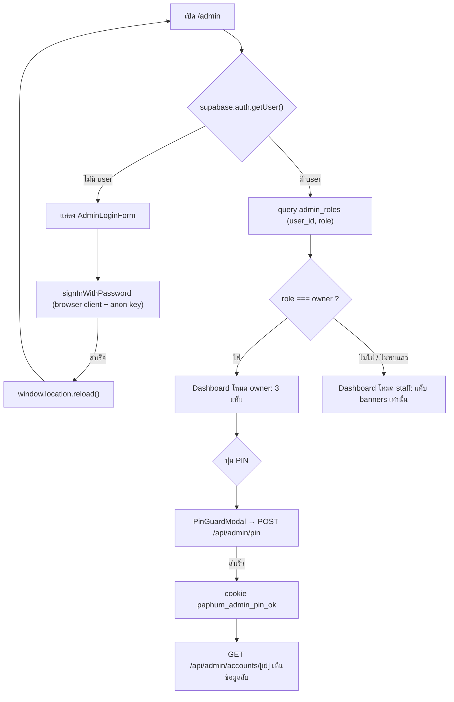

# ฟีเจอร์ที่ 3 — ระบบหลังบ้าน, สิทธิ์ owner/staff, PIN, AES-256 และ Google Sheets

> ไฟล์ที่เกี่ยวข้อง: `src/app/admin/page.tsx`, `src/components/admin/AdminDashboardClient.tsx`, `src/components/admin/AdminLoginForm.tsx`, `src/components/admin/PinGuardModal.tsx`, `src/components/admin/AccountFormModal.tsx`, `src/components/admin/AccountsSecretTable.tsx`, `src/components/admin/ScheduleGeneratorModal.tsx`, `src/app/api/admin/pin/route.ts`, `src/app/api/admin/accounts/route.ts`, `src/app/api/admin/accounts/[id]/route.ts`, `src/lib/crypto.ts`, `src/lib/totp.ts`, `src/lib/sheets-sync.ts`, `scripts/google-apps-script.js`, `supabase/migrations/001_initial_schema.sql` (ตาราง `admin_security`)
> เอกสารที่เกี่ยวข้อง: `docs/04-security-audit.md` (C-1, C-3, H-2, H-3), `docs/05-database-normalize-and-optimize.md` (ตาราง `admin_roles` ที่ขาด)

---

## 1. เส้นทางการเข้าสู่หลังบ้าน



### 1.1 Login (ฝั่ง client ล้วน)

`src/components/admin/AdminLoginForm.tsx:13-39`

```ts
13: const supabase = createBrowserClient(
14:   process.env.NEXT_PUBLIC_SUPABASE_URL!,
15:   process.env.NEXT_PUBLIC_SUPABASE_ANON_KEY!
16: );
23: const trimmed = username.trim().toLowerCase();
24: const internalEmail = trimmed.includes('@') ? trimmed : `${trimmed}@paphum.local`;
28: const { error: signInError } = await supabase.auth.signInWithPassword({ email: internalEmail, password });
34: // error ทั่วไป: 'Username หรือรหัสผ่านไม่ถูกต้อง'
39: window.location.reload();
```

| ประเด็น | รายละเอียด |
|---|---|
| รูปแบบ username | ถ้าไม่มี `@` จะเติม `@paphum.local` ให้อัตโนมัติ (`:24`) |
| การป้องกัน brute force | ไม่มีเลย นอกจาก `disabled={loading}` (`:86`) |
| การแจ้ง error | generic (ดี ไม่บอกว่าผิดที่ username หรือ password) |
| หลังล็อกอิน | reload ทั้งหน้า ไม่มี redirect/role check ฝั่ง client |

### 1.2 การหา role

`src/app/admin/page.tsx:14-33`

```ts
17: const { data: { user } } = await supabase.auth.getUser();
21: if (!user) return <AdminLoginForm />;
25: const { data: roleRow } = await supabase
26:   .from('admin_roles')
27:   .select('username, role')
28:   .eq('user_id', user.id)
29:   .maybeSingle();
31: const role: AdminRole = (roleRow?.role as AdminRole) ?? 'staff';
32: const username: string = roleRow?.username ?? user.email?.split('@')[0] ?? 'admin';
```

| ข้อเท็จจริง | ผลกระทบ |
|---|---|
| ตาราง `admin_roles` **มีอยู่จริงใน production** (`supabase/migrations/DB.md:68-71`) แต่ไม่มีในไฟล์ `001_initial_schema.sql` (188 บรรทัด) ซึ่งล้าสมัย | ถ้าใครสร้าง DB ใหม่จาก `001` จะ query error → `roleRow = null` → **ทุกคนเป็น staff รวม owner** |
| production มี policy `Users can read own role` (`auth.uid() = user_id`) อยู่แล้ว (`DB.md:126`) | อ่าน role ของตัวเองได้ แต่ไม่มี policy ให้ owner จัดการ role ของคนอื่น → ต้องเพิ่มเมื่อทำฟีเจอร์จัดการทีม |
| fallback เป็น `staff` (`:31`) | ปลอดภัยเชิง fail-safe แต่ทำให้ระบบใช้งานไม่ได้ถ้าตั้งค่าผิด |
| ไม่มี `redirect()` | ผู้ใช้ authenticated ที่ไม่ใช่แอดมินยังเห็นหน้า dashboard (โหมด staff) |

### 1.3 Dashboard หลังบ้าน

`src/app/admin/page.tsx:84-94` ส่ง props ให้ `AdminDashboardClient`:

| Prop | ที่มา | หมายเหตุ |
|---|---|---|
| `role` | `admin_roles.role` | `owner` หรือ `staff` |
| `initialAccounts` | `accounts` เฉพาะคอลัมน์สาธารณะ (`page.tsx:68-70`) | staff ได้ `[]` (`:56`) |
| `initialCategories` | `banner_categories` (`:36-40`) | ทุก role |
| `initialSettings` | `installment_settings` หรือ fallback (`:72, :46-48`) | ทุก role |
| `initialHasPin` | มีแถวใน `admin_security` (`:74-76`) | staff ก็ตั้ง PIN ได้ |
| `initialPinUnlocked` | เทียบคุกกี้กับ `user.id` (`:80-82`) | ดูข้อ 3.3 |

---

## 2. การแบ่งสิทธิ์ owner vs staff

### 2.1 UI gate (ทั้งหมดอยู่ใน `AdminDashboardClient.tsx`)

```ts
83: const isOwner = role === 'owner';
85: const [activeTab, setActiveTab] = useState<AdminTab>(isOwner ? 'accounts' : 'banners');
```

| # | Gate | บรรทัด | ผลกับ staff |
|---|---|---|---|
| 1 | แท็บเริ่มต้น = banners | `:85-87` | ไม่เห็นแท็บไอดี |
| 2 | ข้อความหัวจอ | `:320-322` | "อัปโหลดงานตัดรูปและจัดหมวดหมู่" |
| 3 | ปุ่ม PIN | `:327-349` | ไม่แสดง |
| 4 | แท็บ "ไอดี" | `:364-377` | ไม่แสดง |
| 5 | แท็บ "ตั้งค่าผ่อน" | `:392-405` | ไม่แสดง |
| 6 | เนื้อหาแท็บ accounts | `:409` | ไม่ render |
| 7 | ตาราง secret | `:510-518` | เข้าไม่ถึง |
| 8 | effect ดึง secret | `:140` | `if (viewMode !== 'secret_table' \|\| !pinUnlocked \|\| !isOwner) return;` |
| 9 | ปุ่มลบไอดี | `:237-241` | อยู่ในแท็บ accounts |
| 10 | ปุ่ม sync Sheets | `:255-259` | อยู่ในแท็บ accounts |

### 2.2 Server-side gate

`requireOwner` ถูกเขียนซ้ำ 2 ที่ (ควร extract เป็น helper กลาง):

```ts
// src/app/api/admin/accounts/route.ts:23-29
23: const { data } = await supabase
24:   .from('admin_roles')
25:   .select('role')
26:   .eq('user_id', userId)
27:   .maybeSingle();
29: return data?.role === 'owner';
```

เรียกใช้ที่:

| Endpoint | ตรวจ owner | ตรวจ PIN |
|---|---|---|
| `GET /api/admin/accounts` | ✅ `:101-107` | ❌ (ไม่คืน secret อยู่แล้ว) |
| `POST /api/admin/accounts` | ✅ `:138-144` | ✅ `:146-152` |
| `GET /api/admin/accounts/[id]` | ✅ `[id]/route.ts:155-161` | ✅ `:163-169` |
| `PATCH /api/admin/accounts/[id]` | ✅ `:206-212` | ✅ `:247-253` (ยกเว้น `quickStatusOnly` `:217-244`) |
| `DELETE /api/admin/accounts/[id]` | ✅ `:362-368` | ✅ `:370-376` |

**สรุป:** ผ่านตัวแอป staff ไม่เห็น secret และไม่เห็น `cost` เพราะ:

- `AccountPublic` ไม่มีฟิลด์ `cost` (`src/types/database.ts:4-19`)
- หน้า admin เลือกคอลัมน์เจาะจง ไม่มี cost (`src/app/admin/page.tsx:68-70`)
- `GET /api/admin/accounts` คืนจาก `accounts_public` (`accounts/route.ts:109-118`)

### 2.3 ช่องว่างที่ต้องบันทึกไว้

| # | ช่องว่าง | หลักฐาน | ระดับ |
|---|---|---|---|
| R-1 | RLS ให้ `authenticated` ทุกคน `ALL USING(true)` บน `accounts_secret`/`deliveries`/`banners`/`banner_categories`/`installment_settings` → staff ยิง PostgREST ตรงได้ (ตาราง `accounts` **บังคับ owner แล้ว** — `DB.md:129`) | `DB.md:125-145` | วิกฤต |
| R-2 | policy ที่อ้าง `admin_roles` มีเพียงตัวเดียวบน `accounts` → อีก 5 ตารางไม่ผูกกับ role ที่ชั้น DB | `DB.md:126,129` | วิกฤต |
| R-3 | staff ตั้ง PIN ของตัวเองได้ (`POST /api/admin/pin`) แม้ไม่ได้สิทธิ์ secret | `pin/route.ts:34-91` | กลาง |
| R-4 | ไม่มี middleware/layout ตรวจ role | glob ไม่พบ `middleware.*`, `admin/layout.tsx` | สูง |

---

## 3. ระบบ PIN ชั้นที่ 2

### 3.1 วงจรชีวิต

`src/app/api/admin/pin/route.ts` (128 บรรทัด) export เฉพาะ `GET` (`:9`) และ `POST` (`:34`)

| Action | เงื่อนไข | ผลลัพธ์ | บรรทัด |
|---|---|---|---|
| `GET` | มี session | `{ hasPin, isUnlocked }` | `:9-32` |
| `POST` (ครั้งแรก) | ไม่มีแถวใน `admin_security` | hash + insert + ตั้งคุกกี้ | `:68-91` |
| `POST action=verify` | มีแถวแล้ว | ตรวจ PIN + ตั้งคุกกี้ | `:93-121` |
| `POST action=change` | ต้อง verify PIN เดิมผ่าน | update hash/salt ใหม่ | `:98-111` |
| `POST action=lock` | มี session | `res.cookies.delete()` | `:49-53` |
| `DELETE` | — | **ไม่มี export → 405** | — |

### 3.2 การแฮช PIN (scrypt)

`src/lib/crypto.ts:70-96`

```ts
70: export function hashAdminPin(pin: string): { hash: string; salt: string } {
71:   if (!/^\d{6}$/.test(pin)) throw new Error('Admin PIN must be exactly 6 digits.');
74:   const salt = crypto.randomBytes(16).toString('hex');     // 16 bytes
75:   const derivedKey = crypto.scryptSync(pin, salt, 64);      // 64 bytes
77:   hash: derivedKey.toString('hex'),                          // 128 hex
85: export function verifyAdminPin(pin, storedHash, storedSalt): boolean {
86:   if (!/^\d{6}$/.test(pin) || !storedHash || !storedSalt) return false;
89:   const derivedKey = crypto.scryptSync(pin, storedSalt, 64);
90:   const storedBuffer = Buffer.from(storedHash, 'hex');
96:   return crypto.timingSafeEqual(derivedKey, storedBuffer);
```

| หัวข้อ | ค่าจริง |
|---|---|
| KDF | **scrypt** (ไม่ใช่ PBKDF2 ตามที่เอกสารรุ่นก่อนระบุ — ดู `docs/techdocs.md` §2 ข้อ 4) |
| Salt | 16 bytes สุ่ม, เก็บ hex ใน `admin_security.pin_salt` (`001:98`) |
| Output | 64 bytes → hex 128 ตัว |
| Cost parameter | **ไม่ระบุ** `N/r/p` → ใช้ default ของ Node (N=16384, r=8, p=1) |
| Timing-safe | ✅ `timingSafeEqual` (`:96`) |

### 3.3 คุกกี้ `paphum_admin_pin_ok`

`src/app/api/admin/pin/route.ts:6-7, 83-89`

| คุณสมบัติ | ค่าจริง | หมายเหตุ |
|---|---|---|
| ชื่อ | `paphum_admin_pin_ok` | `:6` |
| **ค่าที่เก็บ** | **`user.id` (UUID) ดิบ ไม่มี HMAC/ลายเซ็น** | `:83, 114` |
| `httpOnly` | `true` | ✅ |
| `sameSite` | `strict` | ✅ |
| `secure` | `NODE_ENV === 'production'` | ✅ |
| `maxAge` | 2,592,000 วินาที (**30 วัน**) | `:7` |
| `path` | `/` | ส่งไปทุก path รวมหน้าสาธารณะ |

**การตรวจฝั่ง server** (3 ที่ ใช้รูปแบบเดียวกัน):

```ts
// src/app/api/admin/pin/route.ts:26
const isUnlocked = cookieStore.get(PIN_COOKIE_NAME)?.value === user.id;
// src/app/api/admin/accounts/route.ts:34
return cookieStore.get('paphum_admin_pin_ok')?.value === userId;
// src/app/api/admin/accounts/[id]/route.ts:30
return cookieStore.get('paphum_admin_pin_ok')?.value === userId;
```

**ช่องโหว่:** ค่าที่ต้องใส่คือ UUID ของตัวเอง ซึ่ง decode ได้จาก JWT `sub` (Supabase session ฝั่ง browser) → owner ที่มี session อยู่แล้วตั้งคุกกี้เองด้วย `curl -H "Cookie: paphum_admin_pin_ok=<uuid>"` ก็ข้าม PIN ได้ทันทีโดยไม่ต้องรู้ PIN (`docs/04-security-audit.md` C-3)

### 3.4 ปัญหาการล็อก PIN และ Logout

```ts
// src/components/admin/AdminDashboardClient.tsx:202-207
202: const handleLockPin = async () => {
203:   await fetch('/api/admin/pin', { method: 'DELETE' }).catch(() => null);
204:   setPinUnlocked(false);
205:   setSecretMap({});
206:   setViewMode('cards');
207: };
```

| การกระทำ | endpoint ที่เรียก | มีจริง? | ผลลัพธ์ |
|---|---|---|---|
| ล็อก PIN | `DELETE /api/admin/pin` (`:203`) | ❌ | 405, คุกกี้ยังอยู่, reload แล้วกลับมา unlocked |
| Logout | `/api/admin/logout` (`:198`) | ❌ | session + PIN cookie ไม่ถูกล้าง |
| บันทึกเรทผ่อน | `/api/admin/settings` (`:287`) | ❌ | บันทึกไม่สำเร็จ (เงื่อนไข `res.ok` ที่ `:292` เป็น false) |

> ทางแก้ที่ถูกต้องคือ client เรียก `POST /api/admin/pin` ด้วย `{action:'lock'}` ซึ่ง **มีอยู่แล้ว** ที่ `:49-53` — เป็นการเรียกผิด method ไม่ใช่ขาดฟีเจอร์

### 3.5 Rate limiting / Brute-force

| มาตรการ | สถานะ |
|---|---|
| ตัวนับ failed attempts | ❌ ไม่มี |
| Lockout / cooldown | ❌ ไม่มี |
| CAPTCHA | ❌ ไม่มี |
| Audit log | ❌ ไม่มี |
| ขนาด space | 10⁶ (6 หลัก, regex `^\d{6}$` ที่ `crypto.ts:71,86` และ `pin/route.ts:55,100`) |
| Oracle | มี — ตอบ `403 'รหัส PIN ไม่ถูกต้อง'` (`:95`) |

scrypt default ใช้เวลา ~50–100 ms ต่อครั้ง → เดาสุ่มทั้ง space ได้ในหลักชั่วโมงด้วยเครื่องเดียว และไม่มีสัญญาณเตือนใด ๆ

---

## 4. การเข้ารหัสข้อมูลลับ AES-256-GCM

`src/lib/crypto.ts` (97 บรรทัด)

```ts
3:  const ALGORITHM = 'aes-256-gcm';
4:  const IV_LENGTH = 12;
5:  const KEY_HEX_LENGTH = 64;

7:  function getMasterKey(secretKeyHex?: string): Buffer {
8:    const keyHex = secretKeyHex ?? process.env.ENCRYPTION_SECRET_KEY;
9:    if (!keyHex || keyHex.length !== 64 || !/^[0-9a-fA-F]+$/.test(keyHex)) {
10:     throw new Error('ENCRYPTION_SECRET_KEY must be a valid 64-character hex string (32 bytes).');
11:   }
12:   return Buffer.from(keyHex, 'hex');
13: }

19: export function encryptSecret(plainText: string, secretKeyHex?: string): string {
25:   const iv = crypto.randomBytes(IV_LENGTH);
26:   const cipher = crypto.createCipheriv(ALGORITHM, key, iv);
32:   const authTag = cipher.getAuthTag();
34:   return `${iv.toString('hex')}:${authTag.toString('hex')}:${encrypted.toString('hex')}`;
35: }

40: export function decryptSecret(payload: string, secretKeyHex?: string): string {
45:   const parts = payload.split(':');
46:   if (parts.length !== 3) throw new Error('Invalid encrypted payload format.');
56:   const decipher = crypto.createDecipheriv(ALGORITHM, key, iv);
57:   decipher.setAuthTag(authTag);
59:   const decrypted = Buffer.concat([decipher.update(encrypted), decipher.final()]);
```

| ประเด็น | สถานะจริง | หมายเหตุ |
|---|---|---|
| Algorithm | `aes-256-gcm` | ✅ AEAD |
| Key derivation | **ไม่มี KDF** — env ต้องเป็น hex 64 ตัว แล้ว `Buffer.from(hex)` ตรง ๆ | ถ้าผู้ใช้ตั้งเป็น passphrase จะ throw |
| IV | 12 bytes สุ่มใหม่ทุกครั้ง (`:25`) | ✅ ไม่มี fixed IV |
| AuthTag | เก็บและ set ตอนถอด (`:32, :57`) | ✅ ตรวจจับการแก้ไข |
| Format | `iv:authTag:cipher` (hex 3 ส่วน) | ต่างจากที่เอกสารเดิมบอกว่า base64 |
| Empty input | คืน `''` ทั้งเข้าและออก (`:20-22, 41-43`) | ทำให้แยก "ไม่มีค่า" กับ "ค่าว่าง" ไม่ได้ |
| Key rotation | **ไม่มี** — payload ไม่มี key id/version | เปลี่ยน key = ข้อมูลเก่าถอดไม่ได้ทั้งหมด |
| Error handling | ไม่มี try/catch → `final()` โยนเมื่อ tag ผิด | route ต้อง catch เอง |
| จุดที่ throw | **ตอนเรียกใช้** ไม่ใช่ตอน import | แอปยัง start ได้แม้ key หาย |

### 4.1 คอลัมน์ที่เข้ารหัส (ตามที่โค้ดใช้จริง)

`src/app/api/admin/accounts/route.ts:217-236` และ `[id]/route.ts:288-307`

| ฟิลด์ API | คอลัมน์ที่เขียน | หมายเหตุ |
|---|---|---|
| `game_uid` | `game_uid_enc` | |
| `login_provider` | `login_provider_enc` | |
| `username` | `username_enc` | |
| `password` | `password_enc` | |
| `authenticator` | `authenticator_enc` | seed 2FA ของ Garena |
| `gmail` | `gmail_enc` | |
| `gmail_password` | `gmail_password_enc` | |
| `gmail_authenticator` | `gmail_authenticator_enc` | |
| `gmail_recovery` | `gmail_recovery_enc` | รหัสกู้ 8 หลัก |
| `private_notes` | `private_notes_enc` | ฝัง `[เบอร์:...]` (`accounts/route.ts:46-48`) |

> **Schema Drift:** migration ใช้ชื่อ `username_encrypted`, `password_encrypted`, `gmail_encrypted`, `gmail_password_encrypted`, `authenticator_encrypted`, `private_notes` (ไม่มี `_enc`) และไม่มี `gmail_authenticator`/`gmail_recovery` เลย (`001:26-32`) — รายละเอียด `docs/05-database-normalize-and-optimize.md` หัวข้อ 2

---

## 5. TOTP (2FA Generator)

`src/lib/totp.ts` (57 บรรทัด)

| หัวข้อ | รายละเอียด | บรรทัด |
|---|---|---|
| อัลกอริทึม | TOTP มาตรฐาน HMAC-SHA1, 6 หลัก | `:30-49` |
| Base32 decode | ตัดอักขระนอก `A-Z2-7` และ uppercas ก่อน | `:3-4` |
| Time step | 30 วินาที | `:24` |
| Drift window | **ไม่มี** (สร้างเท่านั้น ไม่มีการ verify) | `:24` |
| ความยาว secret | ไม่ตรวจ (แค่กัน array ว่าง) | `:20-21` |
| แสดงที่ | `AccountsSecretTable.tsx:153-197` รีเฟรชทุก 1 วินาที (`:49-52`) | |

**ข้อควรระวัง:** seed 2FA ถูกส่งเป็น plaintext ไปยัง browser (จำเป็นต่อการ generate ฝั่ง client) และถูกส่งต่อไป Google Sheets ด้วย (`accounts/route.ts:70-79`) → seed รั่วสองทาง

---

## 6. API จัดการไอดี

### 6.1 ตาราง method

| Method | Path | สิทธิ์ | Request | Response | บรรทัด |
|---|---|---|---|---|---|
| GET | `/api/admin/accounts` | owner | — | `{ accounts }` จาก `accounts_public` | `accounts/route.ts:90-125` |
| POST | `/api/admin/accounts` | owner + PIN | object สร้างไอดี หรือ `{action:'sync_all'}` | `{ok, id, sheetWarning?}` | `:127-274` |
| GET | `/api/admin/accounts/[id]` | owner + PIN | — | `{ secret }` ถอดรหัสแล้ว | `[id]/route.ts:140-189` |
| PATCH | `/api/admin/accounts/[id]` | owner + PIN | object เต็ม หรือ `{quickStatusOnly, status}` | `{ok, sheetWarning?}` | `:191-345` |
| DELETE | `/api/admin/accounts/[id]` | owner + PIN | — | `{ok}` | `:347-408` |

### 6.2 Validation ที่มีจริง

| ฟิลด์ | กติกา | บรรทัด |
|---|---|---|
| `code` | ต้องไม่ว่างเท่านั้น — ไม่มี max length/pattern/duplicate check | `accounts/route.ts:181-184`, `[id]:255-258` |
| `status` | whitelist 4 ค่า | `:12-17, 186-188`, `[id]:260-262` |
| ตัวเลข | `Number(x) \|\| 0` | `:190, 208`, `[id]:264, 279-281` |
| `tags` | `Array.isArray ? body.tags : []` — รับค่าอะไรก็ได้ใน array | `:213`, `[id]:284` |
| URL รูป | cast ตรง ไม่ตรวจ scheme/domain | `:215-216`, `[id]:286-287` |

### 6.3 บั๊ก: ค่าที่ผู้ใช้ตั้งหายตอนสร้างไอดี

```ts
// src/app/api/admin/accounts/route.ts:209-212
209: min_down_weekly: 0,
210: min_down_monthly: 0,
211: interest_free_weeks: freeWeeks,
212: interest_free_months: freeMonths,
```

ฟอร์มส่ง `min_down_weekly`/`min_down_monthly` จริง (`AccountFormModal.tsx:448-451`) แต่ route ตั้งเป็น `0` เสมอตอนสร้าง → **ผู้ใช้ตั้งดาวน์ขั้นต่ำแล้วไม่มีผล** จนกว่าจะแก้ไข (PATCH เก็บค่าจริงที่ `[id]:280-283`)

### 6.4 Transactionality

- **ไม่มีการเขียนหลายตารางเลย** — เขียนตารางเดียวชื่อ `accounts` ที่มีทั้ง public + secret columns (`accounts/route.ts:204-244`)
- ไม่มี `.rpc()` หรือ transaction
- ไม่มี rollback เมื่อ sync Sheets ล้ม → คืน `sheetWarning` แต่ DB สำเร็จแล้ว (`:250-267`)
- ไม่มี `.upsert()` → รหัสซ้ำได้ 400 พร้อมข้อความ Postgres ดิบ (`:246-248`)

### 6.5 Secret row หาย / ถอดรหัสไม่ได้

```ts
// src/app/api/admin/accounts/[id]/route.ts:89-107
89:  game_uid: row.game_uid_enc ? decryptSecret(String(row.game_uid_enc)) : '',
```

- ค่า null → คืน `''` (ไม่ throw)
- ค่าที่เข้ารหัสด้วย key เก่า → `final()` โยน → catch ที่ `:183-188` ตอบ 500 พร้อม `err.message`
- ค่าว่างถูกเขียนทับลง Sheets ด้วยค่าว่าง (`:126-135`) → **data loss เงียบ**

### 6.6 ข้อความ error ที่รั่ว internals

| จุด | ข้อความ | บรรทัด |
|---|---|---|
| GET list fail | `error.message` ของ PostgREST | `accounts/route.ts:114-116` |
| insert fail | `insertError.message` | `:246-248` |
| PATCH fail | `error?.message` | `[id]:230-235, 318-323` |
| DELETE fail | `deleteError.message` | `[id]:389-391` |
| catch ทั้งไฟล์ | `err.message` (รวมข้อความ crypto/env) | `accounts/route.ts:119-123, 268-273`; `[id]:183-188, 339-344, 402-407` |

---

## 7. Google Sheets Sync

### 7.1 Payload

`src/lib/sheets-sync.ts`

```ts
1:  export interface SheetAccountPayload {
12:   password: string;
13:   authenticator: string;
14:   gmail: string;
15:   gmail_password: string;
16:   gmail_authenticator: string;
17:   gmail_recovery: string;
18:   private_notes: string;
19:   updated_at: string;
22: export async function syncAccountToSheets(action: 'upsert' | 'delete', account: ...)
33:   const res = await fetch(webhookUrl, {
34:     method: 'POST',
35:     headers: { 'Content-Type': 'application/json' },
36:     body: JSON.stringify({ secret, action, account }),
37:   });
```

| หัวข้อ | สถานะ |
|---|---|
| Secret ส่งทาง header? | ❌ ส่งใน **JSON body** (`:37, :65`) → ติดใน execution log ของ Apps Script |
| ฝั่ง Apps Script ตรวจ | `body.secret !== WEBHOOK_SECRET` (`google-apps-script.js:65`) — เทียบแบบ `!==` ไม่ constant-time |
| ค่า secret เริ่มต้น | placeholder `'REPLACE_WITH_YOUR_GOOGLE_SHEETS_WEBHOOK_SECRET'` (`:2`) ต้องแก้มือ |
| Timeout | ❌ ไม่มี `AbortSignal` (`:33-41`) → คำขอผู้ใช้ค้างตาม Apps Script |
| Retry | ❌ ไม่มี |
| Ordering | ❌ ไม่รับประกัน — delete/upsert อาจสลับลำดับ |
| `sync_all` | `clearContents()` แล้วเขียนใหม่ทั้งแผ่น (`:75-83`) |
| Escape ค่า | ❌ ไม่มี → **formula injection** เมื่อค่าเริ่มด้วย `=` (`:82, :107`) |

### 7.2 เหตุการณ์ที่ trigger sync

| เหตุการณ์ | action | ต้อง PIN | บรรทัด |
|---|---|---|---|
| สร้างไอดี | `upsert` | ✅ | `accounts/route.ts:251-258` |
| แก้ไขเต็ม | `upsert` | ✅ | `[id]:326-333` |
| เปลี่ยนสถานะเร็ว | `upsert` | ❌ **ไม่ต้อง PIN** | `[id]:237-241` |
| ลบไอดี | `delete` (ส่งแค่ `{code}`) | ✅ | `[id]:393-399` |
| Sync ทั้งหมด | `sync_all` | ✅ | `accounts/route.ts:157-178` |

**จุดที่อันตรายที่สุด:** `quickStatusOnly` ไม่ต้อง PIN แต่ยัง decrypt ข้อมูลลับทั้งชุดเพื่อส่ง Sheets (`[id]:217-244` โดยเฉพาะ `:238`) → ผู้ใช้ที่มี session owner แต่ไม่รู้ PIN ยังทำให้ plaintext ถูกส่งออกนอกระบบได้

### 7.3 ข้อมูลที่ถูกส่งออก (plaintext)

`scripts/google-apps-script.js:4-23, 39-60` เขียนคอลัมน์:

`ต้นทุน`, `Garena Password`, `Gmail Password`, `Gmail Authenticator`, `รหัสกู้ Gmail (8 หลัก)`, `หมายเหตุส่วนตัว`

→ Google Sheet กลายเป็น **credential store แบบ plaintext** ที่ป้องกันด้วยสิทธิ์ของบัญชี Google เท่านั้น ใครมีสิทธิ์แก้ไข/แชร์ชีต = เห็นรหัสทุกไอดี

### 7.4 `doPost` (142 บรรทัด)

```js
62: function doPost(e) {
63:   try {
64:     const body = JSON.parse(e.postData.contents);
65:     if (!body || body.secret !== WEBHOOK_SECRET) {
66:       return ContentService.createTextOutput(JSON.stringify({ ok:false, error:'Unauthorized' }))
68:         .setMimeType(ContentService.MimeType.JSON);
69:     }
71:     const sheet = getOrCreateSheet();
74:     if (action === 'sync_all' && Array.isArray(body.accounts)) { sheet.clearContents(); ... }
90:     if (action === 'upsert' && body.account) { ... foundRow ... setValues / appendRow ... }
117:    if (action === 'delete' && body.account.code) { ... deleteRow(i+2) ... }
```

- ตอบ JSON เสมอ (ไม่ throw เป็น HTML) ✅
- `catch` ส่ง `String(err)` กลับ (`:139`) → รั่วข้อมูลภายในเล็กน้อย
- ไม่จำกัดขนาด/จำนวนแถว, ไม่มี schema validation

---

## 8. `ScheduleGeneratorModal` (210 บรรทัด)

| หัวข้อ | รายละเอียด | บรรทัด |
|---|---|---|
| หน้าที่ | สร้างตารางนัดชำระสำหรับแอดมิน | `:5-11, 61-77` |
| คณิตศาสตร์ | **import จาก `src/lib/installment.ts` จริง** (ไม่ duplicate) | `generatePaymentSchedule` `:203-233`, `formatAdminScheduleText` `:285-323` |
| เรตที่แสดง | 140/600 จาก lib | `:127, 136` |
| Input | code, ราคา, ดาวน์, ปลอดดอก, จำนวนงวด, วันเริ่ม | `:140-202` |
| Output | **clipboard เท่านั้น** | `:81-85, 209-225` |
| PII ลูกค้า | **ไม่มี** — มีแค่ code + ราคา + งวด/วันที่ | `installment.ts:307-320` |
| ต้อง PIN? | ไม่ต้อง และไม่แตะ secret | `AdminDashboardClient.tsx:841-858` |
| ความเสี่ยง build | `new Date()` ใน component body (`:34`) ถูกกลบด้วย Suspense ของ admin page | `admin/page.tsx:15, 99` |

---

## 9. การรั่วของ secret ไปยัง client

### 9.1 เส้นทางที่ถูกต้อง (มี gate ครบ)

```ts
// AdminDashboardClient.tsx:139-174
139: useEffect(() => {
140:   if (viewMode !== 'secret_table' || !pinUnlocked || !isOwner) return;
147:   Promise.all(missing.map(async (acc) => {
149:     const res = await fetch(`/api/admin/accounts/${acc.id}`);
152:     return { id: acc.id, secret: data.secret };
```

```ts
// AccountFormModal.tsx:318-339
318: setLoadingSecret(true);
319: fetch(`/api/admin/accounts/${editingAccount.id}`)
323:   const sec = data.secret as AccountSecretDecrypted;
330:   setPassword(sec.password ?? '');
331:   setAuthenticator(sec.authenticator ?? '');
```

### 9.2 สิ่งที่ตรวจแล้วว่า **ไม่รั่ว**

| รายการ | หลักฐาน |
|---|---|
| `cost` ไม่ได้ถูกส่งใน RSC props | `admin/page.tsx:68-70` เลือกเฉพาะคอลัมน์สาธารณะ |
| staff ได้ `initialAccounts = []` | `admin/page.tsx:56` |
| `service_role` key ไม่อยู่ใน client | grep `src/` = ไม่พบ |
| ไม่มี `dangerouslySetInnerHTML`/`innerHTML`/`eval` | grep = ไม่พบ |
| description แสดงเป็น text | `AccountDetailClient.tsx:199-203` |

### 9.3 ความเสี่ยงที่เหลือ

| # | ความเสี่ยง | หลักฐาน |
|---|---|---|
| L-1 | response ที่มี secret ไม่มี `Cache-Control: no-store` | `[id]/route.ts:182` |
| L-2 | secret อยู่ใน React state → XSS ใด ๆ อ่านได้ทั้งหมด | `AdminDashboardClient.tsx:106-108` |
| L-3 | PIN cookie ปลอมได้ → gate ทั้งชั้นอ่อนลง | `pin/route.ts:83` |
| L-4 | `isOwner`/`pinUnlocked` ฝั่ง client spoof ได้ (แต่ server ตรวจซ้ำ) | `AdminDashboardClient.tsx:83-86` |
| L-5 | seed 2FA + รหัสผ่านถูกส่งออกไป Sheets แบบ plaintext | `accounts/route.ts:70-79` |

---

## 10. สิ่งที่ไม่มีอยู่ในระบบ (absence checklist)

| รายการ | สถานะ | สิ่งที่ค้น |
|---|---|---|
| CSRF token / double-submit | ❌ | grep `csrf` = 0 |
| ตรวจ Origin/Referer | ❌ | grep `origin` เจอแค่ `window.location.origin` |
| Audit trail (ใครดู secret เมื่อไร) | ❌ | grep `audit` = 0, ไม่มีตาราง audit |
| Rate limit / lockout | ❌ | grep `rate.?limit` = 0 |
| Security headers (CSP/HSTS/X-Frame) | ❌ | `next.config.ts` ไม่มี `headers()` |
| Middleware | ❌ | glob `middleware.*` = ไม่พบ |
| `export const runtime` | ❌ | ทุก route ใช้ default Node (จำเป็นเพราะ `node:crypto`) |
| `Cache-Control` บน JSON ลับ | ❌ | ไม่มีใน `[id]/route.ts` |
| Transaction/RPC | ❌ | ไม่มี `.rpc(` |
| ตรวจว่ามีแถว secret หรือไม่ | ❌ | grep `accounts_secret` ใน `src/` = 0 |
| Endpoint `/api/admin/logout` | ❌ | client เรียก `:198` |
| Endpoint `/api/admin/settings` | ❌ | client เรียก `:287` |
| `DELETE /api/admin/pin` | ❌ | client เรียก `:203`, route มีแค่ GET/POST |
| ตาราง `admin_roles` | ❌ ใน migration | โค้ดใช้ 3 จุด |
| ตาราง `accounts` | ❌ ใน migration | โค้ดใช้ 10 จุด |

---

## 11. สรุปงานที่ควรทำในโมดูลนี้

| ลำดับ | งาน | เหตุผล |
|---|---|---|
| 1 | เปลี่ยน PIN cookie เป็น HMAC token ที่ผูกกับ `user.id` + เวลา + เวอร์ชัน PIN | ปิดช่องปลอมคุกกี้ (สำคัญที่สุดของโมดูล) |
| 2 | เพิ่ม rate limit + lockout + audit log ให้ `/api/admin/pin` | กัน brute force 10⁶ |
| 3 | เพิ่ม `DELETE` handler หรือแก้ client ให้เรียก `{action:'lock'}` | ปุ่มล็อกทำงานจริง |
| 4 | สร้าง `/api/admin/logout` และ `/api/admin/settings` | ฟีเจอร์ที่ผู้ใช้เห็นแต่ใช้ไม่ได้ |
| 5 | บังคับ PIN ใน `quickStatusOnly` หรือแยก payload ที่ส่ง Sheets | กัน plaintext รั่วโดยไม่ต้อง PIN |
| 6 | ลดอายุ PIN เหลือ 15–60 นาที + ใส่ `no-store` | ลดหน้าต่างการโจมตี |
| 7 | เพิ่มตาราง `admin_roles` + RLS ที่อ้าง role จริง | บังคับสิทธิ์ที่ชั้น DB |
| 8 | เก็บค่าดาวน์ขั้นต่ำที่ผู้ใช้กรอกตอนสร้างไอดี | บั๊กข้อมูลธุรกิจ |
| 9 | เข้ารหัสหรือไม่ส่ง seed 2FA ออกไป Sheets | ลดการรั่วของ 2FA |
| 10 | เพิ่ม validation ด้วย zod + ซ่อน error ภายใน | ลด schema disclosure |

---

## 12. สถานะการแก้ไข (อัปเดต 18 พ.ย. 2026)

| งาน | สิ่งที่ทำ | ไฟล์ |
|---|---|---|
| เก็บค่าดาวน์ขั้นต่ำจากฟอร์ม | `POST /api/admin/accounts` อ่าน `min_down_weekly` / `min_down_monthly` จาก body (`Math.max(0, Math.trunc(Number(...) || 0))`) แทนการ hardcode 0 — ฟอร์มส่งค่ามาตั้งแต่เดิมแล้วแต่ API ทิ้ง | `src/app/api/admin/accounts/route.ts` |
| รวมเกณฑ์โหมดผ่อน | ใช้ `getDefaultInstallmentMode()` จาก `src/lib/installment.ts` (`MONTHLY_DEFAULT_PRICE_THRESHOLD = 6000`) ทั้งใน POST/PATCH ของ API และใน `AccountFormModal` (label แสดงเลขเกณฑ์จาก constant) เดิม API ใช้ `> 5000` | `src/app/api/admin/accounts/route.ts`, `src/app/api/admin/accounts/[id]/route.ts`, `src/components/admin/AccountFormModal.tsx` |
| ตารางแจกแจงงวด | `ScheduleGeneratorModal` ใช้ `getDefaultInstallmentMode` แทนเงื่อนไข `>= 6000` ที่เขียนซ้ำ | `src/components/admin/ScheduleGeneratorModal.tsx` |

> ยังค้าง (นอกขอบเขตโค้ดรอบนี้): `interest_free_weeks/months` ใน POST ยัง derive จากราคาแม้ฟอร์มจะส่งค่ามา, และงาน DB เรื่อง drop policy anon ของ `deliveries` + deploy Apps Script เวอร์ชันใหม่

---

## 13. สถานะการแก้ไขรอบที่ 2 (อัปเดต 18 พ.ย. 2026)

| งาน | สิ่งที่ทำ | ไฟล์ |
|---|---|---|
| คงค่าปลอดดอกรายไอดี | `POST /api/admin/accounts` บันทึก `interest_free_weeks` และ `interest_free_months` ที่ผู้ใช้กรอกจากฟอร์มตรง ๆ ไม่เขียนทับจากราคา | `src/app/api/admin/accounts/route.ts` |
| อายุ PIN 30 วัน + ตัวนับใน DB | `PIN_SESSION_SECONDS = 2,592,000` (30 วัน) และย้ายตัวนับ `pin_attempts` ไปเก็บใน Postgres (`supabase/migrations/003_pin_attempts.sql`) แทนหน่วยความจำชั่วคราว | `src/lib/pin-token.ts`, `src/lib/pin-attempts.ts`, `src/app/api/admin/pin/route.ts` |
| Logger & Error กลาง | แทนที่ `error.message` ดิบในทุก admin route ด้วย `dbErrorResponse()` / `serverErrorResponse()` ที่บันทึก log แบบ redacting ข้อมูลลับ | `src/lib/logger.ts`, `src/lib/api-error.ts`, `src/app/api/admin/**` |