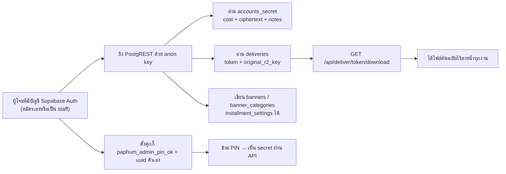

# Security Audit Report — PAPhum Shop & Studio

> **ขอบเขต:** ตรวจจาก source code ใน repository ทั้งหมด (`src/`, `supabase/`, `scripts/`, `tests/`, config) ณ วันที่ 18 พฤศจิกายน 2026
> **อัปเดต 18 พ.ย. 2026:** มี production dump แล้วที่ `supabase/migrations/DB.md` (ผลรัน `information_schema` + `pg_policies`) — ข้อที่ขึ้นกับ DB ในรายงานนี้ **ตรวจทานกับ production แล้ว** และระบุหลักฐาน `DB.md:<บรรทัด>` กำกับ
> **ระดับความรุนแรง:** Critical (ต้องแก้ก่อน deploy) → High (แก้ภายในสัปดาห์) → Medium (แก้ในรอบถัดไป) → Low (ปรับปรุง)

---

## 0. สรุปผู้บริหาร

| ระดับ | จำนวน | สาระสำคัญ |
|---|---|---|
| **Critical** | 4 | `accounts_secret` เปิดให้ผู้ใช้ที่ล็อกอินคนใดก็ได้, ลิงก์ส่งงานถูก enumerate ได้ (**ยืนยันใน production**), PIN ปลอมได้, รหัสผ่านถูกเก็บ plaintext ใน Google Sheets |
| **High** | 6 | อัปโหลดไฟล์อะไรก็ได้ด้วย session ใดก็ได้, PIN brute-force ได้, `banners`/`banner_categories`/`installment_settings` เปิดให้ authenticated ทุกคนเขียน (**ยืนยันใน production**), route ผลงานไม่มี role guard |
| **Medium** | 9 | ไม่มี CSRF, ไม่มี no-store, error รั่ว schema, formula injection, session lifecycle พัง, ไม่มี audit log |
| **Low** | 8 | DoS จาก URL ที่ผิดรูปแบบ, wildcard injection, ไม่มี noindex, URL แชร์ได้, ไม่มีตัวอย่าง env |

**ข้อสรุปสำคัญ:** ระบบออกแบบชั้นป้องกันไว้ 3 ชั้น (session → role → PIN) และทำได้ครบใน Route Handler ของ `accounts` แต่ **RLS บังคับ role เฉพาะตาราง `accounts`** (`DB.md:129`) ส่วน `accounts_secret`, `deliveries`, `banners`, `banner_categories`, `installment_settings` ยังมี policy `true` ให้ `authenticated` (`DB.md:125-145`) และ **PIN cookie ไม่มีลายเซ็น** ทำให้การป้องกันขึ้นกับสมมติฐานว่า "ผู้โจมตีจะไม่ยิง PostgREST ตรง และไม่ตั้งคุกกี้เอง" ซึ่งไม่ควรใช้เป็นสมมติฐานด้านความปลอดภัย



---

## 1. ตารางสรุปช่องโหว่ทั้งหมด 27 รายการ

| ID | ระดับ | ช่องโหว่ | ไฟล์หลัก |
|---|---|---|---|
| C-1 | Critical | RLS ให้ `authenticated` เข้าถึงทุกตารางแบบ `USING(true)` | `supabase/migrations/001_initial_schema.sql:122-133,141-181` |
| C-2 | Critical | RLS `deliveries` ให้ anon อ่านทุกแถวที่ยังไม่หมดอายุ | `001_initial_schema.sql:172-175` |
| C-3 | Critical | PIN cookie เก็บ `user.id` ดิบ ปลอมได้ | `src/app/api/admin/pin/route.ts:83,114` |
| C-4 | Critical | Google Sheets เก็บรหัสผ่าน/seed 2FA แบบ plaintext | `scripts/google-apps-script.js:4-23,39-60`; `src/lib/sheets-sync.ts:12-19` |
| H-1 | High | Presign ไม่ตรวจ MIME/ขนาด/role + `UNSIGNED-PAYLOAD` | `src/app/api/admin/upload/presign/route.ts:128-137,67` |
| H-2 | High | `quickStatusOnly` ถอดรหัส+ส่ง Sheets โดยไม่ต้อง PIN | `src/app/api/admin/accounts/[id]/route.ts:217-244` |
| H-3 | High | PIN ไม่มี rate limit/lockout (space 10⁶) | `src/app/api/admin/pin/route.ts:93-96` |
| H-4 | High | Schema drift ทำให้โมเดลสิทธิ์ใช้กับ DB จริงไม่ได้ | `001` ทั้งไฟล์ vs `src/app/admin/page.tsx:26`, `src/app/id/[code]/page.tsx:24` |
| H-5 | High | 3 route ผลงานเปิดให้ authenticated ทุกคนแก้/ลบ | `src/app/api/admin/banners/route.ts:14-22,340-347`; `banner-categories/route.ts:14-21` |
| H-6 | High | ไม่มี middleware/central guard + ไม่มี logout endpoint | glob ไม่พบ `middleware.*`; `AdminDashboardClient.tsx:198` |
| M-1 | Medium | ไม่มี CSRF token / ตรวจ Origin | ทุก state-changing route |
| M-2 | Medium | Response ที่มี secret ไม่มี `Cache-Control: no-store` | `[id]/route.ts:182` |
| M-3 | Medium | Error message รั่ว schema/Postgres/crypto | `accounts/route.ts:114,246`; `[id]:230,389` |
| M-4 | Medium | Formula injection เมื่อเขียนลง Google Sheets | `google-apps-script.js:82,107` |
| M-5 | Medium | ปุ่มล็อก PIN/logout/บันทึก settings เรียก endpoint ที่ไม่มี | `AdminDashboardClient.tsx:198,203,287` |
| M-6 | Medium | ลบ banner/category ไม่ลบ object ใน R2 + `category_ids` ค้าง | `banners/route.ts:349-355`; `banner-categories/route.ts:175-178` |
| M-7 | Medium | ไม่มี audit log การเข้าถึง secret/ลบข้อมูล | grep `audit` = 0 |
| M-8 | Medium | ไม่มี security headers (CSP/HSTS/X-Frame-Options) | `next.config.ts:3-15` |
| M-9 | Medium | เจ้าของ PIN อัปเดต `pin_hash` ตรง ๆ ผ่าน PostgREST ได้ | `001_initial_schema.sql:184-188` |
| L-1 | Low | `decodeURIComponent` ไม่มี try/catch → 500 | `src/app/id/[code]/page.tsx:19`; `banners/[slug]/page.tsx:21` |
| L-2 | Low | `ilike` ไม่ escape `%`/`_` | `src/app/id/[code]/page.tsx:28` |
| L-3 | Low | หน้า `/deliver` ไม่มี `noindex` | `src/app/deliver/[token]/page.tsx` |
| L-4 | Low | Presigned GET อายุ 1 ชม. แชร์ต่อได้ | `src/lib/r2.ts:139` |
| L-5 | Low | URL รูป/โลโก้ไม่ตรวจ scheme/domain | `accounts/route.ts:215-216`; `banners/route.ts:100` |
| L-6 | Low | `next_code = count + 1` ทำให้รหัสซ้ำ | `src/app/api/admin/banners/route.ts:27-38` |
| L-7 | Low | Download route ไม่มี rate limit | `src/app/api/deliver/[token]/download/route.ts` |
| L-8 | Low | ไม่มี `.env.example` และ `.gitignore` กลบ `.env*` ทั้งหมด | `.gitignore:34` |

---

## 2. Critical

### C-1 — RLS เปิดข้อมูลลับ (`accounts_secret`) และตารางงานให้ผู้ใช้ Supabase Auth ทุกคน

| หัวข้อ | รายละเอียด |
|---|---|
| **ระดับ** | Critical |
| **ไฟล์/บรรทัด** | **production:** `supabase/migrations/DB.md:125` (`accounts_secret` → `true`), `:130-132` (`deliveries` → `true`), `:136` (`installment_settings` → `true`), `:138-140` (`banners` → `true`), `:142-144` (`banner_categories` → `true`)<br>**ไฟล์ migration (ล้าสมัย):** `supabase/migrations/001_initial_schema.sql:129-133, 141-145, 153-157, 165-169, 177-181` |
| **พฤติกรรม** | policy ทั้ง 5 ชุดใช้ `FOR ALL TO authenticated USING (true) WITH CHECK (true)` — "authenticated" คือผู้ใช้ Supabase Auth **คนใดก็ได้** ไม่ได้ผูกกับ `admin_roles`<br>**ข้อยกเว้นที่ production ทำถูกแล้ว:** ตาราง `accounts` ใช้ policy owner-only ผ่าน `admin_roles` (`DB.md:129`) — ห้ามแก้ policy นี้ให้หลวมลง |
| **ผลกระทบ** | ใครสมัคร Supabase Auth ได้ก็อ่าน `accounts_secret` ทั้งตาราง: `cost` (ต้นทุน = กำไรจริงของร้าน), ciphertext ของรหัสผ่าน/seed 2FA, `private_notes` และแก้/ลบ `banners`, `banner_categories`, เปลี่ยนเรทผ่อนได้<br>**สิ่งที่อ่านไม่ได้แล้ว:** ตาราง `accounts` (owner-only) — แต่ ciphertext ชุดเดียวกันยังอยู่ใน `accounts_secret` |
| **ผลกระทบทางธุรกิจ** | ต้นทุนไอดีรั่วทันที; คู่แข่งรู้โครงสร้างราคา; ผลงานทั้งพอร์ตถูกลบได้ |

**วิธีแก้เชิงเทคนิค**

> **ห้ามสร้าง policy บน `accounts_public`** — มันเป็น **VIEW** (`DB.md:114-116`) การบังคับสิทธิ์ต้องทำที่ตารางฐาน `accounts` ซึ่ง production ทำถูกแล้ว (`DB.md:129`)
> **ต้อง drop policy ทุกชื่อเดิมก่อน** เพราะ production มีชื่อซ้ำหลายชุด (เช่น `deliveries` มี 4 policy) ถ้า drop ไม่ครบ ตัวที่เหลือจะยังเปิดอยู่
> รายการ `drop` ที่ครบทุกชื่ออยู่ใน `docs/05-database-normalize-and-optimize.md` §5.7 — ใช้ชุดนั้นแทนการเขียนใหม่

```sql
-- 1) ฟังก์ชันช่วย (ถ้ายังไม่มี)
create or replace function public.is_owner()
returns boolean language sql stable security definer set search_path = public as $$
  select exists (
    select 1 from public.admin_roles
    where user_id = auth.uid() and role = 'owner'
  );
$$;

-- 2) accounts_secret: owner เท่านั้น (ชื่อ policy อ้าง DB.md:125)
drop policy if exists "Admin full access on accounts_secret" on public.accounts_secret;
create policy "owner manage account secrets"
  on public.accounts_secret for all to authenticated
  using (public.is_owner()) with check (public.is_owner());

-- 3) banners / banner_categories / installment_settings: owner เขียน, ทุกคนอ่าน
drop policy if exists "Authenticated manage banners" on public.banners;
drop policy if exists "Admin full access on banners" on public.banners;
create policy "owner manage banners"
  on public.banners for all to authenticated
  using (public.is_owner()) with check (public.is_owner());

drop policy if exists "Authenticated manage banner categories" on public.banner_categories;
drop policy if exists "Admin full access on banner categories" on public.banner_categories;
create policy "owner manage categories"
  on public.banner_categories for all to authenticated
  using (public.is_owner()) with check (public.is_owner());

drop policy if exists "Admin can update installment settings" on public.installment_settings;
create policy "owner manage settings"
  on public.installment_settings for all to authenticated
  using (public.is_owner()) with check (public.is_owner());

-- 4) deliveries: ปิดการอ่านของ anon/authenticated (ดู C-2)
drop policy if exists "Public read active deliveries" on public.deliveries;
drop policy if exists "Public can read active deliveries" on public.deliveries;
drop policy if exists "Authenticated manage deliveries" on public.deliveries;
drop policy if exists "Admin full access on deliveries" on public.deliveries;
create policy "owner manage deliveries"
  on public.deliveries for all to authenticated
  using (public.is_owner()) with check (public.is_owner());
```

**ตรวจซ้ำ:** anon ต้องไม่มีสิทธิ์เขียนตารางใดเลย และ **อย่าแตะ policy ของ `accounts`** ที่ทำถูกอยู่แล้ว

```sql
select tablename, policyname, roles, cmd, qual
from pg_policies where schemaname = 'public'
order by tablename, policyname;
```

**เกณฑ์ผ่าน:** `set role authenticated; select * from public.accounts_secret;` ต้องได้ 0 แถว (สำหรับ user ที่ไม่ได้อยู่ใน `admin_roles`)

---

### C-2 — Enumerate token ส่งงานได้ทั้งหมดผ่าน anon key

| หัวข้อ | รายละเอียด |
|---|---|
| **ระดับ** | Critical |
| **ไฟล์/บรรทัด** | **production (ยืนยันแล้ว):** `supabase/migrations/DB.md:131` และ `:133` — มี **2 policy ซ้ำ** ที่ให้ `anon, authenticated` อ่าน `USING (expires_at > now())`<br>**ไฟล์ migration:** `supabase/migrations/001_initial_schema.sql:172-175` |
| **พฤติกรรม** | policy ทั้งสองไม่มีเงื่อนไข token — ใครถือ anon key อ่าน `deliveries` ได้ทุกแถวที่ยังไม่หมดอายุ |
| **ผลกระทบ** | anon key อยู่ใน bundle อยู่แล้ว (`src/lib/supabase/server.ts:9`, `AdminLoginForm.tsx:15`) → ใครก็ยิง `GET /rest/v1/deliveries?select=token,original_r2_key,original_filename` แล้วได้ทุกงานที่ยังไม่หมดอายุ จากนั้นเรียก `/api/deliver/{token}/download` เพื่อรับ presigned URL ของไฟล์ต้นฉบับ |
| **ทำไมร้ายแรง** | ทำให้ "secret link 128 บิต" ไม่มีความหมาย และไฟล์ที่ลูกค้าจ่ายเงินซื้อถูกดาวน์โหลดได้ฟรี |

**วิธีแก้**

```sql
-- ต้อง drop ให้ครบทั้ง 2 ชื่อ (production มีซ้ำ)
drop policy if exists "Public read active deliveries" on public.deliveries;
drop policy if exists "Public can read active deliveries" on public.deliveries;
drop policy if exists "Authenticated manage deliveries" on public.deliveries;
drop policy if exists "Admin full access on deliveries" on public.deliveries;

-- ลบสิทธิ์ anon ทั้งหมดบนตารางนี้
revoke all on public.deliveries from anon;

-- ให้เฉพาะ owner ผ่าน server (route handler ที่มี service role หรือ security definer function)
create policy "owner manage deliveries"
  on public.deliveries for all to authenticated
  using (public.is_owner()) with check (public.is_owner());
```

และเปลี่ยน download route ให้ใช้ **service role client เฉพาะฝั่ง server** (ไม่ใช่ anon client ที่รับผลจาก RLS) พร้อมเพิ่ม rate limit ต่อ IP/token

```ts
// แนวทาง: ตรวจ token + expiry ด้วย service role แล้วจึง presign
const admin = createClient(process.env.NEXT_PUBLIC_SUPABASE_URL!, process.env.SUPABASE_SERVICE_ROLE_KEY!);
const { data } = await admin.from('deliveries')
  .select('original_r2_key, original_filename, expires_at')
  .eq('token', token).gt('expires_at', new Date().toISOString()).maybeSingle();
```

> ทางเลือกที่เบากว่า: เก็บ delivery ใน Redis/KV ที่ผูก token → key และไม่ให้ anon อ่านตารางได้เลย

---

### C-3 — PIN cookie ปลอมได้ (ไม่มีลายเซ็น)

| หัวข้อ | รายละเอียด |
|---|---|
| **ระดับ** | Critical |
| **ไฟล์/บรรทัด** | ตั้งค่า `src/app/api/admin/pin/route.ts:83-89` และ `:114-120`; ตรวจสอบ `src/app/api/admin/accounts/route.ts:32-35`, `src/app/api/admin/accounts/[id]/route.ts:28-31`, `src/app/api/admin/pin/route.ts:26` |
| **พฤติกรรม** | คุกกี้ `paphum_admin_pin_ok` เก็บค่า `user.id` ตรง ๆ และ server ตรวจด้วย `cookie === user.id` |
| **ผลกระทบ** | UUID ของตัวเอง decode ได้จาก JWT `sub` (Supabase session ฝั่ง browser) → owner ที่มี session ตั้งคุกกี้เองได้ทันที ไม่ต้องรู้ PIN |
| **ปัจจัยซ้ำเติม** | `maxAge = 30 วัน` (`:7`) และ `path:'/'` ส่งคุกกี้ไปทุกหน้า |

**วิธีแก้**

```ts
// src/lib/pin-token.ts (ใหม่)
import crypto from 'node:crypto';
const SECRET = process.env.PIN_TOKEN_SECRET!;   // ต้องเป็น secret แยกจาก ENCRYPTION_SECRET_KEY

export function signPinToken(userId: string, pinVersion: number, ttlSeconds = 900) {
  const exp = Math.floor(Date.now() / 1000) + ttlSeconds;
  const payload = `${userId}.${pinVersion}.${exp}`;
  const sig = crypto.createHmac('sha256', SECRET).update(payload).digest('hex');
  return `${payload}.${sig}`;
}

export function verifyPinToken(token: string | undefined, userId: string, pinVersion: number) {
  if (!token) return false;
  const parts = token.split('.');
  if (parts.length !== 4) return false;
  const [uid, ver, exp, sig] = parts;
  if (uid !== userId || Number(ver) !== pinVersion) return false;
  if (Number(exp) < Math.floor(Date.now() / 1000)) return false;
  const expected = crypto.createHmac('sha256', SECRET)
    .update(`${uid}.${ver}.${exp}`).digest('hex');
  return crypto.timingSafeEqual(Buffer.from(sig), Buffer.from(expected));
}
```

- เพิ่มคอลัมน์ `pin_version int not null default 0` ใน `admin_security` และเพิ่มค่าเมื่อเปลี่ยน PIN → token เก่าใช้ไม่ได้ทันที
- ลด `maxAge` เหลือ 900–3600 วินาที
- ตรวจ token ด้วย `timingSafeEqual` ทุกจุด (สร้าง helper กลาง `requireOwnerWithPin()` แทนการเขียนซ้ำ 3 ที่)

---

### C-4 — Google Sheets เก็บ credential แบบ plaintext

| หัวข้อ | รายละเอียด |
|---|---|
| **ระดับ** | Critical |
| **ไฟล์/บรรทัด** | `scripts/google-apps-script.js:4-23` (หัวคอลัมน์), `:39-60` (เขียนค่า), `src/lib/sheets-sync.ts:12-19` (payload), `src/app/api/admin/accounts/route.ts:68-85` (ถอดรหัสก่อนส่ง), `src/app/api/admin/accounts/[id]/route.ts:89-135` |
| **พฤติกรรม** | ระบบถอดรหัส Garena password, Gmail password, seed 2FA, รหัสกู้ 8 หลัก, ต้นทุน แล้วส่งเป็น JSON ไป Apps Script ซึ่งเขียนลงชีตตรง ๆ |
| **ผลกระทบ** | ชีตกลายเป็น credential store ที่ป้องกันด้วยสิทธิ์ Google account เท่านั้น; ถ้าชีตถูกแชร์/ถูกบุกรุก/ถูกเปิดใน log → ไอดีทั้งหมดถูกยึด; ขัดกับจุดประสงค์ของ AES ทั้งระบบ |
| **ปัจจัยซ้ำเติม** | secret ของ webhook ส่งใน body (`sheets-sync.ts:37`) และถูกบันทึกใน execution log ของ Apps Script |

**วิธีแก้ (เลือกอย่างใดอย่างหนึ่ง)**

1. **แนะนำ:** ส่งเฉพาะข้อมูลที่จำเป็นต่อการปฏิบัติงาน ได้แก่ `code`, `status`, `price`, `cost`, `updated_at` — ไม่ส่ง credential ใด ๆ
2. ถ้าจำเป็นต้องสำรอง credential ให้เข้ารหัสด้วยกุญแจแยกก่อนส่ง (เช่น `encryptSecret()` แล้วส่ง ciphertext) และเก็บกุญแจไว้นอกชีต
3. ย้าย secret ไป header + ใช้ HMAC signature + timestamp กัน replay

```ts
// ตัวอย่าง: ส่งเฉพาะ non-secret
const payload = { code, status, price, cost, updated_at };
```

---

## 3. High

### H-1 — Presigned upload ไม่มีการตรวจชนิด/ขนาด/สิทธิ์

| หัวข้อ | รายละเอียด |
|---|---|
| **ระดับ** | High |
| **ไฟล์/บรรทัด** | `src/app/api/admin/upload/presign/route.ts:97-104` (แค่ session), `:128-137` (body), `:57,67` (`host` + `UNSIGNED-PAYLOAD`) |
| **พฤติกรรม** | รับ `folder`/`filename` จาก client, สร้าง key จาก `Date.now() + UUID + ext` โดย ext มาจาก regex `[a-zA-Z0-9]+` ไม่มี allowlist; ไม่ตรวจ `contentType`, ไม่จำกัดขนาด, ไม่มี role/PIN |
| **ผลกระทบ** | authenticated คนใดก็ได้อัปโหลด `.html`/`.svg`/ไฟล์ขนาดเท่าไรก็ได้เข้าถึง bucket; ถ้า CDN เสิร์ฟตาม Content-Type อาจเกิด stored XSS บนโดเมน CDN; เปลือง storage |
| **หมายเหตุ** | `src/lib/r2.ts:58-60` มี `isAllowedImageMimeType()` แต่ **ไม่มีผู้เรียกใน production** |

**วิธีแก้**

```ts
const ALLOWED_MIME = new Set(['image/webp', 'image/png', 'image/jpeg']);
const ALLOWED_EXT = new Set(['webp', 'png', 'jpg', 'jpeg']);
const ALLOWED_FOLDERS = new Set(['portfolio', 'accounts', 'temp-deliveries']);

if (!ALLOWED_MIME.has(String(body.contentType))) return err400('ชนิดไฟล์ไม่รองรับ');
if (!ALLOWED_EXT.has(ext)) return err400('นามสกุลไฟล์ไม่รองรับ');
if (!ALLOWED_FOLDERS.has(folder)) return err400('folder ไม่ถูกต้อง');

// ใช้ SDK แทนการเซ็นเอง เพื่อผูก ContentType/ContentLength เข้า signature
const cmd = new PutObjectCommand({
  Bucket: bucketName, Key: key,
  ContentType: body.contentType,
  ContentLength: Number(body.size),           // ตรวจ ≤ 10 * 1024 * 1024
});
const uploadUrl = await getSignedUrl(s3, cmd, { expiresIn: 300 });
```

พร้อมเปิด R2 lifecycle rule ลบ `temp-deliveries/` ที่เก่ากว่า 7 วัน

---

### H-2 — `quickStatusOnly` ถอดรหัสและส่งออกนอกระบบโดยไม่ต้อง PIN

| หัวข้อ | รายละเอียด |
|---|---|
| **ระดับ** | High |
| **ไฟล์/บรรทัด** | `src/app/api/admin/accounts/[id]/route.ts:217-244` (โดยเฉพาะ `:238` ที่เรียก `syncAccountToSheets`) |
| **พฤติกรรม** | สาขา `quickStatusOnly` ถูกออกแบบให้เปลี่ยนสถานะเร็วโดยไม่ต้อง PIN แต่โค้ดยังเรียก `decryptAccountRow()` และส่ง plaintext ไป Sheets |
| **ผลกระทบ** | owner ที่ไม่รู้ PIN ยังทำให้ credential ถูกส่งออกนอกระบบได้ (และเกิด plaintext ใน log/ชีต) |
| **หลักฐานเทียบ** | path ปกติต้อง PIN ที่ `:247-253` — สาขานี้ข้ามไป |

**วิธีแก้**

```ts
if (body.quickStatusOnly) {
  // อัปเดตเฉพาะ status ไม่ต้อง decrypt
  const { error } = await supabase.from('accounts')
    .update({ status: body.status, updated_at: new Date().toISOString() })
    .eq('id', id);
  if (error) return NextResponse.json({ error: 'อัปเดตไม่สำเร็จ' }, { status: 400 });

  // ส่งเฉพาะฟิลด์ที่ไม่ลับ
  void syncAccountToSheets('upsert', { code: row.code, status: body.status });
  return NextResponse.json({ ok: true });
}
```

---

### H-3 — PIN เดาได้ไม่จำกัดจำนวนครั้ง

| หัวข้อ | รายละเอียด |
|---|---|
| **ระดับ** | High |
| **ไฟล์/บรรทัด** | `src/app/api/admin/pin/route.ts:93-96` (ตอบ 403 พร้อมแยกแยะ), `:55-60`; ไม่มีตาราง/ตัวนับใด ๆ |
| **พฤติกรรม** | ไม่มี rate limit, lockout, captcha, audit; PIN มี 6 หลัก = 1,000,000 ค่า; scrypt ~50–100 ms/ครั้ง |
| **ผลกระทบ** | เดาแบบขนานหลาย connection ทำได้ในหลักชั่วโมง และเมื่อสำเร็จจะได้ cookie ที่ใช้ได้ 30 วัน |
| **หมายเหตุ** | แม้ C-3 ทำให้ไม่ต้องเดา PIN แต่ต้องแก้ทั้งสองข้อ |

**วิธีแก้**

```sql
alter table public.admin_security
  add column failed_attempts int not null default 0,
  add column locked_until timestamptz;

create table public.admin_pin_attempts (
  id bigserial primary key,
  user_id uuid not null references auth.users(id) on delete cascade,
  ip text,
  success boolean not null,
  created_at timestamptz not null default now()
);
create index on public.admin_pin_attempts (user_id, created_at desc);
```

- ผิด 5 ครั้ง → `locked_until = now() + interval '15 minutes'`
- ผิด 10 ครั้ง → บังคับ login ใหม่ + แจ้งเตือน
- ใช้ IP + user id ในการนับ และเพิ่ม delay แบบ exponential

---

### H-4 — ไฟล์ migration ไม่ตรงกับ production (Schema Drift)

| หัวข้อ | รายละเอียด |
|---|---|
| **ระดับ** | High |
| **ไฟล์/บรรทัด** | **production ตรงกับโค้ด:** `supabase/migrations/DB.md:16-41` (`accounts`), `:68-71` (`admin_roles`), `:114-116` (view `accounts_public`) vs โค้ด `src/app/id/[code]/page.tsx:24`, `src/app/admin/page.tsx:67`, `src/app/api/admin/accounts/route.ts:159,241`, `[id]/route.ts:172,224,312,379`<br>**ไฟล์ที่ล้าสมัย:** `001_initial_schema.sql:5-41` (แยก `accounts_public` + `accounts_secret`, ไม่มี `accounts`/`admin_roles`, CHECK ตัวพิมพ์เล็กที่ `:8`) |
| **พฤติกรรม** | ความจริงคือ production ใช้ `accounts` (ตารางเดียว) + view `accounts_public` + `admin_roles` แต่ไฟล์ `001` เขียนอีกแบบ → ใครอ่าน/รันไฟล์ 001 จะเข้าใจผิดและอาจสร้างตารางซ้ำหรือแก้สถานะเป็นตัวพิมพ์เล็ก |
| **ผลกระทบ** | ถ้ามีคนรัน `001` บน production: `create table accounts_public` จะล้มเหลว (มี view ชื่อนี้) หรือถ้า drop view ทิ้ง → `/store` พัง; ถ้าแก้ `status` เป็น lowercase → view กรองไม่เจอข้อมูลทั้งหมด; ถ้าแก้ CHECK เป็น lowercase → INSERT จากแอป (PascalCase) ล้มเหลวทุกครั้ง |
| **เชิงความปลอดภัย** | policy ของ `accounts` ใน production บังคับ owner ถูกต้อง (`DB.md:129`) แต่ถ้า agent สร้าง policy ใหม่จากไฟล์ 001 (`USING(true)`) จะเปิดตารางที่มี ciphertext ให้ทุกคนอ่าน |

**วิธีแก้**

1. **ถือ `supabase/migrations/DB.md` เป็นแหล่งความจริง** และถือ `001_initial_schema.sql` เป็นเอกสารประวัติ (ห้ามรันซ้ำ)
2. งาน schema ใหม่ทั้งหมดให้ใช้ migration **`003_*.sql` ขึ้นไป** และใช้ `add column if not exists` — **ห้าม recreate ตาราง/วิวที่มีอยู่**
3. ถ้าจะล็อกโดเมนสถานะ ให้สร้าง enum ด้วย **PascalCase** (`'Unavailable','Available','Installment','SoldOut'`) และ drop/recreate view ตามลำดับ (SQL อยู่ใน `docs/05` §5.1) — **ห้ามใช้ lowercase**
4. เพิ่ม integration test ที่ query `information_schema.columns` เทียบกับรายการคอลัมน์ที่โค้ดใช้ เพื่อจับ drift ใน CI

> **หมายเหตุ:** ก่อนมี `DB.md` รายงานนี้เคยสรุปว่า migration คือความจริง — ข้อสรุปนั้นถูกกลับแล้วด้วยหลักฐานจาก production dump

---

### H-5 — Route ผลงานเปิดให้ authenticated ทุกคนแก้/ลบ

| หัวข้อ | รายละเอียด |
|---|---|
| **ระดับ** | High |
| **ไฟล์/บรรทัด** | `src/app/api/admin/banners/route.ts:14-22, 63-70, 172-179, 340-347`; `src/app/api/admin/banner-categories/route.ts:14-21, 59-66, 105-112, 160-167`; `src/app/api/admin/upload/presign/route.ts:97-104` |
| **พฤติกรรม** | ทั้ง 9 handler ตรวจแค่ `auth.getUser()` ไม่มี `requireOwner` และไม่มี PIN — ต่างจาก `accounts` ที่มีครบ |
| **ยืนยันกับ production** | ไม่มีชั้น DB กันให้ด้วย: `banners` และ `banner_categories` มี policy `true` ให้ `authenticated` (`supabase/migrations/DB.md:138-144`) → ยิง PostgREST ตรงก็ลบได้โดยไม่ต้องผ่าน route เลย |
| **ผลกระทบ** | บัญชีที่ล็อกอินได้แต่ไม่ใช่แอดมิน (หรือ staff ที่ถูกจำกัดสิทธิ์ใน UI) ยิง API ลบผลงานทั้งพอร์ต, เปลี่ยนชื่อหมวด, อัปโหลดไฟล์ได้ |
| **ผลกระทบทางธุรกิจ** | ข้อมูลผลงานซึ่งเป็นสินทรัพย์หลักของสตูดิโอสูญหายได้ |

**วิธีแก้:** สร้าง helper กลาง `src/lib/auth/guard.ts`

```ts
export async function requireAdmin(supabase: SupabaseClient, opts?: { ownerOnly?: boolean; pin?: boolean }) {
  const { data: { user } } = await supabase.auth.getUser();
  if (!user) return { error: json(401, 'Unauthorized') };
  const { data: role } = await supabase.from('admin_roles').select('role').eq('user_id', user.id).maybeSingle();
  if (!role) return { error: json(403, 'Forbidden') };
  if (opts?.ownerOnly && role.role !== 'owner') return { error: json(403, 'เฉพาะ Owner') };
  if (opts?.pin && !(await verifyPinCookie(user.id))) return { error: json(403, 'ต้องปลดล็อก PIN') };
  return { user, role: role.role };
}
```

แล้วเรียกใช้ทุก route (banners = `requireAdmin` อย่างน้อย, ลบข้อมูล = `ownerOnly`)

---

### H-6 — ไม่มีชั้นป้องกันกลาง และไม่มีการออกจากระบบจริง

| หัวข้อ | รายละเอียด |
|---|---|
| **ระดับ** | High |
| **ไฟล์/บรรทัด** | glob `middleware.*` = ไม่พบ; glob `src/app/admin/layout.tsx` = ไม่พบ; `src/components/admin/AdminDashboardClient.tsx:198` เรียก `/api/admin/logout` ที่ไม่มี; `src/app/api/admin/pin/route.ts` ไม่มี `DELETE` |
| **พฤติกรรม** | ทุก route ต้องป้องกันตัวเอง (ทำไม่สม่ำเสมอ ตาม H-5); การ logout ไม่ล้าง session/cookie; การล็อก PIN ตอบ 405 |
| **ผลกระทบ** | ผู้ใช้ที่เลิกใช้งานแล้วยังคงมี session + PIN 30 วันบนเครื่องสาธารณะ; ไม่มีจุดเดียวที่ตรวจสิทธิ์ทำให้พลาดได้ง่าย |

**วิธีแก้**

1. สร้าง `src/proxy.ts` หรือ `middleware.ts` ตรวจ `/admin` และ `/api/admin/*` (ยกเว้น `/api/admin/pin` ตอน login) → 401/redirect
2. สร้าง `POST /api/admin/logout` ที่เรียก `supabase.auth.signOut()` + `res.cookies.delete('paphum_admin_pin_ok')`
3. แก้ client ให้ล็อก PIN ด้วย `POST /api/admin/pin` body `{action:'lock'}` (มีอยู่แล้วที่ `:49-53`)

---

## 4. Medium

### M-1 — ไม่มี CSRF token และไม่ตรวจ Origin

| หัวข้อ | รายละเอียด |
|---|---|
| **ระดับ** | Medium |
| **ไฟล์/บรรทัด** | ทุก state-changing route: `accounts/route.ts:127`, `[id]/route.ts:191,347`, `banners/route.ts:62,171,339`, `banner-categories/route.ts:58,104,159`, `pin/route.ts:34` |
| **พฤติกรรม** | ไม่มี token, ไม่มี double-submit, ไม่ตรวจ `Origin`/`Referer`; พึ่ง `SameSite` ของคุกกี้ |
| **ความเสี่ยงจริง** | PIN cookie เป็น `strict` (`pin/route.ts:85`) ช่วยได้ระดับหนึ่ง แต่ session ของ Supabase ไม่ได้ตั้ง `sameSite` ใน `src/lib/supabase/server.ts:11-24` (ใช้ default ของ `@supabase/ssr`) |

**วิธีแก้:** ตรวจ `Origin` เทียบกับ `NEXT_PUBLIC_SITE_URL` ในทุก mutating request + เพิ่ม double-submit cookie token

```ts
const origin = req.headers.get('origin');
if (origin !== process.env.NEXT_PUBLIC_SITE_URL) {
  return NextResponse.json({ error: 'Invalid origin' }, { status: 403 });
}
```

---

### M-2 — Secret JSON ไม่มี `Cache-Control: no-store`

| หัวข้อ | รายละเอียด |
|---|---|
| **ระดับ** | Medium |
| **ไฟล์/บรรทัด** | `src/app/api/admin/accounts/[id]/route.ts:182` (และทุก response ที่มี secret) |
| **พฤติกรรม** | ไม่มีการตั้ง header ใด ๆ → อาจถูก cache โดย proxy/CDN หรือ browser bfcache |
| **วิธีแก้** | `return NextResponse.json({ secret }, { headers: { 'Cache-Control': 'no-store, max-age=0' } })` |

---

### M-3 — Error message รั่วโครงสร้างภายใน

| หัวข้อ | รายละเอียด |
|---|---|
| **ระดับ** | Medium |
| **ไฟล์/บรรทัด** | `accounts/route.ts:114-116, 246-248, 119-123`; `[id]/route.ts:230-235, 318-323, 389-391, 183-188` |
| **พฤติกรรม** | ส่ง `error.message` ของ PostgREST/Postgres และ `err.message` ของ crypto กลับ client |
| **ผลกระทบ** | ผู้โจมตีเรียนรู้ชื่อ constraint/คอลัมน์, ยืนยันว่ามี `ENCRYPTION_SECRET_KEY` ตั้งผิด ฯลฯ |
| **วิธีแก้** | log รายละเอียดฝั่ง server (พร้อม request id) แล้วตอบข้อความกลาง `{ error: 'ดำเนินการไม่สำเร็จ', code: 'ACCOUNT_UPDATE_FAILED' }` |

---

### M-4 — Formula injection ใน Google Sheets

| หัวข้อ | รายละเอียด |
|---|---|
| **ระดับ** | Medium |
| **ไฟล์/บรรทัด** | `scripts/google-apps-script.js:39-60`, `:82`, `:107` |
| **พฤติกรรม** | เขียนค่าจาก `password`, `private_notes`, `code` ลงชีตด้วย `setValues()` โดยไม่ escape |
| **ผลกระทบ** | ค่าที่เริ่มด้วย `=`, `+`, `-`, `@` กลายเป็นสูตร (อาจ exfiltrate ข้อมูลหรือทำให้ชีตเพี้ยน) |
| **วิธีแก้** | prefix ด้วย `'` เมื่อค่าเริ่มด้วยอักขระเหล่านั้น หรือใช้ `setValue` กับ `setNumberFormat('@')` |

```js
const safe = (v) => {
  const s = String(v ?? '');
  return /^[=+\-@\t\r]/.test(s) ? `'${s}` : s;
};
```

---

### M-5 — Session lifecycle ไม่ทำงาน (logout / lock / settings)

| หัวข้อ | รายละเอียด |
|---|---|
| **ระดับ** | Medium |
| **ไฟล์/บรรทัด** | `AdminDashboardClient.tsx:198` (logout), `:203` (ล็อก PIN), `:287` (settings) |
| **พฤติกรรม** | เรียก endpoint ที่ไม่มีอยู่ → 404/405 และ `catch(() => null)` กลืน error |
| **ผลกระทบ** | ผู้ใช้คิดว่าออกจากระบบแล้วแต่ session ยังอยู่; PIN ยังคง unlocked 30 วัน; ไม่สามารถบันทึกเรทผ่อนได้เลย |
| **วิธีแก้** | ตาม H-6 + สร้าง `/api/admin/settings` ที่ตรวจ owner และอัปเดต `installment_settings` |

---

### M-6 — ลบข้อมูลแล้ว object ใน R2 และ FK เชิง array ค้าง

| หัวข้อ | รายละเอียด |
|---|---|
| **ระดับ** | Medium |
| **ไฟล์/บรรทัด** | `banners/route.ts:349-355` (DELETE ไม่ลบ R2), `banner-categories/route.ts:175-178` (ไม่ล้าง `category_ids`), `src/lib/r2.ts:145-159` (`deleteR2Object` ไม่มีผู้เรียก) |
| **ผลกระทบ** | ต้นทุน storage โตถาวร; ไฟล์ต้นฉบับลูกค้าค้างใน bucket เกิน 7 วัน (ขัดกับคอมเมนต์ `001:83`); banner ที่อ้างหมวดที่ลบแล้วล่องหนแต่ยังนับในยอดรวม |
| **วิธีแก้** | ใน DELETE handler: อ่าน `watermarked_url`/`original_r2_key` ก่อนลบ แล้วเรียก `deleteR2Object()`; เพิ่ม trigger/ฟังก์ชันล้าง `category_ids` เมื่อลบหมวด; ตั้ง lifecycle rule ที่ bucket |

---

### M-7 — ไม่มี audit log

| หัวข้อ | รายละเอียด |
|---|---|
| **ระดับ** | Medium |
| **ไฟล์/บรรทัด** | grep `audit` ใน `src/` = 0; ไม่มีตาราง audit ใน production (`supabase/migrations/DB.md:14-41` = รายการตารางทั้งหมด) และไม่มีใน `001` |
| **ผลกระทบ** | เมื่อ secret รั่วจะไม่รู้ว่าใครเข้าถึง/แก้เมื่อไร; ไม่ผ่านข้อกำหนดพื้นฐานของระบบที่เก็บ credential |
| **วิธีแก้** | ตาราง `admin_audit_log(id, user_id, action, target_table, target_id, ip, user_agent, created_at, meta jsonb)` + เขียนทุกครั้งที่มีการอ่าน secret/ลบ/แก้ role |

---

### M-8 — ไม่มี security headers

| หัวข้อ | รายละเอียด |
|---|---|
| **ระดับ** | Medium |
| **ไฟล์/บรรทัด** | `next.config.ts:3-15` (ไม่มี `headers()`), ไม่มี `vercel.json`, ไม่มี middleware |
| **ผลกระทบ** | ไม่มี CSP กัน XSS, ไม่มี HSTS, ไม่มี `X-Frame-Options` → คลิกแจ็กกิ้งหน้า admin ได้ |
| **วิธีแก้**

```ts
const nextConfig: NextConfig = {
  cacheComponents: true,
  partialPrefetching: true,
  async headers() {
    return [{
      source: '/:path*',
      headers: [
        { key: 'X-Frame-Options', value: 'DENY' },
        { key: 'X-Content-Type-Options', value: 'nosniff' },
        { key: 'Referrer-Policy', value: 'strict-origin-when-cross-origin' },
        { key: 'Strict-Transport-Security', value: 'max-age=63072000; includeSubDomains; preload' },
        { key: 'Permissions-Policy', value: 'camera=(), microphone=(), geolocation=()' },
      ],
    }];
  },
};
```

> CSP ต้องทำหลังย้ายจาก `` นอกโดเมน/CDN ให้ครบก่อน มิฉะนั้นรูปจะถูกบล็อก

---

### M-9 — PIN hash ถูกแก้ตรง ๆ ผ่าน PostgREST ได้

| หัวข้อ | รายละเอียด |
|---|---|
| **ระดับ** | Medium |
| **ไฟล์/บรรทัด** | **production:** `supabase/migrations/DB.md:127-128` — มี **2 policy ซ้ำ** ที่ให้เจ้าของแถว `ALL` บน `admin_security`<br>**ไฟล์ migration:** `001_initial_schema.sql:184-188` (`FOR ALL USING (auth.uid() = user_id)`) |
| **พฤติกรรม** | เจ้าของแถวสามารถ `PATCH /rest/v1/admin_security` เปลี่ยน `pin_hash`/`pin_salt` ของตัวเองได้โดยไม่ต้องยืนยัน PIN เดิม (ทั้ง 2 policy อนุญาตเหมือนกัน — drop ต้องครบทั้งคู่) |
| **ผลกระทบ** | ข้ามขั้นตอน "เปลี่ยน PIN ต้องรู้ PIN เดิม" (ซึ่ง route ทำถูกที่ `pin/route.ts:93-111`) |
| **วิธีแก้** | ให้ `SELECT` อย่างเดียวแก่เจ้าของ และเขียนผ่าน RPC `security definer` ที่ตรวจ PIN เดิม (หรือให้ service role เขียนเท่านั้น) |

---

## 5. Low

| ID | ช่องโหว่ | ไฟล์/บรรทัด | พฤติกรรม | วิธีแก้ |
|---|---|---|---|---|
| L-1 | `decodeURIComponent` ไม่มี try/catch | `src/app/id/[code]/page.tsx:19`; `src/app/banners/[slug]/page.tsx:21` | URL มี `%` เดี่ยว → `URIError` → 500 | ครอบ try/catch แล้ว `notFound()` |
| L-2 | `ilike` ไม่ escape wildcard | `src/app/id/[code]/page.tsx:28` | `%`/`_` ใน code กลายเป็น pattern | escape `%`, `_`, `\` ก่อนส่ง หรือใช้ `.eq` กับ code ที่ normalize แล้ว |
| L-3 | `/deliver` ไม่มี noindex | `src/app/deliver/[token]/page.tsx` | ลิงก์ส่วนตัวอาจถูก index/แชร์โดย search engine | เพิ่ม `export const metadata = { robots: { index: false, follow: false } }` |
| L-4 | Presigned GET อายุ 1 ชม. | `src/lib/r2.ts:139` | URL ที่ได้แชร์ต่อได้โดยไม่ต้องใช้ token | ลดเหลือ 60–120 วินาที และ/หรือ proxy stream ผ่าน server |
| L-5 | URL รูป/โลโก้ไม่ตรวจ scheme | `accounts/route.ts:215-216`; `banners/route.ts:100`; `banner-categories/route.ts:90` | รับ `javascript:`/โดเมนภายนอกได้ (React `` ไม่ execute JS แต่ hotlink ได้) | allowlist host = `R2_PUBLIC_URL` และบังคับ `https:` |
| L-6 | `next_code = count + 1` | `banners/route.ts:27-38` | ลบงานแล้วรหัสซ้ำ / อัปโหลดพร้อมกันได้เลขซ้ำ | ใช้ sequence หรือ unique constraint + retry |
| L-7 | Download ไม่มี rate limit | `deliver/[token]/download/route.ts` | ถูกยิงถี่เพื่อสร้าง presign จำนวนมาก | rate limit ต่อ IP + token (เช่น 10 ครั้ง/นาที) |
| L-8 | ไม่มี `.env.example` | `.gitignore:34` | ผู้พัฒนาใหม่ตั้งค่าผิด/ใช้ค่าตัวอย่างปนกัน | เพิ่ม `!.env.example` และเอกสาร key ที่ต้องมี |

---

## 6. ตารางตรวจสิทธิ์ของทุก API (Auth Matrix)

| Endpoint | Session | Role owner | PIN | ตรวจ input | no-store | rate limit |
|---|---|---|---|---|---|---|
| `GET /api/admin/accounts` | ✅ | ✅ | — | — | ❌ | ❌ |
| `POST /api/admin/accounts` | ✅ | ✅ | ✅ | บางส่วน | ❌ | ❌ |
| `GET /api/admin/accounts/[id]` | ✅ | ✅ | ✅ | — | ❌ | ❌ |
| `PATCH /api/admin/accounts/[id]` | ✅ | ✅ | ✅ (ยกเว้น quickStatus) | บางส่วน | ❌ | ❌ |
| `DELETE /api/admin/accounts/[id]` | ✅ | ✅ | ✅ | — | — | ❌ |
| `GET/POST /api/admin/pin` | ✅ | ❌ | — | regex 6 หลัก | — | ❌ |
| `GET/POST/PATCH/DELETE /api/admin/banners` | ✅ | ❌ | ❌ | บางส่วน | — | ❌ |
| `GET/POST/PATCH/DELETE /api/admin/banner-categories` | ✅ | ❌ | ❌ | บางส่วน | — | ❌ |
| `POST /api/admin/upload/presign` | ✅ | ❌ | ❌ | ❌ | — | ❌ |
| `GET /api/deliver/[token]/download` | token | — | — | token + expiry | — | ❌ |

---

## 7. จุดที่ตรวจแล้วไม่พบช่องโหว่ (เพื่อความเป็นธรรม)

| รายการ | ผลการตรวจ |
|---|---|
| XSS จาก HTML | ไม่มี `dangerouslySetInnerHTML`, `innerHTML`, `eval(`, `new Function` ใน `src/` เลย; description แสดงเป็น text (`AccountDetailClient.tsx:199-203`) |
| SQL Injection | ใช้ Supabase query builder ทั้งหมด ไม่มี raw SQL ต่อ string |
| Service role รั่วไป client | `SUPABASE_SERVICE_ROLE_KEY` ใช้เฉพาะ `scripts/migrate-banners.ts:108,124` — grep ใน `src/` = 0 |
| IV reuse ใน AES | สุ่ม 12 bytes ใหม่ทุกครั้ง (`crypto.ts:25`) และมีเทสต์ยืนยัน ciphertext ต่างกัน (`tests/lib/crypto.test.ts:24-32`) |
| PIN hash timing | ใช้ `timingSafeEqual` (`crypto.ts:96`) ✅ |
| Path traversal ใน presign | `folder` ถูกตัดอักขระนอก `[a-zA-Z0-9_-]`, ext มาจาก regex ไม่มี `/` หรือ `.` (`presign/route.ts:131-135`) ✅ |
| Header injection ใน download | ตัด `"` `\` CR LF (`r2.ts:132-137`) ✅ |
| Token entropy | `randomBytes(16)` = 128 บิต (`banners/route.ts:149`) ✅ |
| Secret columns ถึง client | ไม่มี query ใดดึง secret ไปยัง client component โดยไม่มี owner+PIN gate |
| Logging secret | ไม่มี `console.*` ใน `src/` เลย |

---

## 8. ลำดับการแก้ไขที่แนะนำ (72 ชั่วโมงแรก)

| ลำดับ | งาน | ไฟล์ | เวลา |
|---|---|---|---|
| 1 | ปิด policy `USING(true)` ที่เหลือ + ใช้ `is_owner()` (production มี `admin_roles` แล้ว — `DB.md:68-71`) | migration ใหม่ `003+` | 2–3 ชม. |
| 2 | ลบ policy anon ของ `deliveries` (2 ชื่อ — `DB.md:131,133`) + ให้ download ใช้ service role | migration ใหม่, `download/route.ts` | 1–2 ชม. |
| 3 | เปลี่ยน PIN cookie เป็น HMAC token + ลดอายุ | `pin/route.ts`, `lib/pin-token.ts` ใหม่ | 2 ชม. |
| 4 | หยุดส่ง plaintext ไป Sheets | `sheets-sync.ts`, `accounts/route.ts`, `google-apps-script.js` | 2 ชม. |
| 5 | เพิ่ม role guard ให้ banner 3 route + presign | `lib/auth/guard.ts` ใหม่ + 4 route | 2 ชม. |
| 6 | เพิ่ม rate limit PIN + `no-store` + error กลาง | `pin/route.ts`, `[id]/route.ts` | 2 ชม. |
| 7 | สร้าง logout/lock/settings endpoint | 3 route ใหม่ | 1–2 ชม. |
| 8 | เพิ่ม security headers + `noindex` deliver | `next.config.ts`, `deliver/page.tsx` | 30 นาที |

> หลังแก้ครบ 8 ข้อ ให้รัน `npx vitest run` และทดสอบ manual ตาม Auth Matrix ในข้อ 6 ซ้ำทุกช่อง
