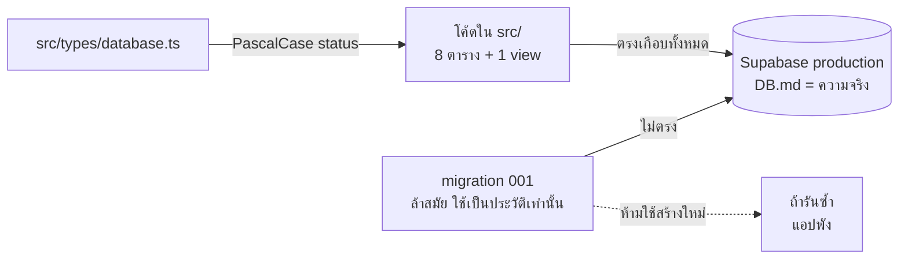
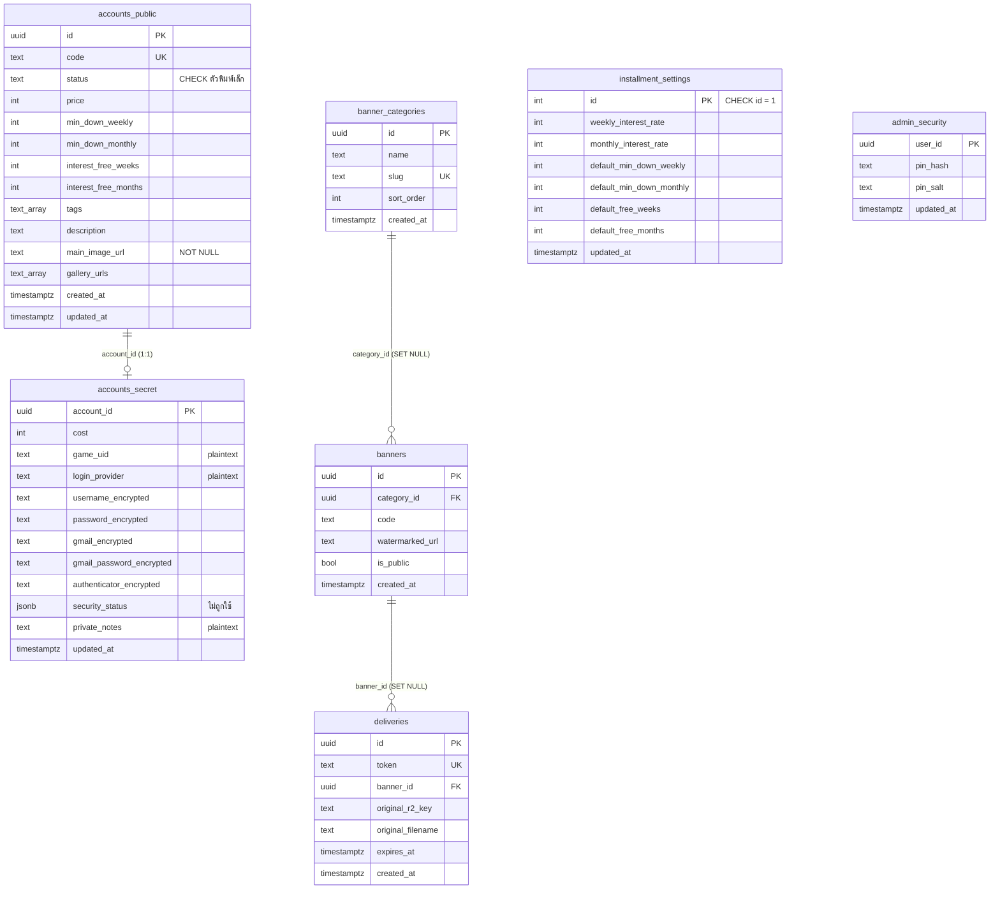
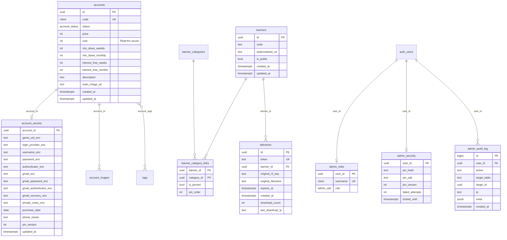

# ฐานข้อมูล — Schema Drift, Normalization และการ Optimize

> **วิธีอ่านเอกสารนี้:** ข้อสรุปมาจาก 4 แหล่ง
> (1) **production dump `supabase/migrations/DB.md` 145 บรรทัด** — ผลรัน `information_schema.columns` + `information_schema.views` + `pg_policies` บน Supabase จริง (18 พ.ย. 2026)
> (2) `supabase/migrations/001_initial_schema.sql` 188 บรรทัด
> (3) ชื่อตาราง/คอลัมน์ที่โค้ดเรียกจริงใน `src/` (grep `.from('...')` ได้ 55 จุด)
> (4) `src/types/database.ts` 83 บรรทัด
>
> **สรุปสั้นที่สุด: production ไม่ตรงกับไฟล์ migration แต่ค่อนข้างตรงกับโค้ด** — ไฟล์ `001_initial_schema.sql` เป็นเอกสารประวัติที่ล้าสมัย **ห้ามใช้สร้าง DB ใหม่** ให้ยึด `DB.md` เป็นความจริง

---

## 1. สถานะปัจจุบัน: 4 แหล่งความจริง



| แหล่ง | ตาราง/วิวที่ประกาศ | สถานะ |
|---|---|---|
| **`supabase/migrations/DB.md`** | 8 ตาราง + **1 view** (`accounts`, `accounts_public` (view), `accounts_secret`, `admin_roles`, `admin_security`, `banner_categories`, `banners`, `deliveries`, `installment_settings`) | ✅ **production จริง — ใช้เป็นแหล่งความจริง** |
| `supabase/migrations/001_initial_schema.sql` | 7 ตาราง (ไม่มี `accounts`, `admin_roles`; `accounts_public` เป็น TABLE) | ⚠️ ล้าสมัย ห้ามรันซ้ำ |
| โค้ด (`src/`) | 8 ชื่อ: `accounts`, `accounts_public`, `admin_roles`, `admin_security`, `banner_categories`, `banners`, `deliveries`, `installment_settings` | ✅ ตรงกับ production |
| `src/types/database.ts` | TypeScript interface 5 ตัว | ✅ ตรงกับ production (ยกเว้น `cost` ที่ไม่ถูกประกาศใน `AccountPublic`) |

### 1.1 ความจริงจาก production (อ้าง `DB.md`)

| # | ข้อเท็จจริง | หลักฐาน |
|---|---|---|
| P-1 | `accounts` **เป็นตารางฐานจริง** และเก็บทั้งข้อมูลสาธารณะ + คอลัมน์ `*_enc` + `security_status` ไว้ในตารางเดียว | `DB.md:16-41` |
| P-2 | `accounts_public` **เป็น VIEW** ไม่ใช่ตาราง: `select id, code, ... from accounts where status in ('Available','Installment','SoldOut')` | `DB.md:114-116` |
| P-3 | view ใช้สิทธิ์เจ้าของ view (ไม่ได้ตั้ง `security_invoker`) → anon อ่าน view ได้แม้ไม่มีสิทธิ์บนตารางฐาน | `DB.md:116` + ไม่มี policy anon บน `accounts` (`DB.md:129`) |
| P-4 | `accounts.status` เป็น `text` default `'Unavailable'` (PascalCase) — **ไม่ใช่ CHECK ตัวพิมพ์เล็กตาม migration** | `DB.md:18` |
| P-5 | `accounts.price`, `cost`, `min_down_*` เป็น **`numeric`** (migration เป็น `integer`) | `DB.md:19-22` |
| P-6 | `admin_roles` มีจริง: `user_id, username, role, created_at` | `DB.md:68-71` |
| P-7 | `accounts_secret` มีอยู่ครบ แต่ **ไม่มีโค้ดใดเรียก** (`grep accounts_secret src/` = 0) | `DB.md:56-67` |
| P-8 | `banner_categories` มี `description`, `logo_url`, **`icon_url`**, `hide_preview` — `icon_url` ไม่ถูกใช้ในโค้ด | `DB.md:81-84` |
| P-9 | `banners` มี `is_pinned`, `pin_order`, `category_ids uuid[]` ครบ | `DB.md:91-93` |
| P-10 | `banner_categories` และ `banners` **ไม่มี** `updated_at` | `DB.md:76-93` |
| P-11 | `admin_security` ยังไม่มี `pin_version` / `failed_attempts` / `locked_until` | `DB.md:72-75` |
| P-12 | `deliveries` ยังไม่มี `download_count` / `last_download_ip` / `revoked_at` | `DB.md:94-100` |

### 1.2 RLS ที่มีจริงใน production

| ตาราง | policy ที่คุมอยู่จริง | ผล |
|---|---|---|
| `accounts` | `Owners manage accounts` → `EXISTS (select 1 from admin_roles where user_id = auth.uid() and role = 'owner')` | ✅ **owner เท่านั้น** (staff อ่านตารางฐานไม่ได้) |
| `accounts_secret` | `Admin full access` → `true` สำหรับ `authenticated` | ❌ ผู้ใช้ Auth คนใดก็ได้อ่าน (ตารางนี้ไม่มีโค้ดใช้ แต่ยังมี ciphertext + `cost` ของเดิม) |
| `admin_roles` | `Users can read own role` → `auth.uid() = user_id` | ✅ อ่านได้เฉพาะ role ของตัวเอง |
| `admin_security` | 2 policy ซ้ำ `auth.uid() = user_id` | ⚠️ เจ้าของแก้ `pin_hash` เองได้ |
| `deliveries` | `Public read active deliveries` (`anon, authenticated`, `expires_at > now()`) + `true` สำหรับ authenticated | ❌ anon enumerate token ได้ |
| `installment_settings` | `Public read` + `Admin ...` `true` | ⚠️ authenticated ทุกคนแก้เรทได้ |
| `banners` | `Public read` (`is_public`) + `true` สำหรับ authenticated | ⚠️ authenticated ทุกคนแก้/ลบได้ |
| `banner_categories` | `Public read` + `true` สำหรับ authenticated | ⚠️ authenticated ทุกคนแก้/ลบได้ |

**ข้อควรระวังที่สำคัญที่สุดสำหรับ agent:** production มี **policy ซ้ำ** หลายชุด (เช่น `deliveries` มี 4 policy, `installment_settings` 4, `banners` 4, `banner_categories` 4, `admin_security` 2) เพราะเคยรัน SQL ใหม่ทับของเก่า → เวลาจะปิดช่องโหว่ต้อง `drop policy` **ให้ครบทุกชื่อ** ไม่ใช่แค่ชื่อที่ migration ระบุ ไม่งั้น policy `true` ที่เหลือจะยังเปิดอยู่

---

## 2. รายการ Schema Drift ทั้งหมด (ตรวจทีละคอลัมน์)

### 2.1 ระดับตาราง

| # | ตาราง/วิว | ใน migration 001 | ใน production (`DB.md`) | ในโค้ด | ผลถ้าใช้ migration สร้าง DB ใหม่ |
|---|---|---|---|---|---|
| T-1 | `accounts` | ❌ ไม่มี | ✅ TABLE (`:16-41`) | ✅ 10 จุด | `/id/[code]` (`src/app/id/[code]/page.tsx:24`), `/admin` (`src/app/admin/page.tsx:67`), API ทั้ง 4 method (`accounts/route.ts:159,241`; `[id]/route.ts:172,224,312,379,385`) ตอบ 404/500 |
| T-2 | `admin_roles` | ❌ ไม่มี | ✅ TABLE (`:68-71`) | ✅ 3 จุด (`src/app/admin/page.tsx:26`; `accounts/route.ts:24`; `[id]/route.ts:20`) | `roleRow = null` → ทุกคนถูกมองเป็น `staff` (`admin/page.tsx:31`) และ `requireOwner()` คืน false ตลอด → **owner คนแรกเข้าระบบไม่ได้เลย** |
| T-3 | `accounts_public` | ✅ **TABLE** (`:5`) | ✅ **VIEW** (`:114-116`) | ✅ 3 จุด (`src/app/store/page.tsx:12`; `accounts/route.ts:110`) | ถ้าสร้างตาม migration จะได้ตารางว่าง ไม่ใช่ view ที่สะท้อน `accounts` → `/store` ว่าง |
| T-4 | `accounts_secret` | ✅ TABLE (`:23`) | ✅ TABLE (`:56-67`) | ❌ **ไม่มีผู้เรียกเลย** | มีตารางแต่ไม่มีข้อมูล/ไม่มีโค้ดอ่าน |
| T-5 | `banner_category_links` | ❌ ไม่มี | ❌ ไม่มี | ❌ ไม่มี (ใช้ array แทน) | ไม่มี junction table → ต้องพึ่ง `category_ids` |

### 2.2 ระดับคอลัมน์ — ตาราง `accounts` ที่โค้ดต้องการ

รวมจาก `insertData` ใน `accounts/route.ts:204-238`, `decryptAccountRow()` ใน `[id]/route.ts:79-110`, และ `SELECT` ที่ `src/app/admin/page.tsx:68-70`

| คอลัมน์ที่โค้ดใช้ | ชนิดที่โค้ดคาด | มีใน migration? | หมายเหตุ |
|---|---|---|---|
| `id` | uuid | อยู่ใน `accounts_public.id` ✅ | |
| `code` | text | ✅ `accounts_public.code` | |
| `status` | text (PascalCase) | ✅ แต่ CHECK เป็นตัวพิมพ์เล็ก | **ชนกัน** (ข้อ 2.3) |
| `price` | integer | ✅ | |
| `min_down_weekly` | integer | ✅ | โค้ดบังคับ 0 ตอนสร้าง (`route.ts:209`) |
| `min_down_monthly` | integer | ✅ | โค้ดบังคับ 0 ตอนสร้าง (`:210`) |
| `interest_free_weeks` / `_months` | integer | ✅ | |
| `tags` | text[] | ✅ | |
| `description` | text \| null | ✅ | |
| `main_image_url` | text \| null | ✅ **NOT NULL** ใน migration (`:16`) | โค้ดส่ง `null` ได้ (`route.ts:215`) → **violation** |
| `gallery_urls` | text[] | ✅ | |
| `created_at` / `updated_at` | timestamptz | ✅ | |
| `cost` | integer | อยู่ใน `accounts_secret.cost` | โค้ดเขียนลง `accounts` (`route.ts:208`) |
| `game_uid_enc` | text | ❌ (migration: `game_uid` plaintext `:26`) | ชื่อต่าง + รูปแบบต่าง |
| `login_provider_enc` | text | ❌ (`login_provider` `:27`) | |
| `username_enc` | text | ❌ (`username_encrypted` `:28`) | |
| `password_enc` | text | ❌ (`password_encrypted` `:29`) | |
| `authenticator_enc` | text | ❌ (`authenticator_encrypted` `:32`) | |
| `gmail_enc` | text | ❌ (`gmail_encrypted` `:30`) | |
| `gmail_password_enc` | text | ❌ (`gmail_password_encrypted` `:31`) | |
| `gmail_authenticator_enc` | text | ❌ **ไม่มีคอลัมน์ใดเลย** | ข้อมูล 2FA ของ Gmail หาที่เก็บไม่ได้ |
| `gmail_recovery_enc` | text | ❌ **ไม่มีคอลัมน์ใดเลย** | รหัสกู้ 8 หลักหาที่เก็บไม่ได้ |
| `private_notes_enc` | text | ❌ (`private_notes` plaintext `:39`) | |
| `purchase_date`, `phone_owner` | ฝังใน `private_notes_enc` | ❌ | ไม่มีคอลัมน์ของตัวเอง (ข้อ 3.2) |
| `security_status` (jsonb) | — | ✅ `:33-38` | **โค้ดไม่ใช้เลย** → dead column |

**สรุปตัวเลข:** คอลัมน์ที่โค้ดใช้แต่ไม่มีชื่อตรงใน migration = **11 คอลัมน์** และมี **1 คอลัมน์** ใน migration ที่โค้ดไม่ใช้ (`security_status`)
**เทียบกับ production:** ครบทุกคอลัมน์ที่โค้ดใช้ (`DB.md:16-41`) — ชื่อ `*_enc`, `private_notes_enc`, `gmail_authenticator_enc`, `gmail_recovery_enc` มีจริงทั้งหมด และ `security_status` มีอยู่ใน `accounts` (`DB.md:39`) ไม่ใช่ `accounts_secret`

### 2.3 ระดับค่า enum — `status`

| แหล่ง | ค่าที่อนุญาต | หลักฐาน |
|---|---|---|
| TypeScript | `'Unavailable' \| 'Available' \| 'Installment' \| 'SoldOut'` | `src/types/database.ts:1` |
| **Production default** | `'Unavailable'` (text, NOT NULL) | `DB.md:18` |
| CHECK constraint (เฉพาะในไฟล์ migration) | `'available' \| 'installment' \| 'sold'` | `001:8` |
| RLS anon (เฉพาะในไฟล์ migration) | `status = 'available'` | `001:117-120` |
| View `accounts_public` (production) | `status in ('Available','Installment','SoldOut')` | `DB.md:116` |
| โค้ดกรองหน้าเว็บ | `['Available','Installment','SoldOut']` | `src/app/store/page.tsx:14` |
| โค้ด validate ฝั่ง API | 4 ค่า PascalCase | `accounts/route.ts:12-17` (`VALID_STATUSES`) |
| ค่า default ตอนสร้าง | `'Unavailable'` | `accounts/route.ts:186-188` |

**ข้อสรุปจาก production:** ค่าที่ใช้จริงคือ **PascalCase** และ view กรองด้วย PascalCase (`DB.md:116`) — ไฟล์ `001` ที่เขียนตัวพิมพ์เล็กเป็นเอกสารล้าสมัย
`DB.md` ไม่ได้ query CHECK constraint จึงยังไม่ยืนยันว่า production มี CHECK อะไรอยู่ ถ้าจะเพิ่ม ให้ใช้ค่า PascalCase เท่านั้น:

```sql
alter table public.accounts
  drop constraint if exists accounts_status_check;
alter table public.accounts
  add constraint accounts_status_check
  check (status in ('Unavailable','Available','Installment','SoldOut'));
```

> **ผลกระทบถ้าเผลอแก้เป็นตัวพิมพ์เล็ก:** view `accounts_public` จะคืน 0 แถวทันที (`/store` ว่าง) และ `VALID_STATUSES` ฝั่ง API จะปฏิเสธทุกค่า

### 2.4 ระดับคอลัมน์ — ตาราง `banners` และ `banner_categories`

| คอลัมน์ที่โค้ดใช้ | migration | หมายเหตุ |
|---|---|---|
| `banners.category_ids` (text[]) | ❌ ไม่มี | ใช้กรอง `.contains()` (`banners/route.ts:49`; `banners/[slug]/page.tsx:41`) และใช้จัดกลุ่มหน้าแรก (`banners/page.tsx:72-87`) |
| `banners.is_pinned` (boolean) | ❌ ไม่มี | เรียงลำดับ (`banners/page.tsx:30`) และเช็กโควตา (`banners/route.ts:295-317`) |
| `banners.pin_order` (integer) | ❌ ไม่มี | |
| `banners.original_r2_key` | อยู่ใน `deliveries` (`001:88`) | โค้ดไม่ได้เก็บใน banners — ตรวจแล้วไม่มี insert ฟิลด์นี้ (`banners/route.ts:127-135`) ✅ ตรงกัน |
| `banner_categories.description` | ❌ ไม่มี | `BannerCategory` ประกาศไว้ (`src/types/database.ts:41`) และ insert ที่ `banners/route.ts:99` |
| `banner_categories.logo_url` | ❌ ไม่มี | `types:42`, insert `:100` |
| `banner_categories.hide_preview` | ❌ ไม่มี | ใช้ `order('hide_preview')` (`banners/page.tsx:19`) → **query นี้ error ทันทีถ้าคอลัมน์ไม่มี** |
| `banner_categories.updated_at` | ❌ ไม่มี | ไม่ได้ใช้ |
| `deliveries` ทุกคอลัมน์ | ✅ ตรง (`001:84-92`) | ตรงกันครบ ✅ |

### 2.5 ระดับ RLS

| ตาราง | policy ใน migration | ปัญหา |
|---|---|---|
| `accounts` (ที่โค้ดใช้จริง) | **ไม่มี policy เพราะไม่มีตาราง** | ถ้าเปิด RLS ไว้แต่ไม่มี policy → อ่านได้ 0 แถว; ถ้าปิด RLS → anon อ่าน secret ทั้งหมด |
| `accounts_secret` | `FOR ALL TO authenticated USING(true)` (`001:129-133`) | ละเมิดหลัก least privilege (ดู `docs/04-security-audit.md` C-1) |
| `deliveries` | anon อ่านทุกแถวที่ยังไม่หมดอายุ (`001:172-175`) | token หมดความหมาย (C-2) |
| `admin_roles` | ไม่มีตาราง/policy | สิทธิ์ไม่ถูกบังคับที่ชั้น DB |
| `admin_security` | `USING (auth.uid() = user_id)` (`001:184-188`) | เจ้าของแก้ `pin_hash` ตรง ๆ ได้ (M-9) |
| `banner_categories` / `banners` / `installment_settings` | `FOR ALL TO authenticated USING(true)` | staff แก้ได้ทุกอย่างที่ชั้น DB (H-5) |

---

## 3. Normalization: จุดที่ผิดปกติและผลกระทบจริง

> ใช้เกณฑ์ 1NF/2NF/3NF แบบเข้าใจง่าย: **1NF** = ทุกช่องเก็บค่าเดี่ยวและ atomic, **2NF** = ไม่มีแอตทริบิวต์ที่ไม่ใช่คีย์ขึ้นกับเพียงส่วนหนึ่งของคีย์ผสม, **3NF** = ไม่มีแอตทริบิวต์ที่ไม่ใช่คีย์ขึ้นกับแอตทริบิวต์ที่ไม่ใช่คีย์อื่น

### 3.1 ภาพ ER ตามไฟล์ migration (เอกสารประวัติ — ของจริงดู §1.1)

> ไดอะแกรมนี้สะท้อน **ไฟล์ `001_initial_schema.sql` เท่านั้น** ไม่ใช่ production — production มี `accounts` เป็นตารางฐานและ `accounts_public` เป็น view (`DB.md:16-41`, `:114-116`) ความสัมพันธ์เชิงตรรกะ (1 account → 1 secret, 1 banner → N deliveries) ยังเหมือนกัน



### 3.2 ตารางตรวจ Normal Form

| # | จุด | ละเมิด | เหตุผลเชิงข้อมูล | ผลกระทบที่เกิดจริง |
|---|---|---|---|---|
| N-1 | `banners.category_ids` เป็น `text[]` **ซ้ำกับ** `category_id` | **1NF** (multi-valued attribute) + redundancy | 1 banner อยู่ในหลายหมวด แต่เก็บเป็น array ในแถวเดียว ขณะที่ `category_id` เก็บ "หมวดแรก" อีกช่อง | ต้องเขียนสองที่ทุกครั้ง; ลบหมวดแล้ว UUID ค้างใน array (`banner-categories/route.ts:175-178`); banner ที่มีเฉพาะ `category_id` หายจากหน้ารายหมวด (`banners/[slug]/page.tsx:41` ไม่มี fallback) |
| N-2 | `accounts.tags` เป็น `text[]` | **1NF** (multi-valued) | แท็กหลายค่าต่อแถว | ค้นหาแบบ exact tag ต้องใช้ GIN; แก้ชื่อแท็กต้องอัปเดตทุกแถว (update anomaly) |
| N-3 | `private_notes_enc` เก็บ `[ซื้อ:...][เบอร์:...]` ต่อท้ายโน้ต | **1NF** (non-atomic) | 3 ค่า (purchase_date, phone_owner, notes) อัดในสตริงเดียว เข้ารหัสทั้งก้อน | ถอดรหัสไม่ได้ = ข้อมูล 3 อย่างหายพร้อมกัน; query/filter ตาม `phone_owner` ทำไม่ได้เลย; `unpackPrivateNotes` ต้อง regex ทุกครั้ง (`[id]/route.ts:57-77`) |
| N-4 | `banners.is_pinned` / `pin_order` เป็นคุณสมบัติระดับ banner แต่ semantics คือ "pin ในหมวด X" | **2NF/3NF** (ขึ้นกับคู่ (banner, category) ไม่ใช่ banner เดี่ยว) | ค่าหนึ่งช่องต้องตอบคำถาม "pin ในหมวดไหน" ซึ่งไม่มีในคีย์ | pin ในหมวด A ไปโผล่หมวด B; `pin_order` ชนกันข้ามหมวด; โควตา 10 ต่อหมวด (`banners/route.ts:295-317`) นับผิด |
| N-5 | `status` เก็บเป็น text อิสระ + ค่าไม่ตรงกัน 3 ชุด | **Domain integrity** (ไม่ใช่ NF แต่ร้ายแรงกว่า) | ไม่มีโดเมนกลาง | ข้อ 2.3 |
| N-6 | `accounts_secret` มี `cost` ปนกับ credential | **3NF** แบบหลวม (cost เป็นข้อมูลธุรกิจ ไม่ใช่ความลับเชิงรับรอง) | `cost` ต้องเข้า RLS เดียวกับรหัสผ่าน ทำให้ staff/รายงานทั่วไปอ่านไม่ได้โดยไม่จำเป็น | ต้องแยก `cost` ไปไว้ฝั่ง public/admin-only ที่ไม่ใช่ credential |
| N-7 | `installment_settings` เป็น singleton `CHECK (id = 1)` | ยอมรับได้ (ตาราง config แถวเดียว) | — | แต่ถ้าจะมีหลายสาขา/หลายโปรไฟล์ผ่อนในอนาคต ต้องเปลี่ยน PK เป็น `profile_id` |
| N-8 | ไม่มี junction table ระหว่าง banner กับ category | **1NF/2NF** (ตาม N-1) | ความสัมพันธ์ many-to-many ถูกยัดใน array | ไม่สามารถใส่ FK constraint ได้ → ไม่มี referential integrity |

### 3.3 ข้อดีที่ควรเก็บไว้

| จุด | เหตุผล |
|---|---|
| `installment_settings` แยกตาราง (ไม่ hardcode ใน component) | แก้เรทได้โดยไม่ต้อง deploy — แม้ UI ยังเรียก endpoint ที่ไม่มี (`AdminDashboardClient.tsx:287`) |
| `deliveries` แยกจาก `banners` | token/วันหมดอายุไม่ปนกับข้อมูลผลงาน; ลบ banner ได้โดยไม่ทำ token พัง (`ON DELETE SET NULL`) |
| `token TEXT UNIQUE` | ให้ DB บังคับ uniqueness เอง ไม่พึ่งแอป |
| `accounts_secret.account_id` เป็น PK + FK CASCADE | บังคับ cardinality 1:1 ได้ถูกต้อง |

---

## 4. เป้าหมาย Schema ที่แนะนำ (Target Model)



### 4.1 เหตุผลของการเปลี่ยนแต่ละจุด

| การเปลี่ยน | แก้อะไร | ต้องแก้โค้ดกี่จุด |
|---|---|---|
| `accounts` เดียว + view `accounts_public` (แบบ production) | production ทำแบบนี้อยู่แล้วและโค้ดตรงทั้งหมด — ไม่ต้องย้ายข้อมูล | 0 |
| ถ้าจะแยก `account_secrets` จริง | ลดจำนวนคนที่เข้าถึง ciphertext (แต่ต้องย้ายข้อมูล + แก้โค้ด 11 จุด) | ~11 จุด + migration |
| แยก `purchase_date`/`phone_owner` เป็นคอลัมน์ | 1NF, query ได้, ไม่ต้อง regex | `accounts/route.ts:196-200`, `[id]/route.ts:57-77,112-137` |
| `banner_category_links` แทน `category_ids` + `is_pinned` | 1NF/2NF, FK จริง, pin ต่อหมวดถูกต้อง | ~8 จุดใน `banners/*` และ `banners/page.tsx` |
| `account_status` enum | ล็อกโดเมนค่าเดียว | 4 ไฟล์ (`types`, `store/page`, `accounts/route`, `[id]/route`) |
| `citext` สำหรับ `code`/`username` | ลบ `ilike` ที่ต้อง escape wildcard (`id/[code]/page.tsx:28`) | 1 จุด |
| `admin_roles` + `admin_audit_log` + `pin_version` | บังคับสิทธิ์ที่ DB และ audit ได้ | เพิ่ม helper กลาง |

---

## 5. Migration SQL ที่รันได้จริง

> ทุกคำสั่งใช้ `IF NOT EXISTS` / `IF EXISTS` และ **ไม่ลบข้อมูลเดิม** เพื่อให้รันบน production ได้อย่างปลอดภัย
> ลำดับที่ปลอดภัย: **5.1 (enum) → 5.2 (ตารางที่ขาด) → 5.3 (คอลัมน์ที่ขาด) → 5.4 (backfill) → 5.5 (index) → 5.6 (trigger) → 5.7 (RLS) → 5.8 (drop ของเก่า)**

### 5.1 โดเมนสถานะเดียว (ยึด **PascalCase** ตาม production)

> **ห้ามแปลงเป็นตัวพิมพ์เล็ก** — view `accounts_public` กรองด้วย `'Available','Installment','SoldOut'` (`DB.md:116`) และ `VALID_STATUSES` ฝั่ง API ใช้ PascalCase (`accounts/route.ts:12-17`) การเปลี่ยนเป็น lowercase จะทำให้ `/store` ว่างทันที

```sql
-- ขั้นที่ 1: สร้าง enum ที่มีค่าเท่าข้อมูลจริง
do $$
begin
  if not exists (select 1 from pg_type where typname = 'account_status') then
    create type public.account_status as enum
      ('Unavailable','Available','Installment','SoldOut');
  end if;
end $$;

-- ขั้นที่ 2: ตรวจค่าที่มีจริง (ต้องได้เฉพาะ 4 ค่านี้)
select status, count(*) from public.accounts group by 1;

-- ขั้นที่ 3: view ผูกกับคอลัมน์นี้ ต้อง drop ก่อน alter แล้วสร้างคืน
drop view if exists public.accounts_public;

alter table public.accounts
  alter column status type public.account_status
  using (status::public.account_status);

-- ขั้นที่ 4: สร้าง view คืนให้เหมือนเดิมเป๊ะ (รายการคอลัมน์ตาม DB.md:116)
create view public.accounts_public as
select
  id, code, status, price, min_down_weekly, min_down_monthly,
  interest_free_weeks, interest_free_months, tags, description,
  main_image_url, gallery_urls, created_at, updated_at
from public.accounts
where status in ('Available','Installment','SoldOut');
```

> **ห้ามใส่ `with (security_invoker = true)`** ใน view นี้ ถ้าไม่มี policy ให้ `anon` อ่าน `accounts` (ปัจจุบันไม่มี — `DB.md:129` มีเฉพาะ owner) หน้า `/store` จะว่างทันที

จุดที่ต้องแก้ในโค้ดให้ตรงกัน (ทำเฉพาะเมื่อจะย้ายไป enum จริง):

`src/types/database.ts:1`, `src/app/store/page.tsx:14`, `src/components/AccountCatalogClient.tsx:26,30,34,58,60,258`, `src/app/api/admin/accounts/route.ts:12-17`, `src/app/api/admin/accounts/[id]/route.ts` (ค่าคงที่ชุดเดียวกัน)

> ถ้ายังไม่ต้องการ enum: **ไม่ต้องทำอะไรเลย** — production ทำงานด้วย `text` + PascalCase อยู่แล้ว และเป็นทางเลือกที่ปลอดภัยกว่าในรอบนี้

### 5.2 ตารางที่ขาด

> **อ่านก่อนรัน:** `accounts` และ `admin_roles` **มีอยู่จริงใน production แล้ว** (`DB.md:16-41`, `:68-71`) — SQL ด้านล่างใช้ `create table if not exists` จึงเป็น no-op บน production
> **ห้าม `drop table` แล้วสร้างใหม่** เพราะจะทำให้ข้อมูลไอดี/สิทธิ์หายทั้งหมด
> ข้อ 1 และ 3 = ตารางที่มีอยู่แล้ว (ใช้เป็นเอกสารอ้างอิงสำหรับ DB ใหม่) · ข้อ 2 = ตารางทางเลือกที่ยังไม่มี · ข้อ 4–6 = ตารางใหม่สำหรับฟีเจอร์ใน `docs/06`

```sql
-- 1) accounts: ตารางฐาน (สะท้อน DB.md:16-41)
create table if not exists public.accounts (
  id uuid primary key default gen_random_uuid(),
  code text not null unique,
  status text not null default 'Unavailable',
  price numeric not null default 0 check (price >= 0),
  cost numeric not null default 0 check (cost >= 0),
  min_down_weekly numeric not null default 0 check (min_down_weekly >= 0),
  min_down_monthly numeric not null default 0 check (min_down_monthly >= 0),
  interest_free_weeks integer not null default 2 check (interest_free_weeks >= 0),
  interest_free_months integer not null default 1 check (interest_free_months >= 0),
  tags text[] not null default '{}',
  description text,
  main_image_url text,
  gallery_urls text[] not null default '{}',
  game_uid_enc text,
  login_provider_enc text,
  username_enc text,
  password_enc text,
  authenticator_enc text,
  gmail_enc text,
  gmail_password_enc text,
  gmail_authenticator_enc text,
  gmail_recovery_enc text,
  private_notes_enc text,
  security_status jsonb,
  created_at timestamptz not null default now(),
  updated_at timestamptz not null default now()
);

-- ถ้าตารางมีอยู่แล้วแต่ยังขาดคอลัมน์ (กรณี production เก่ากว่าโค้ด) ให้ใช้ ADD COLUMN
-- alter table public.accounts add column if not exists gmail_recovery_enc text;

-- 2) account_secrets: ยังไม่มีใน production — สร้างเฉพาะเมื่อจะแยก secret ออกจาก accounts
--    (ต้อง migrate ข้อมูล + แก้โค้ด 11 จุดก่อน จึงจะคุ้ม)

create table if not exists public.account_secrets (
  account_id uuid primary key references public.accounts(id) on delete cascade,
  game_uid_enc text,
  login_provider_enc text,
  username_enc text,
  password_enc text,
  authenticator_enc text,
  gmail_enc text,
  gmail_password_enc text,
  gmail_authenticator_enc text,
  gmail_recovery_enc text,
  private_notes_enc text,
  purchase_date date,
  phone_owner text,
  updated_at timestamptz not null default now()
);

-- 3) admin_roles: มีอยู่แล้วใน production (DB.md:68-71) — จำเป็นต่อ requireOwner() ทั้ง 3 จุด
create table if not exists public.admin_roles (
  user_id uuid primary key references auth.users(id) on delete cascade,
  username text not null unique,
  role text not null default 'staff' check (role in ('owner','staff')),
  created_at timestamptz not null default now()
);

-- 4) junction table แทน category_ids array
create table if not exists public.banner_category_links (
  banner_id uuid not null references public.banners(id) on delete cascade,
  category_id uuid not null references public.banner_categories(id) on delete cascade,
  is_pinned boolean not null default false,
  pin_order integer not null default 0,
  created_at timestamptz not null default now(),
  primary key (banner_id, category_id)
);

-- 5) audit log (ปิดช่อง M-7)
create table if not exists public.admin_audit_log (
  id bigserial primary key,
  user_id uuid references auth.users(id) on delete set null,
  action text not null,
  target_table text,
  target_id uuid,
  ip text,
  user_agent text,
  meta jsonb not null default '{}'::jsonb,
  created_at timestamptz not null default now()
);

-- 6) ตารางนับความพยายามใส่ PIN (ปิดช่อง H-3)
create table if not exists public.admin_pin_attempts (
  id bigserial primary key,
  user_id uuid not null references auth.users(id) on delete cascade,
  ip text,
  success boolean not null,
  created_at timestamptz not null default now()
);
```

### 5.3 คอลัมน์ที่ขาดบนตารางเดิม

> **สถานะเทียบ production:** `banners.category_ids`, `is_pinned`, `pin_order` มีแล้ว (`DB.md:91-93`); `banner_categories.description`, `logo_url`, `hide_preview` มีแล้ว (`DB.md:81-84`) — SQL ต่อไปนี้จะไม่ทำอะไรกับคอลัมน์ที่มีอยู่
> คอลัมน์ที่ยัง **ไม่มีจริง** และเป็นงานใหม่: `banners.updated_at`, `banner_categories.updated_at`, `admin_security.pin_version/failed_attempts/locked_until`, `deliveries.download_count/last_download_ip`

```sql
-- banners: คอลัมน์ที่โค้ดใช้ (มีแล้วใน production) + updated_at (ยังไม่มี)
alter table public.banners
  add column if not exists category_ids uuid[] not null default '{}',
  add column if not exists is_pinned boolean not null default false,
  add column if not exists pin_order integer not null default 0,
  add column if not exists updated_at timestamptz not null default now();

-- banner_categories: 3 คอลัมน์มีแล้ว + updated_at (ยังไม่มี)
alter table public.banner_categories
  add column if not exists description text,
  add column if not exists logo_url text,
  add column if not exists hide_preview boolean not null default false,
  add column if not exists updated_at timestamptz not null default now();

-- admin_security: รองรับ HMAC token + lockout (ยังไม่มีใน production)
alter table public.admin_security
  add column if not exists pin_version integer not null default 0,
  add column if not exists failed_attempts integer not null default 0,
  add column if not exists locked_until timestamptz;

-- deliveries: นับดาวน์โหลด + ตรวจ rate limit (ยังไม่มีใน production)
alter table public.deliveries
  add column if not exists download_count integer not null default 0,
  add column if not exists last_download_ip text;

-- accounts: production อนุญาต null อยู่แล้ว (DB.md:27) — คำสั่งนี้กัน error บน DB ใหม่
alter table public.accounts alter column main_image_url drop not null;
```

### 5.4 Backfill ข้อมูลเดิม

> **⚠️ ห้ามรัน section นี้บน production** — production มีข้อมูลอยู่ใน `accounts` แล้ว (`DB.md:16-41`) การรัน `insert ... select from accounts_public` จะพยายามคัดลอก view กลับเข้าตารางต้นทาง (ข้อมูลซ้ำ/ทับ)
> ใช้เฉพาะเมื่อย้ายจาก DB เก่าที่มีเฉพาะ `accounts_public` + `accounts_secret` ตาม migration 001 เท่านั้น

```sql
-- ย้าย accounts_public → accounts (ถ้ายังมีข้อมูลอยู่)
insert into public.accounts (
  id, code, status, price, min_down_weekly, min_down_monthly,
  interest_free_weeks, interest_free_months, tags, description,
  main_image_url, gallery_urls, created_at, updated_at
)
select
  id, code, lower(status), price, min_down_weekly, min_down_monthly,
  interest_free_weeks, interest_free_months, tags, description,
  main_image_url, gallery_urls, created_at, updated_at
from public.accounts_public
on conflict (id) do nothing;

-- ย้าย accounts_secret → account_secrets (คอลัมน์ชื่อใหม่)
insert into public.account_secrets (
  account_id, game_uid_enc, login_provider_enc, username_enc, password_enc,
  authenticator_enc, gmail_enc, gmail_password_enc, updated_at
)
select
  account_id, game_uid, login_provider, username_encrypted, password_encrypted,
  authenticator_encrypted, gmail_encrypted, gmail_password_encrypted, updated_at
from public.accounts_secret
on conflict (account_id) do nothing;

-- ย้าย category_ids array → junction table
insert into public.banner_category_links (banner_id, category_id, is_pinned, pin_order)
select
  b.id,
  unnest(
    case
      when coalesce(array_length(b.category_ids, 1), 0) > 0 then b.category_ids
      when b.category_id is not null then array[b.category_id]
      else array[]::uuid[]
    end
  ),
  b.is_pinned,
  b.pin_order
from public.banners b
on conflict (banner_id, category_id) do nothing;
```

> หลัง backfill ต้องตรวจ `select count(*) from public.banner_category_links;` เทียบกับจำนวนคู่ที่คาดหวัง ก่อน drop คอลัมน์เก่า

### 5.5 Index Plan (11 ตัวที่ควรมี)

**ของเดิมมี 3 ตัว (`001:103-105`) และตัวหนึ่งซ้ำซ้อน:**

| Index เดิม | สถานะ |
|---|---|
| `idx_accounts_public_status_created (status, created_at DESC)` | ใช้ได้ แต่ตารางที่โค้ดอ่านจริงคือ `accounts` → ต้องสร้างใหม่ |
| `idx_banners_category_public_created (category_id, is_public, created_at DESC)` | ใช้กับการกรอง `category_id` เดี่ยว แต่หน้า `/banners/[slug]` ใช้ `category_ids` + `contains` → **ไม่ได้ใช้ index นี้** |
| `idx_deliveries_token (token)` | **ซ้ำซ้อน** กับ index ที่ `UNIQUE (token)` สร้างให้อัตโนมัติแล้ว (`001:86`) → ลบได้ |

```sql
-- I-1 หน้า /store: filter status + order created_at DESC
create index if not exists idx_accounts_status_created
  on public.accounts (status, created_at desc);

-- I-2 หน้า admin: เรียงตาม created_at ไม่มี filter
create index if not exists idx_accounts_created
  on public.accounts (created_at desc);

-- I-3 ค้นหาไอดีด้วย code แบบไม่สนตัวพิมพ์ (แทน ilike ที่ escape ยาก)
create unique index if not exists uq_accounts_code_lower
  on public.accounts (lower(code));

-- I-4 หน้า /banners: filter is_public + เรียง pinned/pin_order/created_at
create index if not exists idx_banners_public_pinned_created
  on public.banners (is_public, is_pinned desc, pin_order asc, created_at desc);

-- I-5 หน้า /banners: นับจำนวนต่อหมวด (count head)
create index if not exists idx_banners_public_created
  on public.banners (is_public, created_at desc);

-- I-6 GIN สำหรับ category_ids array (ใช้กับ .contains())
create index if not exists idx_banners_category_ids_gin
  on public.banners using gin (category_ids);

-- I-7 lookup ลิงก์ส่งงาน + sweep ที่หมดอายุ
create index if not exists idx_deliveries_expires
  on public.deliveries (expires_at);
create index if not exists idx_deliveries_active
  on public.deliveries (token) where expires_at > now();  -- หมายเหตุ: ดูข้อ 5.5.1

-- I-8 ค้นหาแท็ก (ถ้าจะทำ filter ตามแท็ก)
create index if not exists idx_accounts_tags_gin
  on public.accounts using gin (tags);

-- I-9 audit log
create index if not exists idx_audit_user_created
  on public.admin_audit_log (user_id, created_at desc);
create index if not exists idx_audit_target
  on public.admin_audit_log (target_table, target_id, created_at desc);

-- I-10 pin attempts (นับในหน้าต่างเวลา)
create index if not exists idx_pin_attempts_user_created
  on public.admin_pin_attempts (user_id, created_at desc);

-- I-11 FK index (Postgres ไม่สร้างให้อัตโนมัติ)
create index if not exists idx_deliveries_banner
  on public.deliveries (banner_id);
create index if not exists idx_banner_links_category
  on public.banner_category_links (category_id);
```

**ตารางสรุปเหตุผล:**

| # | Index | Query ที่รองรับ | ไฟล์อ้างอิง |
|---|---|---|---|
| I-1 | `accounts(status, created_at desc)` | `/store` | `src/app/store/page.tsx:12-15` |
| I-2 | `accounts(created_at desc)` | `/admin` | `src/app/admin/page.tsx:67-70` |
| I-3 | `lower(code)` unique | `/id/[code]` | `src/app/id/[code]/page.tsx:28` |
| I-4 | `banners(is_public, is_pinned desc, pin_order, created_at desc)` | `/banners` | `src/app/banners/page.tsx:27-33` |
| I-5 | `banners(is_public, created_at desc)` | count + หน้าหมวด | `banners/page.tsx:22-25`, `banners/[slug]/page.tsx:39-47` |
| I-6 | GIN `category_ids` | `.contains()` | `banners/[slug]/page.tsx:41`, `banners/route.ts:49` |
| I-7 | `deliveries(expires_at)` | sweep + ตรวจอายุ | `banners/route.ts:153`, `download/route.ts:16` |
| I-8 | GIN `tags` | ค้นหาแท็กในอนาคต | `AccountCatalogClient.tsx` (กรองฝั่ง client) |
| I-9 | audit log | รายงาน/สอบสวน | ตารางใหม่ |
| I-10 | pin attempts | lockout | `pin/route.ts` |
| I-11 | FK index | join / ON DELETE | `deliveries`, junction |

### 5.5.1 ข้อควรระวัง: partial index ที่ใช้ `now()`

`create index ... where expires_at > now()` **ใช้ไม่ได้** เพราะ `now()` ไม่ immutable — Postgres จะปฏิเสธ (หรือ index จะค้างค่าเดิม) ให้ใช้ index ธรรมดาบน `expires_at` (I-7) แล้วปล่อยให้ planner ใช้ range scan

```sql
-- ถูกต้อง
create index if not exists idx_deliveries_expires on public.deliveries (expires_at);
```

### 5.6 Trigger `updated_at` อัตโนมัติ

ปัจจุบัน **ไม่มี trigger ใด ๆ** ในโปรเจกต์ (grep `CREATE TRIGGER` = 0) ทำให้ `updated_at` อัปเดตก็ต่อเมื่อโค้ดส่งค่าเอง (`accounts/route.ts:237`, `[id]/route.ts:308`)

```sql
create or replace function public.set_updated_at()
returns trigger language plpgsql as $$
begin
  new.updated_at = now();
  return new;
end $$;

do $$
declare t text;
begin
  foreach t in array array['accounts','account_secrets','banners','banner_categories','installment_settings','admin_security']
  loop
    execute format('drop trigger if exists trg_%1$s_updated_at on public.%1$s', t);
    execute format(
      'create trigger trg_%1$s_updated_at before update on public.%1$s
       for each row execute function public.set_updated_at()', t);
  end loop;
end $$;
```

### 5.7 RLS ที่ควรเป็น (แก้ของเดิม ไม่ใช่สร้างซ้ำ)

> **production มี policy อยู่แล้วและมีชื่อซ้ำหลายชุด** (`DB.md:123-145`) — ต้อง `drop policy` **ทุกชื่อเดิม** ก่อนสร้างชุดใหม่ ไม่งั้น policy `true` ที่เหลือจะยังเปิดช่องอยู่
> **ห้ามเพิ่ม policy ให้ `anon` อ่านตาราง `accounts`** — หน้า `/store` อ่านผ่าน view `accounts_public` ซึ่งใช้สิทธิ์เจ้าของ view อยู่แล้ว (ถ้าเพิ่มจะเปิดเผยคอลัมน์ `*_enc` ให้ anon)
> **ห้ามให้ `staff` อ่านตาราง `accounts`** เพราะตารางนี้มี ciphertext ของ secret อยู่ inline — ให้ staff อ่านผ่าน view เท่านั้น

```sql
-- 0) ล้าง policy เดิมทุกชื่อ (ชื่ออ้างจาก DB.md:123-145) ก่อนวางชุดใหม่
drop policy if exists "Admin full access on accounts_secret"      on public.accounts_secret;
drop policy if exists "Owners manage accounts"                    on public.accounts;
drop policy if exists "Users can read own role"                   on public.admin_roles;
drop policy if exists "Admin manage own pin"                      on public.admin_security;
drop policy if exists "Admin can manage own PIN"                  on public.admin_security;
drop policy if exists "Authenticated manage deliveries"           on public.deliveries;
drop policy if exists "Public read active deliveries"             on public.deliveries;
drop policy if exists "Admin full access on deliveries"           on public.deliveries;
drop policy if exists "Public can read active deliveries"         on public.deliveries;
drop policy if exists "Owners update installment settings"        on public.installment_settings;
drop policy if exists "Public read installment settings"          on public.installment_settings;
drop policy if exists "Admin can update installment settings"     on public.installment_settings;
drop policy if exists "Public can read installment settings"      on public.installment_settings;
drop policy if exists "Authenticated manage banners"              on public.banners;
drop policy if exists "Public read public banners"                on public.banners;
drop policy if exists "Admin full access on banners"              on public.banners;
drop policy if exists "Public can read public banners"            on public.banners;
drop policy if exists "Authenticated manage banner categories"    on public.banner_categories;
drop policy if exists "Public read banner categories"             on public.banner_categories;
drop policy if exists "Admin full access on banner categories"    on public.banner_categories;
drop policy if exists "Public can read banner categories"         on public.banner_categories;

-- 1) ฟังก์ชันช่วย (security definer เพื่อไม่ให้ recurse RLS)
create or replace function public.is_admin()
returns boolean language sql stable security definer set search_path = public as $$
  select exists (select 1 from public.admin_roles where user_id = auth.uid());
$$;

create or replace function public.is_owner()
returns boolean language sql stable security definer set search_path = public as $$
  select exists (select 1 from public.admin_roles where user_id = auth.uid() and role = 'owner');
$$;

-- 2) accounts: owner เท่านั้น (anon ใช้ view, staff ไม่ควรเห็น ciphertext)
create policy "owner manage accounts" on public.accounts
  for all to authenticated using (public.is_owner()) with check (public.is_owner());

-- 3) accounts_secret (ตารางเก่า): owner เท่านั้น
create policy "owner manage account secrets" on public.accounts_secret
  for all to authenticated using (public.is_owner()) with check (public.is_owner());

-- 4) admin_roles: อ่านของตัวเองได้ เขียนเฉพาะ owner
create policy "self read role" on public.admin_roles
  for select to authenticated using (user_id = auth.uid() or public.is_owner());
create policy "owner manage roles" on public.admin_roles
  for insert to authenticated with check (public.is_owner());
create policy "owner update roles" on public.admin_roles
  for update to authenticated using (public.is_owner()) with check (public.is_owner());
create policy "owner delete roles" on public.admin_roles
  for delete to authenticated using (public.is_owner());

-- 5) deliveries: anon อ่านไม่ได้ — เข้าถึงผ่าน route handler ด้วย service role เท่านั้น
create policy "owner manage deliveries" on public.deliveries
  for all to authenticated using (public.is_owner()) with check (public.is_owner());

-- 6) banners / banner_categories / installment_settings: owner เขียน, ทุกคนอ่านได้ตามเงื่อนไข
create policy "public read banners" on public.banners
  for select to anon, authenticated using (is_public = true);
create policy "owner manage banners" on public.banners
  for all to authenticated using (public.is_owner()) with check (public.is_owner());

create policy "public read categories" on public.banner_categories
  for select to anon, authenticated using (true);
create policy "owner manage categories" on public.banner_categories
  for all to authenticated using (public.is_owner()) with check (public.is_owner());

create policy "public read settings" on public.installment_settings
  for select to anon, authenticated using (true);
create policy "owner manage settings" on public.installment_settings
  for all to authenticated using (public.is_owner()) with check (public.is_owner());

-- 7) เปิด RLS ให้ตารางที่สร้างใหม่ (ตารางเดิมเปิดอยู่แล้วใน production)
alter table public.banner_category_links enable row level security;
alter table public.admin_audit_log      enable row level security;
alter table public.admin_pin_attempts   enable row level security;
alter table public.account_secrets      enable row level security;

-- junction: อ่านสาธารณะ เขียน owner
create policy "public read links" on public.banner_category_links
  for select to anon, authenticated using (true);
create policy "owner write links" on public.banner_category_links
  for all to authenticated using (public.is_owner()) with check (public.is_owner());

-- audit log: เขียนได้ผ่าน security definer เท่านั้น (ปฏิเสธการเขียนตรง)
create policy "owner read audit" on public.admin_audit_log
  for select to authenticated using (public.is_owner());
```

> ทุกครั้งที่แก้ RLS ให้ทดสอบด้วย `set role anon;` และ `set role authenticated;` ใน SQL editor เพื่อยืนยันผลจริง ไม่ใช่ดูจาก UI

### 5.8 ลบของที่ไม่ได้ใช้ (ทำเฉพาะเมื่อยืนยันแล้ว)

> **ห้ามรันบน production โดยไม่ตรวจก่อน** — `accounts_public` เป็น **view ที่ `/store` ใช้อยู่** (`DB.md:114-116`) ถ้า drop หน้าเว็บพังทันที และ `accounts_secret` อาจยังมีข้อมูลเก่าที่ไม่มีใน `accounts`

```sql
-- ตรวจก่อนทุกครั้ง
select count(*) from public.accounts_secret;
select count(*) from public.accounts;

-- drop index ที่ซ้ำกับ UNIQUE (ตรวจว่ามีจริงก่อน)
drop index if exists public.idx_deliveries_token;
drop index if exists public.idx_banners_category_public_created;

-- ❌ ห้าม drop view accounts_public — เป็นของที่หน้า /store ใช้
-- drop view if exists public.accounts_public;

-- drop ตารางเก่า (เมื่อยืนยันว่า accounts_secret ว่าง หรือโอนข้อมูลครบแล้ว)
-- drop table if exists public.accounts_secret;

-- drop คอลัมน์ที่เลิกใช้ (หลังย้ายไป junction table และแก้โค้ดครบแล้วเท่านั้น)
-- alter table public.banners drop column if exists category_ids;
-- alter table public.banners drop column if exists category_id;
```

---

## 6. Performance: ปัญหาที่วัดได้จากโค้ด

> ไม่มี benchmark จริงในโปรเจกต์ (ไม่มี k6/Artillery/`console.time`) ตัวเลขด้านล่างจึงเป็น **จำนวน round trip / ขนาดข้อมูลที่ต้องส่ง** ซึ่งคำนวณจากโค้ดได้ตรง ๆ

### 6.1 ตารางปัญหา

| # | ปัญหา | หลักฐาน | ผลกระทบ | วิธีแก้ |
|---|---|---|---|---|
| P-1 | `/store` ไม่มี `.limit()` | `src/app/store/page.tsx:11-15` | ดึงทุกแถว + render ทุกการ์ด; 1,000 ไอดี = HTML/RSC payload หลาย MB | เพิ่ม `.range(0, 23)` + ปุ่มโหลดเพิ่ม หรือ infinite scroll |
| P-2 | `select('*')` หลายจุด | `store/page.tsx:13`, `accounts/route.ts:111,173,160`, `[id]/route.ts:173`, `banners/route.ts:48`, `banners/page.tsx:28` | คอลัมน์ใหม่ (รวม secret ถ้าเผลอ select จากตารางรวม) ไหลถึง client; payload โต | ระบุคอลัมน์ที่ใช้จริงทุก query |
| P-3 | `/banners` ยิง 4–5 query และดึง banner ทั้งตาราง | `src/app/banners/page.tsx:15-65` | 3 query ที่ `.range(0,999)/(1000,1999)/...` โหลดได้ถึง 2,000+ แถวเข้าหน้าแรก แม้แสดงแค่ 10 รูป/หมวด (`:101-102`) | ทำ RPC/view เดียวคืนเฉพาะ 10 รูปแรกของแต่ละหมวด (ข้อ 6.2) |
| P-4 | ไม่มี `use cache` / `cacheTag` แม้เปิด `cacheComponents` | grep `use cache` ใน `src/` = 0; `next.config.ts:4` | ทุก request render ใหม่ทั้งหมด | ห่อ query หมวด/ผลงานด้วย `use cache` + `cacheTag('banners')` แล้ว invalidate ใน PATCH |
| P-5 | N+1 ที่ `GET /api/admin/banner-categories` | `src/app/api/admin/banner-categories/route.ts:33-53` (2 count ต่อหมวด) | 16 หมวด = 32 round trip ต่อการ refresh 1 ครั้ง และ UI เรียกซ้ำทุก action (`BannerCategoryManager.tsx:277,318,349,379,417`) | ใช้ query เดียว `select category_id, count(*) ... group by` หรือ RPC |
| P-6 | ไม่มี index สำหรับ query หลัก | `001:103-105` | ข้อ 5.5 | รัน SQL ในข้อ 5.5 |
| P-7 | Pagination ที่ `/banners` เรียงด้วยคอลัมน์ไม่ unique | `banners/page.tsx:30-32` (is_pinned, pin_order, created_at) | แถวอาจซ้ำ/หายระหว่าง 2 query ที่รันขนาน | เพิ่ม `id` เป็น tiebreaker หรือเลิกทำ manual batching |
| P-8 | ไม่มี `next/image`, ไม่มี `srcSet` | grep `from 'next/image'` = 0; `next.config.ts` ไม่มี `images` | มือถือโหลดภาพ 1600px ทุกใบ | เพิ่ม `images.remotePatterns` ชี้ `R2_PUBLIC_URL` แล้วเปลี่ยน `` เป็น `<Image>` |
| P-9 | Sweep delivery ใช้ `DELETE` ทั้งตารางทุกครั้งที่สร้าง banner | `banners/route.ts:153` | seq scan + lock ทุกครั้ง (ก่อนมี index) | เพิ่ม index `expires_at` (I-7) และย้ายไป cron/RPC |
| P-10 | ไม่มี connection pooling/ตัวคั่น | ไม่มี config ใด ๆ | Supabase pooler ทำงานแทนอยู่แล้ว — **ไม่ใช่ปัญหา** เว้นแต่ย้ายไป self-host | — |

### 6.2 Query rewrite: `/banners` จาก 4 query → 1 RPC

ปัจจุบัน 4 query (`banners/page.tsx:15-65`) แล้วจัดกลุ่มใน JS (`:72-87`)

```sql
create or replace function public.get_banner_sections(p_per_category int default 10)
returns table (
  category_id uuid,
  category_name text,
  category_slug text,
  logo_url text,
  hide_preview boolean,
  sort_order int,
  total_count bigint,
  banner_ids uuid[],
  banner_urls text[],
  banner_codes text[]
)
language sql stable as $$
  with cats as (
    select c.id, c.name, c.slug, c.logo_url, c.hide_preview, c.sort_order
    from public.banner_categories c
  ),
  counts as (
    select l.category_id, count(*) as total
    from public.banner_category_links l
    join public.banners b on b.id = l.banner_id and b.is_public
    group by l.category_id
  ),
  ranked as (
    select
      l.category_id, b.id, b.watermarked_url, b.code,
      row_number() over (
        partition by l.category_id
        order by l.is_pinned desc, l.pin_order asc, b.created_at desc
      ) as rn
    from public.banner_category_links l
    join public.banners b on b.id = l.banner_id and b.is_public
  )
  select
    c.id, c.name, c.slug, c.logo_url, c.hide_preview, c.sort_order,
    coalesce(ct.total, 0),
    coalesce(array_agg(r.id) filter (where r.rn <= p_per_category), '{}'),
    coalesce(array_agg(r.watermarked_url) filter (where r.rn <= p_per_category), '{}'),
    coalesce(array_agg(r.code) filter (where r.rn <= p_per_category), '{}')
  from cats c
  left join counts ct on ct.category_id = c.id
  left join ranked r on r.category_id = c.id
  group by c.id, c.name, c.slug, c.logo_url, c.hide_preview, c.sort_order, ct.total
  order by c.hide_preview asc, c.sort_order asc, c.name asc;
$$;
```

ข้อดี: ส่งเฉพาะ 10 URL/หมวด, ไม่ต้องมี query ที่ 4–5, ไม่มีปัญหา pagination ที่ไม่ stable

### 6.3 Query rewrite: N+1 ของหมวด

```sql
-- แทน 2 count ต่อหมวดใน banner-categories/route.ts:33-53
select
  c.id, c.name, c.slug, c.description, c.logo_url, c.sort_order, c.hide_preview,
  count(l.banner_id) as total_count,
  count(l.banner_id) filter (where l.is_pinned) as pinned_count
from public.banner_categories c
left join public.banner_category_links l on l.category_id = c.id
group by c.id
order by c.hide_preview asc, c.sort_order asc;
```

### 6.4 Query rewrite: `/store`

```ts
// src/app/store/page.tsx — อ่านผ่าน view accounts_public (production) + ใส่ pagination
const PAGE_SIZE = 24;

const { data, error, count } = await supabase
  .from('accounts_public')   // view กรอง Available/Installment/SoldOut ให้แล้ว (DB.md:116)
  .select(
    'id, code, status, price, min_down_weekly, min_down_monthly, tags, description, main_image_url, gallery_urls, created_at',
    { count: 'exact' }
  )
  .in('status', ['Available', 'Installment', 'SoldOut'])   // PascalCase เท่านั้น — กันพลาดถ้า view ถูกแก้
  .order('created_at', { ascending: false })
  .range(page * PAGE_SIZE, page * PAGE_SIZE + PAGE_SIZE - 1);

if (error) throw error;   // ปัจจุบันกลืน error ที่ :17
```

> **ห้ามเปลี่ยนไป query `accounts` ตรง ๆ จาก anon** — policy ของ `accounts` เป็น owner-only (`DB.md:129`) ถ้าเปลี่ยนจาก view หน้า `/store` จะว่างทันที

### 6.5 Caching ที่ควรใช้ (Next 16 Cache Components)

```ts
// src/lib/queries/banners.ts (ใหม่)
import { cacheTag } from 'next/cache';   // Next 16: import ตรง ไม่มี prefix unstable_ (ยืนยันใน node_modules/next/dist/docs/01-app/01-getting-started/08-caching.md)

export async function getBannerSections() {
  'use cache';
  cacheTag('banners');

  const supabase = await createSupabaseServerClient();
  const { data } = await supabase.rpc('get_banner_sections', { p_per_category: 10 });
  return data ?? [];
}
```

แล้ว invalidate ใน route ที่แก้ข้อมูล:

```ts
import { revalidateTag } from 'next/cache';
// หลัง PATCH/POST/DELETE สำเร็จ
revalidateTag('banners');
```

> ยังควรตรวจ API จริงของ Next 16.4.6 ใน `node_modules/next/dist/docs/` ซ้ำก่อนเขียนจริง — โปรเจกต์นี้ตั้ง `cacheComponents: true` และ `partialPrefetching: true` ที่ `next.config.ts:3-15` ซึ่งมีผลต่อว่าฟังก์ชันใดใช้ได้ในบริบทใด

### 6.6 ขนาดข้อมูลที่ต้องระวัง

| ตาราง | อัตราการโต | เหตุผล |
|---|---|---|
| `banners` | +1 แถว/รูปที่อัปโหลด (อัปโหลดทีละ 30+ ไฟล์ได้ในครั้งเดียว) | `BannerBulkUploader.tsx:96-182` |
| `deliveries` | +1 แถว/งาน แต่ **ถูกลบเมื่อหมดอายุ** (`banners/route.ts:153`) | ขนาดคาดคงที่ ~7 วันของงาน |
| `admin_audit_log` | +1 แถว/การกระทำ | ต้องมี retention (เช่น 180 วัน) |
| `admin_pin_attempts` | +1 แถว/การลอง PIN | ต้องมี retention 30 วัน |

---

## 7. แผนดำเนินการและเกณฑ์ตรวจรับ

| ลำดับ | งาน | เกณฑ์ผ่าน |
|---|---|---|
| 1 | ตรวจ `DB.md` เทียบกับ production ก่อน แล้วใช้ migration **003+** เฉพาะสิ่งที่ยังขาด (ห้าม recreate ตาราง/วิวเดิม) | `select count(*) from public.accounts` = จำนวนไอดีจริง และ `/store` ยังแสดงข้อมูล |
| 2 | คง `status` เป็น **PascalCase** และล็อกโดเมนด้วย enum/CHECK ให้ตรง production (`DB.md:18`) | `npx vitest run` ผ่าน + `/store` แสดงไอดี + admin สร้างไอดีใหม่ได้ + `select distinct status from public.accounts` คืนเฉพาะ 4 ค่า PascalCase |
| 3 | เพิ่ม index ทั้งหมด (5.5) | `explain analyze` ของ query `/store` และ `/banners` ใช้ Index Scan ไม่ใช่ Seq Scan |
| 4 | เพิ่ม trigger `updated_at` (5.6) | PATCH แล้ว `updated_at` เปลี่ยนโดยไม่ต้องส่งจากโค้ด |
| 5 | เปิด RLS ใหม่ (5.7) | `set role anon;` อ่าน `accounts_secret` ได้ 0 แถว และอ่าน `accounts` ผ่าน view ได้เฉพาะที่ขายได้ |
| 6 | เปลี่ยน `/banners` เป็น RPC | query count ต่อ 1 page load = 1 (จาก 4–5) |
| 7 | ลบคอลัมน์/ตารางที่ยืนยันแล้วว่าไม่ใช้ (5.8) | ไม่มี query ใน `src/` อ้างถึง `accounts_secret` แล้ว — **ห้ามแตะ view `accounts_public`** เพราะ `/store` ใช้อยู่ |

### 7.1 Checklist ก่อนถือว่าเสร็จ

- [ ] `grep -r "from('accounts" src/` คืนชื่อตารางชุดเดียว (ไม่ปน `accounts_public` / `accounts`) — **ยกเว้น** `/store` และ `GET /api/admin/accounts` ที่ต้องใช้ view `accounts_public` ตาม production
- [ ] `grep -rn "'Available'\|'SoldOut'\|'Unavailable'\|'Installment'" src/` ยังเป็น PascalCase และตรงกับ `DB.md:18` (ห้ามเปลี่ยนเป็น lowercase)
- [ ] `grep -rn "category_ids" src/` = 0 (หลังย้ายไป junction แล้ว)
- [ ] `grep -rn "private_notes_enc" src/` ยังใช้ แต่ `unpackPrivateNotes` ถูกลบ
- [ ] `grep -rn "admin_roles" src/` ใช้ helper กลาง ไม่เขียนซ้ำ 3 ที่
- [ ] `select indexrelname from pg_stat_user_indexes where idx_scan = 0;` ไม่มี index ที่ไม่มีใครใช้
- [ ] `select tablename, policyname, qual from pg_policies where schemaname='public';` ไม่มี `qual = 'true'` กับ `authenticated` และไม่มีชื่อ policy ซ้ำ (นับเทียบ `DB.md:123-145`)

---

## 8. ภาคผนวก: คำสั่งตรวจ schema จริงเทียบกับเอกสาร

```sql
-- 1) ตารางที่มีอยู่จริง
select table_name from information_schema.tables
where table_schema = 'public' order by 1;

-- 2) คอลัมน์ของตารางที่โค้ดใช้
select table_name, column_name, data_type, is_nullable, column_default
from information_schema.columns
where table_schema = 'public' and table_name in
  ('accounts','accounts_public','accounts_secret','banners','banner_categories','deliveries','admin_roles','admin_security')
order by table_name, ordinal_position;

-- 3) CHECK constraint ทั้งหมด
select conrelid::regclass as table_name, conname, pg_get_constraintdef(oid)
from pg_constraint
where contype = 'c' and connamespace = 'public'::regnamespace;

-- 4) RLS ที่เปิดอยู่
select relname, relrowsecurity from pg_class
where relnamespace = 'public'::regnamespace and relkind = 'r';

-- 5) policy ทั้งหมด (มองหาคำว่า true)
select tablename, policyname, roles, cmd, qual, with_check
from pg_policies where schemaname = 'public' order by tablename, policyname;

-- 6) index ที่มีอยู่และจำนวนครั้งที่ถูกใช้
select relname as table_name, indexrelname, idx_scan, idx_tup_read
from pg_stat_user_indexes
where schemaname = 'public' order by relname, indexrelname;

-- 7) ค่า status ที่มีจริง (จับ drift)
select status, count(*) from public.accounts group by 1 order by 2 desc;
```

> ผลจาก query เหล่านี้คือ "ความจริง" ที่ต้องเอามาแทนที่สมมติฐานในเอกสารทั้งชุดนี้ — ถ้าผลออกมาไม่ตรงกับข้อ 2 ถือว่าข้อ 2 คือรายการที่ต้องแก้ ไม่ใช่รายการที่ต้องเชื่อ
