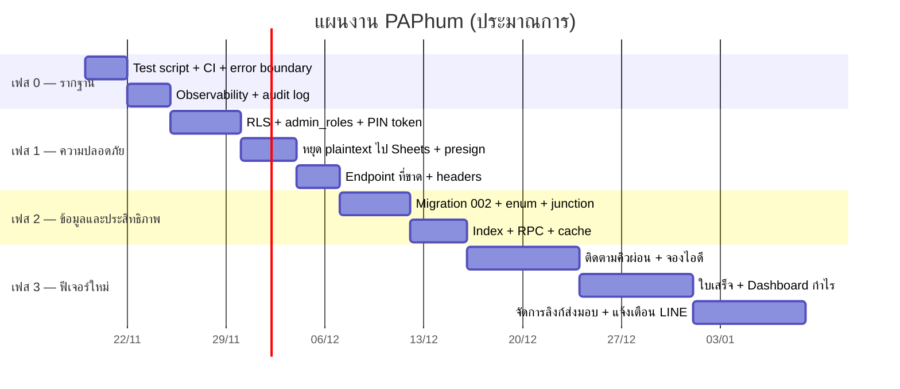
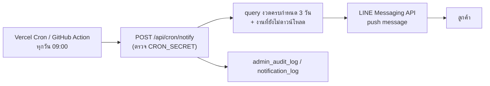

# Roadmap และฟีเจอร์ที่ควรเพิ่ม

> เอกสารนี้ต่อจาก `docs/04-security-audit.md` (ช่องโหว่ 26 ข้อ) และ `docs/05-database-normalize-and-optimize.md` (schema/index)
> **หลักการจัดลำดับ:** ความปลอดภัยของข้อมูลลูกค้า → ความถูกต้องของข้อมูล → ประสิทธิภาพ → ฟีเจอร์ใหม่
> **ข้อจำกัดที่ต้องยอมรับก่อนเริ่ม:** ไม่มี test script (`package.json:5-10`), ไม่มี `vitest.config.*`, ไม่มี CI, ไม่มี `middleware.ts`, ไม่มี `error.tsx`/`not-found.tsx`, ไม่มี observability → งานเฟส 0 คือทำให้ "ตรวจสอบได้" ก่อน

---

## 1. ภาพรวม 4 เฟส



| เฟส | เป้าหมาย | เกณฑ์จบเฟส | อ้างอิง |
|---|---|---|---|
| 0 | ระบบต้องพิสูจน์ได้ว่าทำงาน | `npm test` รันได้, CI แดงเมื่อ type/lint/test พัง, มี `error.tsx` ทุก route group | §2 |
| 1 | ปิดช่องโหว่ Critical/High ทั้ง 10 ข้อ | Auth Matrix ใน `04` ผ่านทุกช่อง, ไม่มี plaintext credential ออกจากระบบ | §3 |
| 2 | schema เดียว + query เร็ว | checklist ใน `05` §7.1 ผ่านครบ | §4 |
| 3 | ฟีเจอร์ที่สร้างรายได้/ลดงานมือ | 6 ฟีเจอร์ตาม §5 ผ่าน acceptance criteria | §5 |

---

## 2. เฟส 0 — รากฐานที่ขาด (3–6 วัน)

### 2.1 งานที่ต้องทำ

| # | งาน | ไฟล์ที่แตะ | เหตุผล |
|---|---|---|---|
| 0-1 | เพิ่ม script `test`, `typecheck`, `lint` ใน `package.json` | `package.json:5-10` | ปัจจุบัน `npm test` ใช้ไม่ได้ และไม่มีใครรัน `tsc --noEmit` |
| 0-2 | เพิ่ม `vitest.config.ts` + `environment: 'node'` | ไฟล์ใหม่ | เทสต์ปัจจุบัน 3 ไฟล์ใน `tests/lib/` รันได้ด้วย `npx` เท่านั้น |
| 0-3 | เพิ่ม `error.tsx` + `not-found.tsx` ระดับ root และ `/admin` | `src/app/error.tsx`, `src/app/not-found.tsx` | ตอนนี้ error ของ Supabase กลายเป็นหน้าว่าง (ไม่มีการดักที่ `store/page.tsx:17`) |
| 0-4 | เพิ่ม logger กลาง (JSON) แทน `console.*` ที่หายไปทั้งหมด | `src/lib/logger.ts` ใหม่ | grep `console.` ใน `src/` = 0 → debug production ไม่ได้เลย |
| 0-5 | เพิ่มตาราง `admin_audit_log` + helper `logAudit()` | `supabase/migrations/002_*.sql`, `src/lib/audit.ts` ใหม่ | ปิด M-7 และเป็นฐานของ Dashboard ในเฟส 3 |
| 0-6 | เพิ่ม `.env.example` (ชื่อ key เท่านั้น) | ไฟล์ใหม่ + `.gitignore:34` | ปัจจุบัน `.env*` ถูก ignore ทั้งหมด ไม่มีตัวอย่าง |
| 0-7 | เพิ่ม GitHub Actions: `tsc --noEmit`, `eslint`, `vitest run` | `.github/workflows/ci.yml` ใหม่ | ไม่มี CI เลย |

### 2.2 ตัวอย่าง `package.json` ที่ควรเป็น

```json
{
  "scripts": {
    "dev": "next dev",
    "build": "next build",
    "start": "next start",
    "lint": "eslint",
    "typecheck": "tsc --noEmit",
    "test": "vitest run",
    "test:watch": "vitest"
  }
}
```

### 2.3 เกณฑ์ตรวจรับเฟส 0

```bash
npm run typecheck   # ต้องได้ 0 error
npm run lint        # ต้องไม่มี error (warning ยอมรับได้)
npm test            # ต้องผ่านทั้ง 3 ไฟล์เดิม + เทสต์ใหม่
```

---

## 3. เฟส 1 — ความปลอดภัย (12–15 วัน)

เรียงตามความเสี่ยงจริง ไม่ใช่ตามหมายเลขใน `04` — สองข้อแรกปิดช่องที่ "ใครก็ได้ที่มีบัญชี" ใช้ได้ทันที

| ลำดับ | งาน | ปิดช่อง | ไฟล์หลัก | เวลา |
|---|---|---|---|---|
| 1-1 | สร้าง `admin_roles` + `is_admin()`/`is_owner()` + เขียน RLS ใหม่ทั้งชุด | C-1, H-4, M-9 | migration ใหม่, `001` | 2–3 วัน |
| 1-2 | ลบ policy anon ของ `deliveries` + download ใช้ service role ฝั่ง server | C-2 | `001:172-175`, `api/deliver/[token]/download/route.ts` | 1 วัน |
| 1-3 | เปลี่ยน PIN cookie เป็น HMAC token + `pin_version` + ลดอายุเหลือ 15–60 นาที | C-3 | `api/admin/pin/route.ts`, `src/lib/pin-token.ts` ใหม่ | 1–2 วัน |
| 1-4 | หยุดส่ง credential ไป Google Sheets (ส่งเฉพาะ code/status/price/cost/updated_at) | C-4, M-4 | `src/lib/sheets-sync.ts:12-19`, `scripts/google-apps-script.js:4-60` | 1–2 วัน |
| 1-5 | เพิ่ม guard กลาง `requireAdmin({ownerOnly,pin})` ให้ banner 3 route + presign | H-1, H-5 | `src/lib/auth/guard.ts` ใหม่, 4 route | 2 วัน |
| 1-6 | ตรวจ MIME/ขนาด/folder + ผูก Content-Type เข้า signature (ใช้ SDK) | H-1 | `api/admin/upload/presign/route.ts:128-144` | 1 วัน |
| 1-7 | `quickStatusOnly` ไม่ถอดรหัส/ไม่ sync secret | H-2 | `api/admin/accounts/[id]/route.ts:217-244` | 0.5 วัน |
| 1-8 | Rate limit + lockout PIN (5 ครั้ง/15 นาที) + audit | H-3 | `api/admin/pin/route.ts`, ตาราง `admin_pin_attempts` | 1–2 วัน |
| 1-9 | สร้าง `/api/admin/logout`, `/api/admin/settings`, `DELETE /api/admin/pin` | H-6, M-5 | 3 route ใหม่ + `AdminDashboardClient.tsx:198,203,287` | 1–2 วัน |
| 1-10 | Security headers + `noindex` `/deliver` + `no-store` บน JSON ลับ | M-2, M-8, L-3 | `next.config.ts`, `deliver/[token]/page.tsx`, `[id]/route.ts:182` | 0.5 วัน |

### 3.1 ลำดับที่ห้ามสลับ

1. **1-1 ต้องมาก่อนทุกข้อ** เพราะ `is_owner()` ถูกใช้โดย route อื่นทั้งหมด
2. **1-3 ต้องมาก่อน 1-7** เพราะถ้า cookie ยังปลอมได้ การเพิ่ม PIN ให้ `quickStatusOnly` ก็ไม่มีความหมาย
3. **1-9 ต้องทำหลัง 1-3** เพราะ logout ต้องล้าง token รูปแบบใหม่

### 3.2 เกณฑ์ตรวจรับเฟส 1

| การทดสอบ | ผลที่ต้องได้ |
|---|---|
| ล็อกอินด้วยบัญชี Supabase ที่ไม่ใช่แอดมิน แล้วยิง `GET /rest/v1/accounts_secret` | ได้ `[]` (ไม่ใช่ข้อมูล) |
| ยิง `GET /rest/v1/deliveries?select=token` ด้วย anon key | ได้ `[]` หรือ 401 |
| ตั้งคุกกี้ `paphum_admin_pin_ok=<uuid ตัวเอง>` แล้วเรียก `GET /api/admin/accounts/{id}` | 403 |
| เดา PIN ผิด 6 ครั้งติด | ครั้งที่ 6 ได้ 429 และมีแถวใน `admin_pin_attempts` |
| เรียก `POST /api/admin/upload/presign` ด้วย `contentType: text/html` | 400 |
| ตรวจ response ของ `GET /api/admin/accounts/{id}` | มี `Cache-Control: no-store` |
| ตรวจ Google Sheet หลัง sync | ไม่มีคอลัมน์รหัสผ่าน/seed 2FA |

---

## 4. เฟส 2 — ข้อมูลและประสิทธิภาพ (9–12 วัน)

| ลำดับ | งาน | รายละเอียด | อ้างอิง |
|---|---|---|---|
| 2-1 | ใช้ migration **003+** เฉพาะสิ่งที่ยังขาด (เพิ่มคอลัมน์/enum/junction) — **ห้าม recreate ตาราง `accounts` / `admin_roles` / view `accounts_public`** ที่มีอยู่แล้ว | ใช้ SQL ใน `05` §5 | `docs/05...` §5.1–5.4, `DB.md:16-41,68-71,114-116` |
| 2-2 | คง `status` เป็น **PascalCase** ทั้ง 4 ชั้น (type, CHECK, RLS, UI) ตาม production — ห้ามเปลี่ยนเป็นตัวพิมพ์เล็ก | type, CHECK, RLS, UI | `docs/05...` §2.3, `DB.md:18` |
| 2-3 | Backfill `banners.category_ids` → `banner_category_links` | ต้องตรวจจำนวนคู่ก่อน drop | `docs/05...` §5.4 |
| 2-4 | สร้าง index 11 ตัว + trigger `updated_at` | SQL ใน `05` §5.5–5.6 | — |
| 2-5 | เปลี่ยน `/banners` เป็น RPC `get_banner_sections` | 4–5 query → 1 | `docs/05...` §6.2 |
| 2-6 | แก้ N+1 ที่ `banner-categories` | 32 → 1 query | `docs/05...` §6.3 |
| 2-7 | เพิ่ม pagination ที่ `/store` | `PAGE_SIZE = 24` | `docs/05...` §6.4 |
| 2-8 | เปิด `use cache` + `cacheTag` สำหรับข้อมูลผลงาน | ต้องตรวจ API Next 16.4.6 ก่อน | `docs/05...` §6.5 |
| 2-9 | เปลี่ยน `` → `next/image` (หลังตั้ง `images.remotePatterns`) | ต้องมี `R2_PUBLIC_URL` | `next.config.ts:3-15` |

### 4.1 ตัวชี้วัดที่ต้องวัดก่อน/หลัง

| ตัวชี้วัด | วิธีวัด | เป้าหมาย |
|---|---|---|
| จำนวน query ต่อการโหลด `/banners` | Supabase logs หรือ logger ที่เพิ่มในเฟส 0 | 4–5 → 1 |
| จำนวน query ต่อการโหลด `/api/admin/banner-categories` | เช่นเดียวกัน | 2N+1 → 1 |
| ขนาด RSC payload ของ `/store` | DevTools Network (doc request) | ลด ≥ 60% ที่ 1,000 ไอดี |
| เวลา TTFB ของ `/banners` (cold) | `curl -w "%{time_starttransfer}"` | < 400 ms |
| จำนวน Seq Scan บนตารางหลัก | `explain analyze` | 0 สำหรับ query ที่มีในหน้าร้าน |

---

## 5. เฟส 3 — ฟีเจอร์ใหม่ 6 ข้อ

> ทุกฟีเจอร์ในหัวข้อนี้ **ยังไม่มีในโค้ด** (ตรวจ grep แล้ว) จึงต้องออกแบบข้อมูลใหม่ทั้งหมด และต้องรันหลังเฟส 2 เพื่อไม่ให้แก้ schema สองรอบ

### 5.1 ฟีเจอร์ A — ติดตามคิวผ่อนชำระ (Installment Tracker)

**ปัญหาปัจจุบัน:** สูตรผ่อนมีอยู่ใน `src/lib/installment.ts` (323 บรรทัด) และสร้างตารางนัดชำระได้ (`generatePaymentSchedule` `:203-233`) แต่ **ผลลัพธ์ถูกคัดลอกลง clipboard แล้วหายไป** (`ScheduleGeneratorModal.tsx:209-225`) — ไม่มีที่เก็บว่าไอดีไหนผ่อนถึงงวดไหน ใครค้าง ใครใกล้ครบ

**ข้อมูลใหม่**

```sql
create table public.installment_plans (
  id uuid primary key default gen_random_uuid(),
  account_id uuid not null references public.accounts(id) on delete cascade,
  customer_name text,
  customer_contact text,
  mode text not null check (mode in ('weekly','monthly')),
  price integer not null,
  down_payment integer not null,
  periods integer not null check (periods between 1 and 24),
  interest_free_periods integer not null default 0,
  amount_per_period integer not null,
  started_on date not null,
  status text not null default 'active'
    check (status in ('active','completed','defaulted','cancelled')),
  created_at timestamptz not null default now(),
  updated_at timestamptz not null default now()
);

create table public.installment_payments (
  id uuid primary key default gen_random_uuid(),
  plan_id uuid not null references public.installment_plans(id) on delete cascade,
  period_number integer not null,
  due_date date not null,
  amount_due integer not null,
  amount_paid integer not null default 0,
  paid_at timestamptz,
  note text,
  unique (plan_id, period_number)
);
```

**งานที่ต้องทำ**

| # | งาน | ไฟล์ |
|---|---|---|
| A-1 | สร้างตาราง + RLS (owner เท่านั้น) | migration ใหม่ |
| A-2 | API `POST /api/admin/installments` สร้างแผนจาก `calculateInstallmentPlan()` + `generatePaymentSchedule()` | route ใหม่ |
| A-3 | API `PATCH /api/admin/installments/[id]` บันทึกการชำระ/เลื่อนงวด | route ใหม่ |
| A-4 | UI แท็บ "คิวผ่อน" ใน `AdminDashboardClient.tsx` (owner เท่านั้น) | `src/components/admin/InstallmentTracker.tsx` ใหม่ |
| A-5 | ปรับ `AccountStatus` เป็น `installment` อัตโนมัติเมื่อสร้างแผน และเป็น `sold` เมื่อครบทุกงวด | ใช้ trigger หรือ API |
| A-6 | หน้าสาธารณะ (ไม่บังคับ) ให้ลูกค้าเช็กคิวด้วยรหัส + เบอร์ 4 ตัวท้าย | `/track` ใหม่ |

**Acceptance criteria**

- สร้างแผนจากไอดีราคา 3,290 (weekly, ดาวน์ 1,000, 4 งวด) ได้ตาราง 4 แถวที่มียอดงวดละ **643** ตรงกับ `tests/lib/installment.test.ts:24`
- บันทึกชำระงวดที่ 1 แล้ว `amount_paid = amount_due` และ `paid_at` ไม่ว่าง
- เมื่อชำระครบทุกงวด `installment_plans.status = 'completed'` และ `accounts.status = 'SoldOut'` (PascalCase ตาม production — `DB.md:18`)
- หน้า `/admin` แสดง "ค้างชำระ N งวด" โดยคำนวณจาก `due_date < current_date and amount_paid < amount_due`
- ไม่มี secret ใด ๆ ถูกส่งไปยัง client ของฟีเจอร์นี้

**ขนาดงาน:** 6–8 วัน

---

### 5.2 ฟีเจอร์ B — จัดการลิงก์ส่งมอบ (revoke / extend / นับดาวน์โหลด)

**ปัญหาปัจจุบัน:** ลิงก์ส่งงานถูกสร้างครั้งเดียวที่ `api/admin/banners/route.ts:149-161` อายุ 7 วันตายตัว ไม่มีทาง **ต่ออายุ, เพิกถอน, หรือดูว่าลูกค้าดาวน์โหลดไปหรือยัง** และ presigned GET ที่ได้มีอายุ 1 ชั่วโมงและแชร์ต่อได้ (`docs/04` L-4) — ถ้าลูกค้าทำลิงก์หลุด ต้องรบกวนแอดมินสร้างงานใหม่

**ข้อมูลที่มีอยู่แล้ว:** `deliveries` (`001:84-92`) + คอลัมน์ที่แนะนำเพิ่มใน `05` §5.3 (`download_count`, `last_download_ip`)

**งานที่ต้องทำ**

| # | งาน | ไฟล์ |
|---|---|---|
| B-1 | เพิ่ม `download_count`, `last_download_ip`, `revoked_at`, `max_downloads` | migration |
| B-2 | `POST /api/admin/deliveries/[id]/extend` ต่ออายุ +7 วัน (สูงสุด 30 วันจากวันสร้าง) | route ใหม่ |
| B-3 | `POST /api/admin/deliveries/[id]/revoke` ตั้ง `revoked_at = now()` | route ใหม่ |
| B-4 | `GET /api/admin/deliveries` list พร้อมสถานะ (active/expired/revoked/used) | route ใหม่ |
| B-5 | เพิ่มเงื่อนไข `revoked_at is null` + `download_count < max_downloads` ในหน้า `/deliver` และ download route | `deliver/[token]/page.tsx:17-23`, `download/route.ts:12-21` |
| B-6 | เพิ่ม rate limit ต่อ IP+token (10 ครั้ง/นาที) และลดอายุ presigned GET เหลือ 120 วินาที | `src/lib/r2.ts:139` |
| B-7 | แสดงสถานะลิงก์ใน `BannerCategoryManager` (ใช้ `DeliveryDownloadClient.tsx` ที่มีอยู่แต่ยังไม่ถูกใช้) | `src/components/DeliveryDownloadClient.tsx` |

**Acceptance criteria**

- เพิกถอนแล้วเปิด `/deliver/{token}` ได้หน้า "ลิงก์ถูกปิดใช้งาน" (HTTP 410) และ download route ตอบ 404
- ต่ออายุแล้ว `expires_at` เพิ่ม 7 วัน แต่ไม่เกิน 30 วันจาก `created_at`
- ดาวน์โหลดครบ `max_downloads` แล้วลิงก์ใช้ไม่ได้
- presigned URL ที่ได้มีอายุ ≤ 120 วินาที
- มีแถวใน `admin_audit_log` ทุกครั้งที่ extend/revoke

**ขนาดงาน:** 3–4 วัน

---

### 5.3 ฟีเจอร์ C — ใบเสร็จและสลิปการชำระ

**ปัญหาปัจจุบัน:** ไม่มีการออกเอกสารใด ๆ ให้ลูกค้า ข้อความที่ลูกค้าได้รับคือ clipboard จาก `formatCustomerQuoteText` (`installment.ts:242-280`) ซึ่งเป็นข้อความล้วน ไม่มีเลขที่เอกสาร ไม่มีลายเซ็น ไม่มีสถานะ

**งานที่ต้องทำ**

| # | งาน | รายละเอียด |
|---|---|---|
| C-1 | สร้าง `receipts` (id, number, plan_id/payment_id, issued_to, amount, issued_at, pdf_r2_key) | migration |
| C-2 | ออกเลขที่เอกสารด้วย sequence รายปี: `PH-2026-0001` | ใช้ Postgres sequence ไม่ใช่ `count + 1` (บทเรียนจาก L-6) |
| C-3 | สร้าง PDF ฝั่ง server (แนะนำ `@react-pdf/renderer` หรือ `pdf-lib`) — **ห้าม generate ฝั่ง client** เพื่อกันการปลอม | `src/lib/receipt.ts` ใหม่ |
| C-4 | อัปโหลด PDF ขึ้น R2 แล้วให้ลิงก์แบบเดียวกับ delivery (ใช้ระบบ B) | `src/lib/r2.ts` |
| C-5 | API `POST /api/admin/receipts` (owner + PIN) และ `GET /api/receipts/[token]` (สาธารณะ, อายุ 30 วัน) | route ใหม่ |

**หมายเหตุทางเทคนิค:** ต้องเพิ่ม dependency ใหม่ (`package.json` ปัจจุบันไม่มี library สร้าง PDF) และต้องคำนึงว่า `next.config.ts` ไม่มี `serverExternalPackages` — ตรวจเอกสาร Next 16.4.6 ใน `node_modules/next/dist/docs/` ก่อน

**Acceptance criteria**

- ออกใบเสร็จจากการชำระ 1 งวดได้ และเลขที่เอกสารไม่ซ้ำแม้ออกพร้อมกัน 2 คำขอ
- PDF มีชื่อร้าน เลขที่ วันที่ รายการ ยอดรวม และเลขงวด
- เปิดลิงก์ใบเสร็จซ้ำได้จนหมดอายุ และไม่ต้องล็อกอิน
- ไม่มีข้อมูล secret (username/password/seed) อยู่ใน PDF

**ขนาดงาน:** 5–6 วัน

---

### 5.4 ฟีเจอร์ D — Dashboard กำไรและต้นทุน

**ปัญหาปัจจุบัน:** ระบบเก็บ `cost` ทุกไอดี (`accounts/route.ts:208`) แต่ **ไม่มีที่ใดใน UI แสดงกำไรเลย** — ต้องเปิด Google Sheet มาลบมือ (`scripts/google-apps-script.js` มีคอลัมน์ "ต้นทุน") ทั้งที่ข้อมูลอยู่ใน DB แล้ว

**ตัวชี้วัดที่ควรมี**

| การ์ด | สูตร |
|---|---|
| กำไรขั้นต้นเดือนนี้ | `sum(price - cost)` ของไอดีที่ `status = 'SoldOut'` และ `updated_at` อยู่ในเดือน |
| ต้นทุนคงค้าง (สต็อก) | `sum(cost)` ของไอดีที่ `status in ('Available','Installment')` |
| มูลค่าสต็อกตามราคาขาย | `sum(price)` ของ `status = 'Available'` |
| จำนวนไอดีตามสถานะ | `group by status` |
| ยอดผ่อนคงค้าง | `sum(amount_due - amount_paid)` จาก `installment_payments` (ฟีเจอร์ A) |
| กำไรเฉลี่ยต่อไอดี | กำไรขั้นต้น ÷ จำนวนที่ขาย |

**งานที่ต้องทำ**

| # | งาน | ไฟล์ |
|---|---|---|
| D-1 | `GET /api/admin/stats?range=30d` (owner + PIN) คืนตัวเลข aggregate | route ใหม่ |
| D-2 | ใช้ SQL aggregate ฝั่ง DB (ไม่ดึงแถวมาบวกใน JS) | RPC `get_dashboard_stats` |
| D-3 | UI แท็บ "ภาพรวม" ใน `AdminDashboardClient.tsx` | `src/components/admin/ProfitDashboard.tsx` ใหม่ |
| D-4 | กราฟ 12 เดือน (ใช้ SVG เอง หรือเพิ่ม `recharts`) | ต้องประเมินน้ำหนัก bundle |
| D-5 | Export CSV ของช่วงเวลาที่เลือก | route ใหม่ |

**ข้อควรระวังด้านความปลอดภัย:** endpoint นี้เปิดเผย `cost` ซึ่งเป็นข้อมูลอ่อนไหวที่สุดของร้าน → ต้อง owner + PIN เท่านั้น และเพิ่ม `Cache-Control: no-store` (บทเรียนจาก M-2)

**Acceptance criteria**

- ตัวเลขบนการ์ดตรงกับ `select sum(price - cost) from accounts where status='SoldOut'` (±0)
- staff เรียก endpoint ได้ 403
- ไม่มี `cost` ถูกส่งไปยัง `AccountPublic` หรือ RSC props ของ staff (`src/app/admin/page.tsx:56` ยังคืน `[]`)
- โหลด < 800 ms ที่ 5,000 ไอดี

**ขนาดงาน:** 4–5 วัน

---

### 5.5 ฟีเจอร์ E — แจ้งเตือนผ่าน LINE (งวดครบกำหนด / งานพร้อมส่ง)

**ปัญหาปัจจุบัน:** ทุกการสื่อสารเป็น manual — แอดมินต้องเปิดหน้า `/admin` ดูว่าใครถึงกำหนด แล้วทักเอง ไม่มีระบบแจ้งเตือนใด ๆ (grep `notification`/`line`/`webhook` ใน `src/` = 0; มีเพียง webhook ไป Google Sheets)

**สถาปัตยกรรมที่แนะนำ**



| # | งาน | รายละเอียด |
|---|---|---|
| E-1 | เพิ่ม env `LINE_CHANNEL_ACCESS_TOKEN`, `LINE_CHANNEL_SECRET`, `CRON_SECRET` | `.env.example` + เอกสาร (ปัจจุบัน `.env.local` มี 11 key ไม่มีตัวเหล่านี้) |
| E-2 | ตาราง `notifications` (id, channel, recipient, template, payload, status, sent_at, error) | migration |
| E-3 | `POST /api/cron/notify` ตรวจ `CRON_SECRET` แบบ constant-time | route ใหม่ |
| E-4 | เทมเพลต 3 แบบ: งวดใกล้ครบกำหนด, งานพร้อมดาวน์โหลด, ลิงก์ใกล้หมดอายุ | `src/lib/notify/templates.ts` |
| E-5 | ผูก LINE userId กับลูกค้า (เก็บใน `installment_plans.customer_line_id`) | migration |
| E-6 | UI ตั้งค่าเทมเพลต + เปิด/ปิดการแจ้งเตือน | แท็บ settings (ต้องสร้าง endpoint `settings` ที่ขาดอยู่ก่อน — ข้อ 1-9) |

**Acceptance criteria**

- เรียก `/api/cron/notify` โดยไม่มี `CRON_SECRET` → 401
- งวดที่ `due_date = current_date + 3` ถูกส่ง 1 ครั้งเท่านั้นต่อวัน (idempotent — ใช้ unique key `(plan_id, period_number, template, date)`)
- ส่งไม่สำเร็จถูกบันทึกใน `notifications.status = 'failed'` พร้อม error และไม่ทำให้ทั้ง job ล้ม
- ไม่มี secret/PIN ในข้อความที่ส่ง

**ขนาดงาน:** 5–6 วัน

---

### 5.6 ฟีเจอร์ F — จองไอดี (Reserve)

**ปัญหาปัจจุบัน:** ลูกค้าที่ "ขอจอง" ต้องให้แอดมินเปลี่ยน `status` เป็น `Installment` มือ ๆ ผ่าน `quickStatusOnly` (`[id]/route.ts:217-244`) ซึ่ง **ไม่ต้อง PIN** และไม่มีการบันทึกว่าใครจอง ถึงเมื่อไร — ไอดีอาจถูกขายให้คนอื่นระหว่างนั้น

**ข้อมูลใหม่**

```sql
create table public.account_reservations (
  id uuid primary key default gen_random_uuid(),
  account_id uuid not null references public.accounts(id) on delete cascade,
  customer_name text not null,
  customer_contact text not null,
  reserved_until timestamptz not null,
  status text not null default 'active'
    check (status in ('active','converted','expired','cancelled')),
  created_by uuid references auth.users(id),
  created_at timestamptz not null default now()
);

-- กันการจองซ้อน: 1 ไอดีมี reservation ที่ active ได้ครั้งละ 1
create unique index uq_active_reservation
  on public.account_reservations (account_id)
  where status = 'active';
```

| # | งาน | รายละเอียด |
|---|---|---|
| F-1 | สร้างตาราง + partial unique index | migration |
| F-2 | `POST /api/admin/reservations` (owner + PIN) | route ใหม่ |
| F-3 | `POST /api/admin/reservations/[id]/convert` → เปลี่ยนเป็น `SoldOut` และสร้าง `installment_plans` (ถ้าผ่อน) | route ใหม่ |
| F-4 | แสดงป้าย "จองแล้ว ถึงวันที่ …" บนการ์ดหน้า `/store` (เฉพาะวัน ไม่แสดงชื่อลูกค้า) | `AccountCatalogClient.tsx:208-300` |
| F-5 | Job หมดอายุอัตโนมัติ (ใช้ cron เดียวกับ E) → `status='Expired'` + คืน `accounts.status='Available'` | cron |
| F-6 | บันทึก audit ทุกครั้งที่จอง/ยกเลิก | `logAudit()` |

**Acceptance criteria**

- จองไอดีเดิมพร้อมกัน 2 คำขอ → คำขอที่สองได้ 409 (unique index บังคับ)
- เมื่อ `reserved_until` ผ่านไป 1 วัน สถานะกลับเป็น `available` โดยอัตโนมัติ
- หน้า `/store` ไม่รั่วชื่อ/เบอร์ลูกค้า (ตรวจ RSC payload)
- แปลงการจองเป็น `sold` แล้วประวัติการจองยังอยู่ (`status='converted'`)

**ขนาดงาน:** 4–5 วัน

---

## 6. ตารางรวมน้ำหนักงานและลำดับความสำคัญ

| ฟีเจอร์ | มูลค่าทางธุรกิจ | ความซับซ้อน | ต้องพึ่ง | ลำดับแนะนำ |
|---|---|---|---|---|
| A — ติดตามคิวผ่อน | สูงมาก (ลดงานมือ, กันค้างชำระ) | กลาง | เฟส 2 (enum, accounts) | 1 |
| D — Dashboard กำไร | สูง (ตัดสินใจราคา/สต็อก) | ต่ำ–กลาง | A (สำหรับยอดผ่อนคงค้าง) | 2 |
| B — จัดการลิงก์ส่งมอบ | กลาง–สูง (ลดงานซัพพอร์ต) | ต่ำ | ไม่มี | 3 |
| F — จองไอดี | กลาง (ลดการขายซ้อน) | ต่ำ–กลาง | เฟส 2 | 4 |
| E — แจ้งเตือน LINE | กลาง (ลด no-show) | กลาง–สูง | A, B, settings endpoint | 5 |
| C — ใบเสร็จ/สลิป | กลาง (ความน่าเชื่อถือ) | สูง (dependency ใหม่) | A, B | 6 |

---

## 7. ความเสี่ยงของแผนนี้

| # | ความเสี่ยง | โอกาส | ผลกระทบ | มาตรการ |
|---|---|---|---|---|
| R-1 | Migration 002 ทำข้อมูล production เสียหาย | กลาง | สูง | สำรอง `pg_dump` ก่อน, รันบน staging, ใช้ `on conflict do nothing`, ไม่ drop คอลัมน์ในรอบแรก |
| R-2 | Schema drift กลับมาอีกเพราะไม่มี integration test | สูง | สูง | เพิ่มเทสต์ที่ query ตารางจริงด้วย service role ใน CI (อ่านชื่อคอลัมน์จาก `information_schema`) |
| R-3 | PIN token ใหม่ทำให้แอดมินที่ล็อกอินค้างอยู่ใช้งานไม่ได้ | สูง | ต่ำ | ประกาศล่วงหน้า + ให้ `pin_version` เริ่มที่ 0 และยอมรับ token เก่า 1 วันแรก |
| R-4 | การหยุดส่ง credential ไป Sheets ทำให้ทีมขาดข้อมูลที่เคยใช้ | กลาง | กลาง | ทำ export CSV จาก DB ก่อนปิด, สอนทีมใช้หน้า admin แทน |
| R-5 | `use cache` กับ `cacheComponents` ทำให้ข้อมูลเก่าค้าง (เช่น ราคาไม่เปลี่ยน) | กลาง | กลาง | ใช้ `cacheTag` + `revalidateTag` ทุก mutation และมีปุ่ม "ล้างแคช" สำหรับ owner |
| R-6 | ฟีเจอร์ C เพิ่ม dependency ที่เข้ากันไม่ได้กับ Turbopack/Next 16 | กลาง | กลาง | ทดสอบ PDF generation ใน branch แยกก่อน; ทางถอยคือ HTML → print to PDF ฝั่ง client (แต่เสียคุณสมบัติกันปลอม) |
| R-7 | LINE API เปลี่ยนราคา/โควตา | ต่ำ | กลาง | เก็บ `notifications` ให้เปลี่ยน channel ได้ และมี fallback เป็นอีเมล |
| R-8 | ไม่มีคนดูแล cron (Vercel Hobby จำกัด) | กลาง | ต่ำ | ใช้ GitHub Actions schedule แทน หรือเรียกจาก cron ภายนอก |

---

## 8. สิ่งที่ **ไม่ควร** ทำในรอบนี้

| ข้อเสนอที่ tempting | เหตุผลที่ไม่ควรทำตอนนี้ |
|---|---|
| เพิ่ม multi-tenant / หลายร้าน | schema ยัง drift อยู่ การทำ multi-tenant ก่อน normalize = ต้อง migrations ซ้ำ |
| เขียนระบบชำระเงินออนไลน์ (Payment Gateway) | ยังไม่มีระบบติดตามคิวผ่อน (A) และใบเสร็จ (C) → เงินเข้าแต่ตามไม่ทัน |
| เปลี่ยนไปใช้ ORM (Prisma/Drizzle) | ปัญหาจริงคือ schema ไม่ตรง ไม่ใช่ชั้น query; เปลี่ยน ORM จะยิ่งสร้าง drift ชุดใหม่ |
| เพิ่ม real-time subscription | ยังไม่มี observability และไม่มีผู้ใช้พร้อมกันมาก; ต้นทุน > ประโยชน์ |
| Rewrite เป็น microservices | ทีมเดียว ไฟล์ไม่ถึง 100 ไฟล์ — จะทำให้ debug ยากขึ้น |
| เปิด public API ให้ partner | ยังไม่มี rate limit, audit log, API key เลย |

---

## 9. Definition of Done ของทุกงานใน roadmap

1. มี test ครอบ (unit สำหรับ pure logic, integration สำหรับ route ที่แตะ DB)
2. `npm run typecheck && npm run lint && npm test` ผ่านใน CI
3. มี audit log สำหรับ action ที่แตะข้อมูลลูกค้า
4. ไม่มี `error.message` ของ DB/crypto หลุดถึง client (ตอบรหัส error กลาง)
5. Response ที่มีข้อมูลอ่อนไหวมี `Cache-Control: no-store`
6. อัปเดตเอกสารใน `docs/` ให้ตรงกับโค้ด (โดยเฉพาะ `05` §2 เมื่อ schema เปลี่ยน)
7. ทดสอบมือตาม Auth Matrix ใน `docs/04` §6 ซ้ำทุกครั้งที่แตะ route ที่มีการตรวจสิทธิ์

---

## 10. ลำดับถัดไปที่แนะนำให้เริ่มทันที

| ลำดับ | งาน | ใช้เวลา | เหตุผล |
|---|---|---|---|
| 1 | เฟส 0 ข้อ 0-1 ถึง 0-3 (test script + error boundary) | 1 วัน | ทำให้ทุกงานหลังจากนี้ตรวจสอบได้ |
| 2 | 1-1 (ปิด RLS ที่หลวม — `admin_roles` มีอยู่แล้วใน production, `DB.md:68-71`) | 2–3 วัน | ช่องโหว่ที่อันตรายที่สุด และเป็นฐานของทุก guard |
| 3 | 1-2 + 1-3 (deliveries + PIN token) | 2–3 วัน | ปิดช่องที่ใช้โจมตีได้ด้วย anon key |
| 4 | 1-4 (หยุด plaintext ไป Sheets) | 1–2 วัน | ลดขอบเขตข้อมูลที่รั่วถ้ามีเหตุ |
| 5 | 2-1 + 2-2 (migration 003+ + enum PascalCase) | 3–4 วัน | ปลดล็อกงานที่เหลือทั้งหมด |

> หลังครบ 5 ข้อนี้ ระบบจะ "ปลอดภัยพอจะเพิ่มฟีเจอร์" — ก่อนหน้านั้นการเพิ่มฟีเจอร์ใหม่จะยิ่งเพิ่มพื้นที่โจมตีบนฐานที่ยังรั่ว
